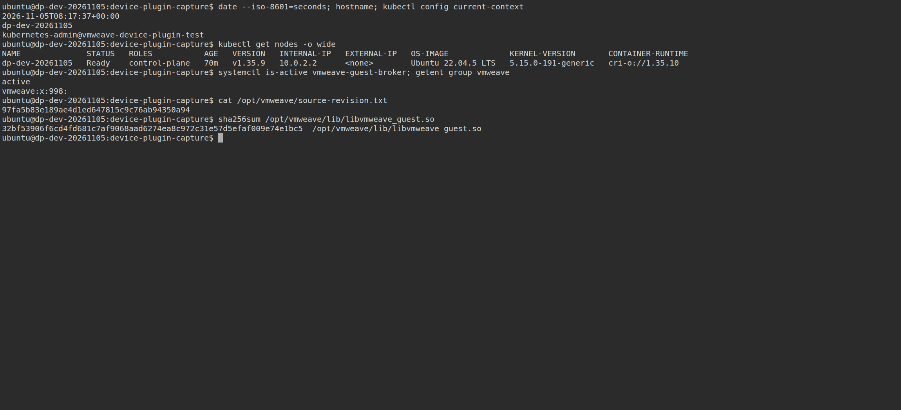
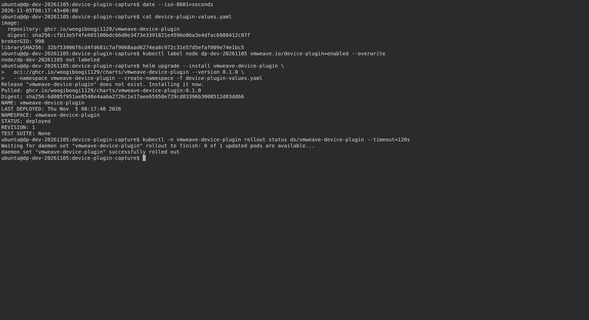
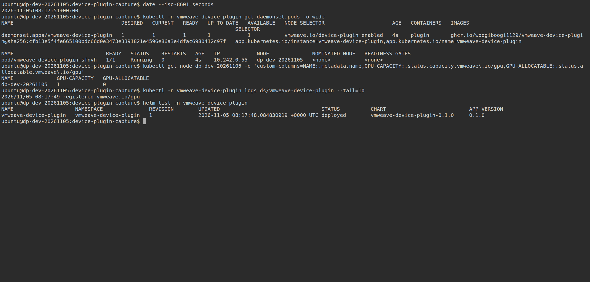
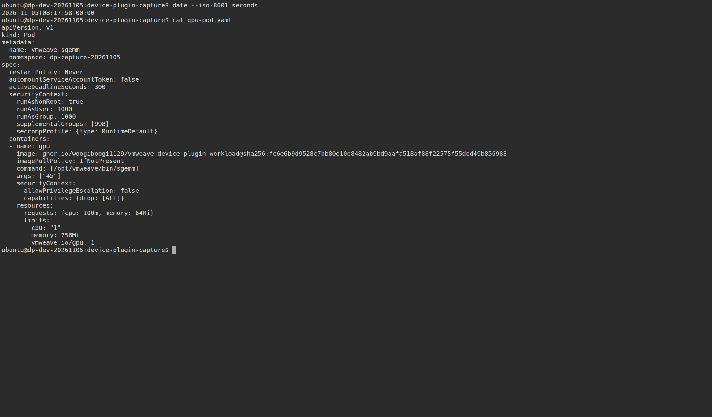
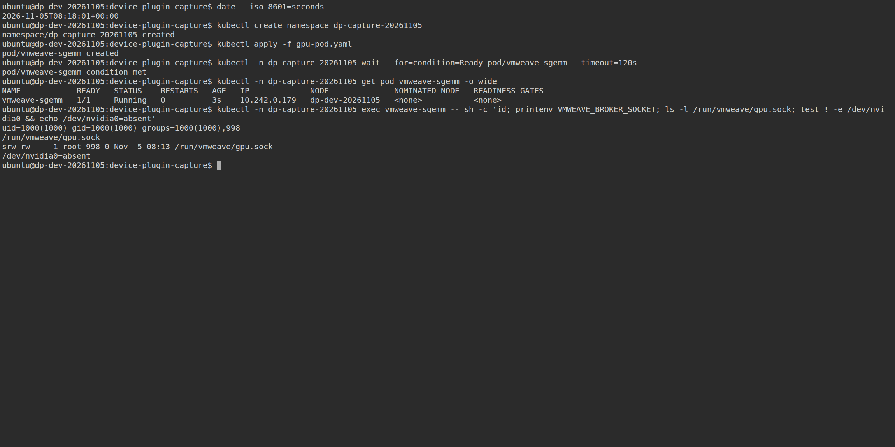
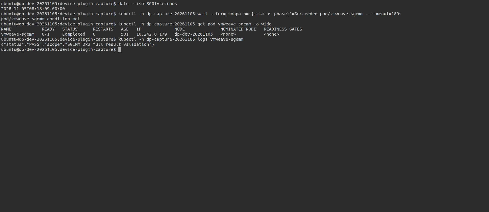
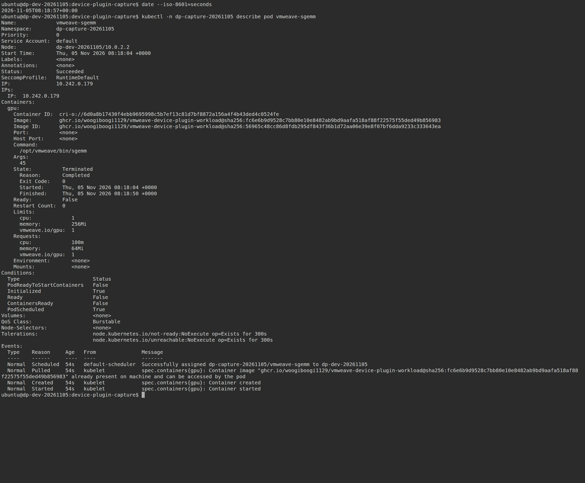
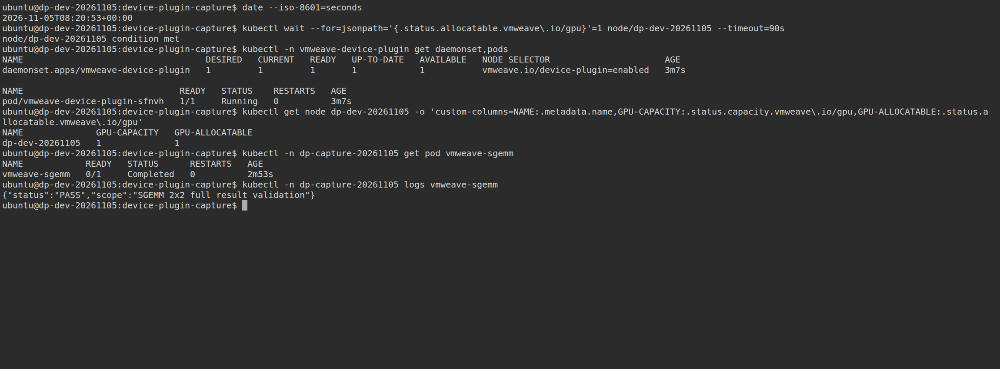

# Device Plugin v0.1 개발·검증 기록

VMWeave VM에 선택적으로 설치하는 내부 Kubernetes Device Plugin이다.
`vmweave.io/gpu: 1`은 기존 VM quota 한 개의 예약·접근 연결을 의미하며,
할당 컨테이너에서 동시 CUDA client 한 개를 지원한다.
일반 VM에 Kubernetes나 Plugin을 강제 설치하지 않는다.

## 구현

- 독립 Go module `integrations/kubernetes-device-plugin/`: kubelet 등록, health watch,
  Allocate 검증, Plugin/kubelet socket 재생성 시 재등록, 중복 실행 방지.
- Guest Broker의 원자적 discovery JSON: boot/allocation/generation, ABI·library hash,
  transport freshness, single-client 상태. 조회 자체는 CUDA 세션을 열지 않는다.
- 기존 client가 연결된 채 쉬는 legacy 경로에서도 heartbeat가 진행되도록 보완했다.
  discovery를 사용하지 않는 기존 실행 경로의 idle 수신 동작은 유지한다.
- opt-in node label·digest 고정 Helm chart, capability를 제거한 root Plugin,
  non-root smoke·SGEMM workload, 소켓 mount·환경변수 자동 주입.
- 전용 CI와 독립 `device-plugin-v*` 태그. 기존 Operator v0.5.8 버전 포인터와
  활성 운영 VM·채널은 변경하지 않는다.

## 실제 환경

외부 `gpu-4` 노드의 `vmweave-test-b/dp-dev-20261105`를 이번 검증 전용으로 새로 만들었다.
4 vCPU·8 GiB VM 안에 Kubernetes 1.35.9, CRI-O 1.35.10, Cilium 1.20.2를 설치했다.
Ubuntu 22.04.5, kernel 5.15.0-191, 실제 `vmweave` GID는 998이다.
외부 HAMi 할당은 compute 25%·1024 MiB이고 Worker는 기존 v0.5.8 공개 digest를 사용한다.
**VM의 실제 ivshmem PCI BAR → Guest Broker → 외부 Worker → 실제 GPU** 경로이며
file-backed 대체 어댑터를 사용하지 않았다. 내부 HAMi는 설치하지 않았다.

## 검증 항목

| 항목 | 관찰 결과 |
|---|---|
| Go race·vet, Unix socket 모의 kubelet | 통과: 상태 검증, 중복/잘못된 Allocate, busy, socket 교체·중복 실행 |
| CPU 제어 회귀 | 136개 실행, 135개 통과·기존 skip 1개 |
| 배포 계약 | 기존 20개 테스트와 Plugin Helm 필수값·권한·mount 검사 통과 |
| 문서 | MkDocs strict·로컬 링크/anchor 검사 통과 |
| 이미지 | 로컬 rootless Podman 및 GitHub Docker에서 Plugin·Guest·workload 빌드 통과 |
| 일반 사용자 Pod | non-root, GPU limit만 요청; Plugin이 소켓/env 주입. `/dev/nvidia0` 없이 메모리·PTX kernel 검증 통과 |
| A/B 직렬 예약 | A 실행·컨테이너 유지 중 B Pending, A 종료 뒤 B 실행 성공 |
| idle CUDA client | CUDA 메모리 할당 후 18초 대기 중에도 freshness·GPU Healthy 유지, SGEMM 2×2 전체 결과 검산 성공 |
| client SIGKILL | 종료 코드 137, Worker 세션·물리 GPU 프로세스 회수, 후속 Pod 성공 |
| Plugin·kubelet 재시작 | GPU 작업 실행 중 각각 재시작해 기존 작업과 후속 Pod 성공 |
| 자원 미요청·잘못된 GID | 소켓 접근 실패; CUDA 실행 성공으로 처리하지 않음 |
| 잘못된 library hash·Plugin GID | allocatable 0, 설정 복구 뒤 1 |
| Broker 중지 | 기존 작업 실패, 약 16.86초 후 Node allocatable 0, 신규 Pod Pending |
| Plugin 제거 | GPU workload 종료 후 제거, 일반 사용자 직접 smoke 성공·재설치 성공 |
| VM 정상 종료·재기동 | 채널 Stopped·이전 할당 회수, 새 VMI/boot/allocation/generation, 대기 Pod 및 SGEMM 성공 |

상태 freshness 기준은 10초이며, Kubernetes Node 상태 게시·스케줄러 반영 시간이 추가된다.
장애 시 실행 중 Pod의 무중단 GPU 이전이나 이전 CUDA context 복원을 보장하지 않는다.
작은 SGEMM 검산은 성능 벤치마크가 아니다.

## 테스트 중 보완·제약

초기 시험 VM의 자동 MAC이 재부팅 때 바뀌어 cloud-init의 기존 netplan과 맞지 않았다.
검증 VM만 정상 종료한 뒤 최초 MAC을 template에 고정해 해결했다.
테스트 관측기의 프로세스 문자열 자기 일치, Python 기본 namespace 인자의 고정,
SSH와 Kubernetes API 준비 시점 차이도 수정하고 해당 단계부터 재검증했다.
VM sudo 정책에 맞추어 direct smoke의 사용자 전환은 root `runuser`를 사용했다.
이 준비·관측 실패를 제품 통과 결과로 계산하지 않는다.

지원 범위는 이번 단일 VM·단일 slot·지정 workload 이미지다.
다중 VM 호환 조합, arbitrary CUDA/PyTorch image, nested HAMi, quota 재분할,
직접 VM 실행과 Pod의 동시 사용 중재, 장시간 성능/부하 시험은 범위 밖이다.
VM root를 신뢰하지 않는 보안 격리를 제공하는 기능도 아니다.

기계 판독 결과와 선택 로그는 [validation.json](evidence/device-plugin-20261105/validation.json)에 있다.
원본 전체 로그·검증 도구는 로컬 `.local/device-plugin-20261105/`에 보존한다.

## 공개 패키지 재검증과 종료

[`device-plugin-v0.1.0`](https://github.com/WoogiBoogi1129/VMWeave-GPU/releases/tag/device-plugin-v0.1.0)은
소스 `97fa5b83e189ae4d1ed647815c9c76ab94350a94`로 게시했다.
Plugin·Guest·workload 이미지 3종과 OCI chart를 인증 정보 없이 직접 다운로드했다.
릴리스 archive 체크섬, image ID, Guest source revision·library hash를 대조한 뒤
정지 Broker를 업그레이드하고 VM을 정상 종료·재부팅해 fresh binding으로 검증했다.

게시 이미지로 non-root Pod A/B 직렬 예약·PTX kernel·18초 idle SGEMM이 통과했다.
물리 GPU PID `3504969`의 NSpid `206`이 해당 Worker의 session PID와 일치했다.
작업 종료 뒤 세션·GPU 프로세스가 사라졌고, 최종 VM은 `Halted`, 채널은 `Stopped`다.
이번 시험의 VM/PVC·디스크·SSH 진입점은 검토용으로 보존했으며 GPU 할당은 반환했다.

Docker archive를 Podman/CRI-O에 import하면 registry manifest digest가 재계산될 수 있다.
실제 import된 RepoDigest와 공개 digest를 각각 기록했으며 image ID의 동일성을 검증했다.
공개 registry에서 직접 pull한 image ID도 같은 값이다.
[배포 digest와 checksum 기록](../../deploy/releases/device-plugin-v0.1.0.json),
[게시 이미지 실제 실행 증거](evidence/device-plugin-20261105/release-e2e--published-validation.json)를 참조한다.

게시 태그 이후 `main`의 별도 재빌드 한 건은 package build 단계에서 실패했다.
태그 릴리스 빌드는 성공했고, CI에 실패 단계·마지막 출력 진단을 추가한 뒤
[후속 main 빌드](https://github.com/WoogiBoogi1129/VMWeave-GPU/actions/runs/41989294201)와
[개발 브랜치 빌드](https://github.com/WoogiBoogi1129/VMWeave-GPU/actions/runs/41989289174)가 모두 통과했다.
첫 실패의 세부 원인은 확정하지 않았다. 제품 소스를 바꾸어 실패를 우회한 것은 아니다.
기존 Operator·Helper·Hook·Worker·Guest 전체 이미지
[Docker 빌드](https://github.com/WoogiBoogi1129/VMWeave-GPU/actions/runs/41988401561)도 통과했다.

## 실제 터미널 PNG 캡처 (추가 검증)

2026-11-05에 보존한 시험 VM을 다시 기동하고 공개 `device-plugin-v0.1.0` 패키지로
설치부터 GPU Pod 완료까지 추가 실행했다. 아래 PNG는 **실제 VM의 대화형 SSH 터미널을
`tmux → ttyd → Chromium`으로 촬영한 원본**이다. 이전 로그의 재생·출력 재작성·이미지 합성은 하지 않았다.
앞의 개발 검증과는 촬영 시각·Pod UID가 다른 추가 실행이다. 화면의 시각은 UTC다.

명령은 VM 내부 `kubernetes-admin@vmweave-device-plugin-test` context에서 실행했다.
관리자 설치 과정과 일반 workload의 non-root 실행을 함께 기록한다.
원본 크기로 보려면 각 PNG 링크를 연다. 명령 출력 TXT, 실제 YAML, API JSON,
[촬영 메타데이터](evidence/device-plugin-20261105/terminal-captures/capture.json),
[명령별 종료 코드](evidence/device-plugin-20261105/terminal-captures/commands.json),
[SHA256SUMS](evidence/device-plugin-20261105/terminal-captures/SHA256SUMS)를 함께 보존했다.

### 1. VM 및 Guest 준비 확인

`hostname`, `kubectl config current-context`, `kubectl get nodes -o wide`로 실행 위치를 확인했다. Broker `active`, 실제 GID `998`, Guest 릴리스 리비전과 library hash도 함께 기록했다.

[원본 PNG](evidence/device-plugin-20261105/terminal-captures/01-guest-and-prerequisites.png) · [명령 출력 TXT](evidence/device-plugin-20261105/terminal-captures/01-guest-and-prerequisites.txt)

### 2. Device Plugin 설치 과정

전용 시험 VM의 기존 Plugin release를 제거한 뒤 공개 OCI chart를 새로 설치했다. 실제 values, `helm upgrade --install`, `STATUS: deployed`, `REVISION: 1`, `kubectl rollout status` 성공을 확인할 수 있다. 기존 node label이 같아 `not labeled`가 출력됐으며 명령 종료 코드는 0이다.

[원본 PNG](evidence/device-plugin-20261105/terminal-captures/02-device-plugin-install.png) · [명령 출력 TXT](evidence/device-plugin-20261105/terminal-captures/02-device-plugin-install.txt)

### 3. 설치 직후 DaemonSet·kubelet 등록

`kubectl get daemonset,pods`, Node resource 조회, Plugin 로그, `helm list`를 촬영했다. Plugin Pod는 `1/1 Running`이고 로그에 `registered vmweave.io/gpu`가 있다. 이 시점에는 노드 상태 전파 중이라 `GPU-ALLOCATABLE`이 아직 `0`이었다. 이 원본을 보존했으며 최종 `1` 확인은 8번에 있다.

[원본 PNG](evidence/device-plugin-20261105/terminal-captures/03-plugin-and-gpu-registration.png) · [명령 출력 TXT](evidence/device-plugin-20261105/terminal-captures/03-plugin-and-gpu-registration.txt)

### 4. 실행한 Pod Spec YAML 전체

실제 제출한 [gpu-pod.yaml](evidence/device-plugin-20261105/terminal-captures/gpu-pod.yaml) 전체다. `vmweave.io/gpu: 1`, non-root UID/GID, `supplementalGroups: [998]`, 공개 workload digest를 지정했다. `args: ["45"]`는 CUDA 메모리 할당 후 45초 대기하여 실행 중 화면을 확보하기 위한 값이다.

[원본 PNG](evidence/device-plugin-20261105/terminal-captures/04-gpu-pod-spec.png) · [명령 출력 TXT](evidence/device-plugin-20261105/terminal-captures/04-gpu-pod-spec.txt)

### 5. Pod 생성·실행 및 소켓 주입

`kubectl apply`, `kubectl wait`, `kubectl get pod`로 `Running`을 확인하고 `kubectl exec`로 실제 UID 1000, 추가 그룹 998, `VMWEAVE_BROKER_SOCKET`, 소켓 접근 경로를 확인했다. Pod YAML에 직접 정의하지 않은 소켓과 환경변수의 실행 시 주입 증거다.

[원본 PNG](evidence/device-plugin-20261105/terminal-captures/05-pod-running-and-injected-socket.png) · [명령 출력 TXT](evidence/device-plugin-20261105/terminal-captures/05-pod-running-and-injected-socket.txt)

### 6. 작업 완료와 GPU 검산 결과

`kubectl wait`로 `Succeeded`를 확인한 뒤 `kubectl get pod`의 `Completed`와 `kubectl logs`의 SGEMM 2×2 전체 결과 검산 `PASS`를 기록했다.

[원본 PNG](evidence/device-plugin-20261105/terminal-captures/06-pod-completed-and-sgemm-result.png) · [명령 출력 TXT](evidence/device-plugin-20261105/terminal-captures/06-pod-completed-and-sgemm-result.txt)

### 7. kubectl describe 전체 완료 상태

`kubectl describe pod vmweave-sgemm` 전체 출력이다. `Status: Succeeded`, `State: Terminated`, `Reason: Completed`, `Exit Code: 0`, `Restart Count: 0`, GPU requests/limits와 정상 Events를 확인할 수 있다. 완료된 Pod의 `Ready: False`는 실행 종료 상태다. 여기의 `Environment`·`Mounts`는 Pod API 선언이며 실제 Plugin 주입 결과는 5번 `exec`에서 확인했다.

[원본 PNG](evidence/device-plugin-20261105/terminal-captures/07-kubectl-describe-completed-pod.png) · [명령 출력 TXT](evidence/device-plugin-20261105/terminal-captures/07-kubectl-describe-completed-pod.txt)

### 8. 최종 GPU 가용 자원 확인

Node의 `vmweave.io/gpu` allocatable이 `1`이 될 때까지 `kubectl wait`한 후 다시 조회했다. DaemonSet Ready 1, GPU Capacity 1·Allocatable 1, 완료 Pod와 SGEMM PASS를 한 화면에 기록했다.

[원본 PNG](evidence/device-plugin-20261105/terminal-captures/08-final-gpu-availability.png) · [명령 출력 TXT](evidence/device-plugin-20261105/terminal-captures/08-final-gpu-availability.txt)

촬영 후 VM은 다시 정상 종료하고 GPU 할당을 반환했다.
완료 Pod `dp-capture-20261105/vmweave-sgemm`과 `/home/ubuntu/device-plugin-capture/`의
YAML은 VM 디스크에 보존했다. 다음 정상 부팅 후 같은 `kubectl describe` 명령으로 조회할 수 있다.
[종료 기록](evidence/device-plugin-20261105/terminal-captures/cleanup.json)에 VM·Pod UID를 남겼다.
