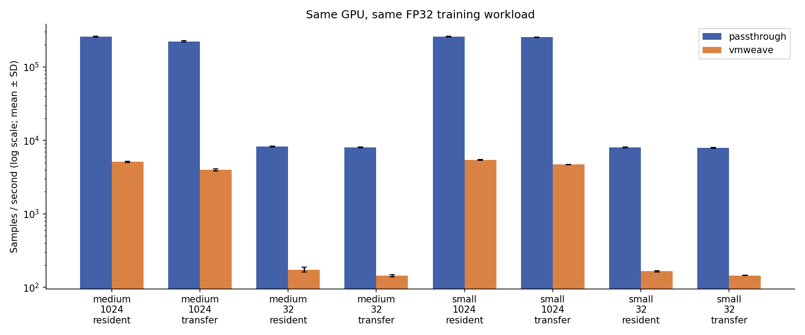
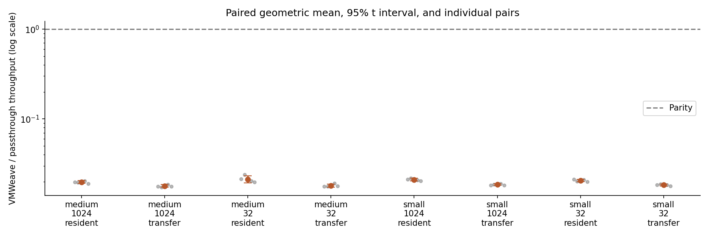
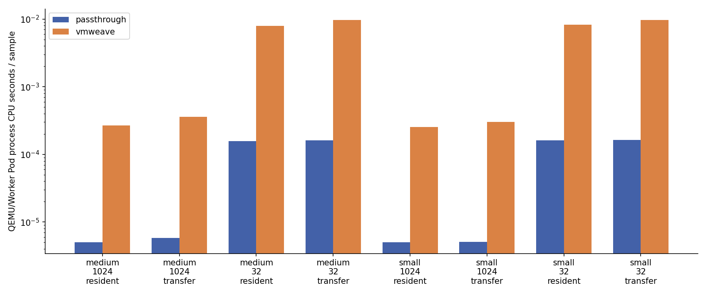
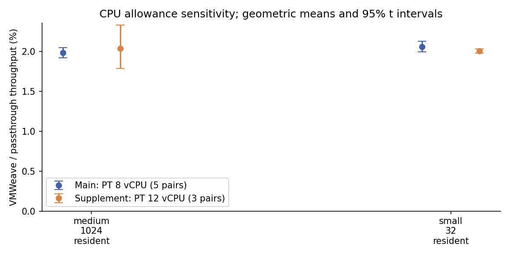
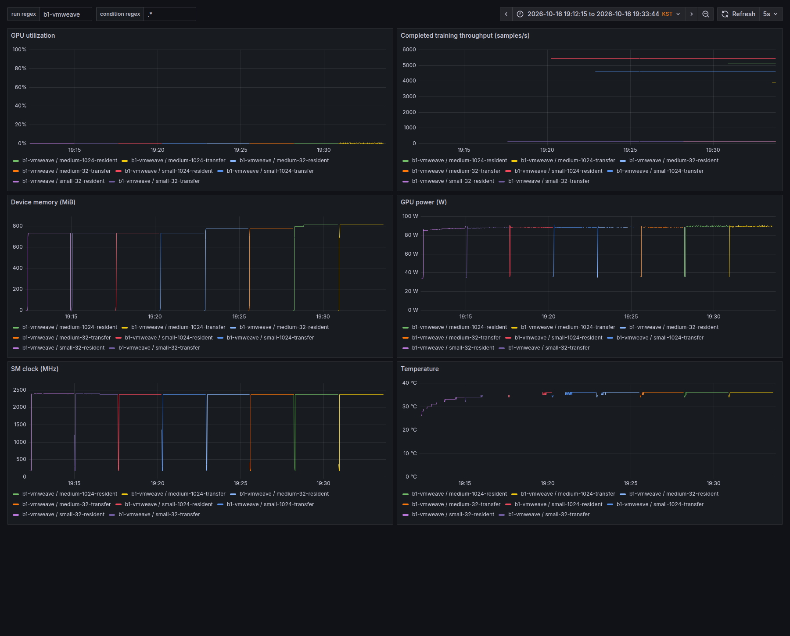
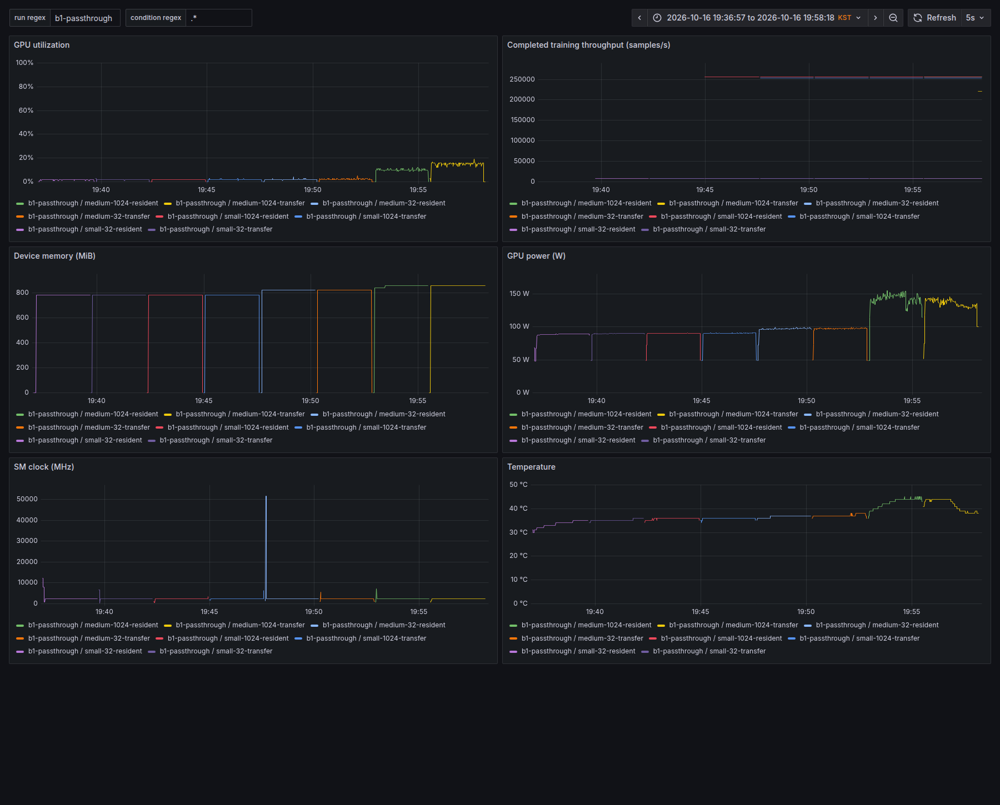

# 최신 VMWeave와 GPU passthrough VM의 FP32 학습 비교

최신 후속: [2026-10-25 Rodinia 3개 비교군 실험](results/20261025-rodinia-threeway/README.md) — Passthrough / Flyt SHM / VMWeave v0.5.3. 초기화 포함 결과와 별도 구간 진단을 구분한다.

2026-10-16~17(KST) 실험. 결과 디렉터리 날짜는 시작일 기준이다. 주 비교 80회와 총 CPU 예산 보조 비교 12회를 완료했다. 정확성 통과와 성능 결과, 지원하지 못한 조건을 구분해 기록한다.

동일 물리 GPU를 순차 전환하여 현재 main에서 새로 빌드한 VMWeave와 일반 KubeVirt GPU passthrough VM에서 같은 PyTorch 학습을 실행한다. [실행 전 프로토콜과 사전 검사에 따른 변경 기록](protocol.md)을 함께 보존한다.

## 확인된 정확성과 지원 범위

- small(32→64→8), medium(1024→2048→512)의 batch 32/1024 × resident/transfer 총 8조건은 두 경로 모두 실행됐다.
- 1·10·100 step의 loss, 전체 gradient, 전체 weight를 rtol=1e-4, atol=1e-6으로 비교했고, **8조건 모두 최대 절대오차 0**이었다. [전체 텐서별 비교 결과](results/20261016/correctness.json)
- 원래 계획한 large(2048→4096→1024)는 passthrough에서 4조건 모두 실행됐지만 VMWeave는 모두 `model.cuda()`에서 `CUDA invalid value`로 실패했다.
- large의 첫 가중치는 FP32 2048×4096 = 32 MiB이다. 현재 `FLYT_EXEC_MAX_COPY_BYTES`는 16 MiB이며 Guest의 비동기 복사 API가 이를 초과하는 요청을 거부한다. 이는 OOM이나 Core 제한 성능 결과가 아니다. [실패 로그](results/20261016/pilot-vmweave/large-32-resident/stderr.txt), [복사 제한 정의](../../runtime/shm/cuda-dispatch/include/flyt_cuda_exec.h), [Guest 복사 검사](../../runtime/shm/src/guest_async.c)
- medium은 이 제한을 확인한 뒤 추가한 모델이다. large 성능을 medium 결과로 대체 추정하지 않는다.

## 사전 검사와 실행 도구 수정

과거 단일 작업용 `Allocation` harness는 첫 프로세스 종료 후 VM을 회수했다. 정식 실험은 최신 `VM` lifecycle과 Guest broker로 바꿔 조건마다 새 CUDA 프로세스를 실행한다. [초기 단일 작업 시도](results/20261016/allocation-lifecycle-preflight/small-32-transfer/stderr.txt)는 성능 통계에서 제외했다. [초기 큰 모델 검사](results/20261016/vm-lifecycle-first-preflight/large-32-resident/stderr.txt)도 보존하고, 최종 사전 검사에서 원래 4개 large 조건 모두의 실패를 다시 확인했다.

## 성능 결과

주 비교의 **8조건 × 2경로 × 5반복 = 80측정**을 완료했다. 이 범위에서 VMWeave 처리량은 passthrough의 **1.790–2.121%**였다. 수치는 조건별 paired 처리량 비율의 기하평균이다. 25/75 Core 배분 실험이나 임의 AI 모델 전체의 성능으로 일반화하지 않는다.

| 조건 | passthrough samples/s (평균 ± SD) | VMWeave samples/s (평균 ± SD) | VMWeave/PT (%) · 95% CI |
|---|---:|---:|---:|
| medium-1024-resident | 256,700.36 ± 3,644.56 | 5,092.12 ± 120.02 | 1.983% [1.918, 2.051] |
| medium-1024-transfer | 221,318.50 ± 4,058.65 | 3,961.59 ± 117.26 | 1.790% [1.728, 1.853] |
| medium-32-resident | 8,234.16 ± 148.35 | 174.95 ± 12.79 | 2.121% [1.932, 2.328] |
| medium-32-transfer | 8,010.55 ± 92.90 | 144.61 ± 4.90 | 1.805% [1.733, 1.879] |
| small-1024-resident | 257,183.96 ± 3,939.16 | 5,428.07 ± 75.66 | 2.111% [2.042, 2.181] |
| small-1024-transfer | 253,051.16 ± 1,702.93 | 4,691.77 ± 49.73 | 1.854% [1.817, 1.891] |
| small-32-resident | 8,032.76 ± 89.71 | 165.64 ± 2.77 | 2.062% [1.996, 2.130] |
| small-32-transfer | 7,928.10 ± 80.30 | 145.64 ± 1.20 | 1.837% [1.797, 1.878] |

공유 호스트 서비스 교체가 있었던 두 번째 블록을 제외한 사후 민감도 분석(n=4)에서 조건별 비율 범위는 **1.804–2.091%**였다. [전체 민감도 결과](results/20261016/sensitivity.json). 원래 5개 블록을 주 결과로 유지하며, 이 분석이 서비스 변경의 인과 효과를 분리하는 것은 아니다.

비율 신뢰구간은 같은 블록의 log(VMWeave/PT) 비율에 Student t 구간을 적용한 뒤 지수 변환했다. n=5로 작고 정규성은 보장하지 않는다. 모드 순서는 W/P, P/W, W/P, P/W, W/P여서 완전히 균형 잡힌 순서는 아니다. 통계적 허용 오버헤드를 미리 정하지 않았으므로 성능 자체에 임의 PASS 판정을 붙이지 않는다.

[모든 반복의 처리량·CPU 비용·GPU 표본 통계](results/20261016/summary.json), [완료 자료 검증](results/20261016/validation.json). GPU 평균은 수집 표본의 산술평균이며, 1초 sleep에 query/SSH 지연이 추가되므로 실제 표본 간격은 CSV 타임스탬프로 확인해야 한다. CPU 값은 표본 구간의 누적 counter 차이로 계산한 추정치다.

반복별 본 측정 구간의 평균 GPU utilization은 VMWeave 0.00–0.28%, passthrough 1.88–15.06%였다. 양쪽 모두 이 작은 eager MLP에서 GPU 포화 상태를 달성하지 못했다. 따라서 포화된 대형 AI 학습 전체에 이 처리량 비율을 적용할 수 없다. 관측한 Pod 프로세스 CPU 사용량은 VMWeave 1.36–1.44 core, passthrough 1.28–1.30 core였으며, 이것이 전체 호스트 비용을 뜻하지는 않는다.

## 동일한 총 CPU 예산의 보조 결과

VMWeave 8 vCPU + Worker CPU 4개와 passthrough 12 vCPU를 비교했다. 두 조건을 별도 3 paired blocks에서 측정했으며 주 비교에 합치지 않았다.

| 조건 | passthrough samples/s (평균 ± SD) | VMWeave samples/s (평균 ± SD) | VMWeave/PT (%) · 95% CI |
|---|---:|---:|---:|
| medium-1024-resident | 263,466.95 ± 8,566.44 | 5,372.91 ± 117.94 | 2.040% [1.785, 2.331] |
| small-32-resident | 8,333.21 ± 290.11 | 167.16 ± 6.34 | 2.006% [1.979, 2.033] |

[보조 측정 원시 결과와 통계](results/20261016/equal-budget/summary.json), [보조 자료 검증](results/20261016/equal-budget/validation.json). 이 비교에서는 Guest vCPU 수가 다르므로 주 비교와 보조 비교를 함께 읽어야 한다.

## 비교 환경

| 항목 | 설정 |
|---|---|
| VMWeave 소스 | main `3f980b0f0706312c615e9ded4facac7bc2849e9f`에서 새 Guest/Worker 빌드 |
| GPU | RTX PRO 6000 Blackwell Server Edition, `GPU-c654d43e-43f8-c28e-77c2-1f17a0cbf46a`, host `0000:aa:00.0` |
| VMWeave 경로 | VM lifecycle → Guest broker → SHM → session-worker → 수정 HAMi → CUDA |
| Core / VRAM | VMWeave Core 100 / 8192 MiB; passthrough는 전체 GPU 접근 |
| Guest | 동일 Ubuntu 22.04 이미지 기반, 8 vCPU / RAM 16 GiB |
| CPU 배치 | Guest QEMU 32–39, VMWeave Worker 40–43; GPU 로컬 NUMA node 2 |
| PyTorch | 같은 `2.11.0+flyt.cu128` 환경 bundle, CUDA 12.8 |
| 드라이버 | 양쪽 580.173.02, libcuda SHA256 일치 |
| 학습 | FP32 eager Linear→ReLU→Linear, MSE, SGD lr=0.01, foreach=False/fused=False |
| 알고리즘 | TF32 off, deterministic algorithms on, `DISABLE_ADDMM_CUDA_LT=1` |
| 데이터 | seed 20261016 합성 입력/목표값, 한 번 생성한 동일 fixture 파일 |

[빌드·바이너리 식별 정보](results/20261016/build/identity.json), [드라이버 라이브러리 SHA](results/20261016/build/driver-libraries.txt), [토폴로지](results/20261016/build/topology.txt).

주 비교에서는 VMWeave Worker에 CPU affinity 4개를 추가 허용한다. CPU 집합은 전용 예약이 아니고 호스트 RAM의 NUMA 배치를 강제하지 않았으며, GPU 3 서비스가 같은 호스트를 함께 사용했다(중간 Pod 교체는 아래에 별도 기록). 이를 동일 CPU 비용이라고 표현하지 않는다. 총 CPU 예산 12개를 맞추는 별도 보조 측정도 수행했다. VRAM의 제한 의미도 두 경로에서 같지 않다.

수정 HAMi 바이너리 `f30f08c8…aebd8`은 실험 Worker에만 bind mount하여 적용했다. 호스트 전체 HAMi 라이브러리를 교체하거나 기존 서비스에 새 바이너리를 주입한 실험은 아니다. GPU 전환 때 HAMi/DCGM Pod를 일시 재시작했으므로 모니터링에는 짧은 공백이 있으며, 초기 passthrough 사전 검사에서는 약 5분간 일시 중지했다.

## 측정 방식과 해석 범위

정확성과 성능은 별도 프로세스에서 검사한다. 성능은 30초 이상 warmup 이후 초기 가중치를 복구하고, 120초 이상 학습한 뒤 GPU 완료까지 기다려 wall-clock 처리량을 계산한다. 측정 구간 안에 step별 `loss.item()`, CPU 결과 복사, `cuda.synchronize()`를 넣지 않는다. 마지막 loss의 유한성 검사는 측정 후 수행한다.

resident는 입력을 GPU에 미리 올리고, transfer는 매 step pageable CPU 입력과 목표값을 GPU에 복사한다. 고정 합성 배치를 반복하는 학습 루프 비교이며, 실제 데이터셋 수렴 시간이나 최적화된 비동기 DataLoader 성능을 뜻하지 않는다. 공식 PyTorch wheel의 무수정 지원, cuDNN/AMP/torch.compile/NCCL, 임의 대형 모델 지원을 검증한 결과도 아니다.

GPU 계측은 VMWeave에서 host NVML, passthrough에서 Guest NVML을 사용한다. 1초 단위 표본은 짧은 커널 활동을 정밀하게 분해하지 못하므로 GPU utilization을 처리량과 혼동하지 않는다. CPU 비용은 정확한 Pod UID에 속한 프로세스의 누적 CPU counter 표본으로 계산하며, host IRQ·별도 시스템 daemon 등 호스트 전체 CPU 비용을 모두 계상한 값은 아니다. passthrough Guest의 계측 프로세스도 QEMU 비용에 포함된다.

Core 100에서는 사용한 HAMi 소스의 `rate_limiter`가 토큰 제한 계산 전에 반환한다. [관련 소스 발췌와 해시](results/20261016/build/core100-source.json)를 남겼다. 이번 비교는 전체 VMWeave 실행 경로의 비용을 포함하며, 25/75 제한 공식이나 특정 구성요소 하나가 성능 차이의 원인임을 입증하는 분리 실험은 아니다.

## NVML 클록 자료의 품질

passthrough의 준비·종료 구간에서 NVML이 5,000 MHz를 넘는 SM 클록을 보고하는 표본을 관측했다. 별도 질의의 최대 SM 클록 보고값은 2,430 MHz였으므로 서로 일치하지 않는다. 원시 값은 수정하거나 숨기지 않으며, 이런 값을 실제 물리 동작 클록으로 해석하지 않는다. 주 비교와 보충 비교 전체에서 해당 표본 30개는 모두 본 측정 구간 밖이었다. 처리량은 NVML 클록에서 추정하지 않고 완료 step 수와 wall clock으로 직접 계산했다.

[표본별 시각과 본 측정 구간 포함 여부](results/20261016/nvml-clock-observations.json), [최대 클록 질의](results/20261016/identities/ai-perf-p-b2-1016/clock-query.txt). 이 보고값 이상 현상의 내부 원인은 별도 검증하지 않았다.

## 공유 호스트 서비스 변경 관측

두 번째 VMWeave 반복 도중 기존 GPU 3의 embedding 서비스가 2026-10-16 11:32:49 UTC에 replicas 1→0, 11:34:30 UTC에 0→1로 변경됐다. 새 Pod는 다시 Ready가 됐지만 기존 Pod와 GPU 프로세스는 교체됐다. 서비스 managedFields에는 `app` 관리자의 변경이 기록돼 있다. 이 실험 실행기는 `aap-serving`을 수정하지 않으며, 요청한 주체와 근본 원인까지 규명한 것은 아니다. [이벤트·상태 증거](results/20261016/service-change/observation.json), [Kubernetes 이벤트](results/20261016/service-change/events.json).

기존 모니터는 최초 Pod 이름으로 필터링했으므로 교체 후 표본에서 해당 서비스가 누락된다. 이후 모니터는 같은 ReplicaSet 접두어의 새 Pod도 수집하고 원래 이름의 누락을 명시하도록 수정했다. 따라서 표본의 남은 서비스가 Ready라는 사실을 네 서비스의 연속 가용성으로 해석하면 안 된다. 공유 호스트 부하 변경이 성능에 영향을 줄 수 있으므로 두 번째 블록은 원래 통계에 보존하고 별도 민감도 분석 대상으로 표시한다.

## 정리와 기존 서비스 관측

실험 VM/Worker를 회수하고 GPU 2를 NVIDIA 드라이버에 복원했다. 임시 KubeVirt 장치 허용 설정과 HAMi/DCGM scheduling 설정을 복구하고 실험 전용 저장소·helper를 정리했다. [정리 검증](results/20261016/cleanup.json)과 [기존 서비스의 주기적 UID·Ready·재시작/PID 관측](results/20261016/service-continuity.jsonl)을 보존한다. 이 관측은 서비스 요청 지연이나 SLA 전체를 검증한 것은 아니다.

종료된 VM을 가리키는 실험 전용 GPURequest 12개가 남아 첫 정리 검사가 중단됐다. VM·Worker 부재를 확인한 뒤 잔여 요청을 삭제했고, namespace 검사에서 잘못 쓴 `pvcs` 별칭도 수정했다. [첫 정리 로그](results/20261016/cleanup.log), [재개 로그](results/20261016/cleanup-resume.log), [최종 정리 로그](results/20261016/cleanup-final.log), [삭제 전 요청 기록](results/20261016/orphan-requests-before-cleanup.json)을 보존한다. 최종 정리 PASS는 실험 자원 회수와 현재 Ready 상태에 한정되며, 서비스 무중단 판정이 아니다. 로컬 Grafana·Prometheus·수집기도 종료했다.

## 시각 자료와 실행 자료

아래는 첫 paired 블록의 실제 Grafana 화면이다. 조회 시간 범위와 이미지 해시는 각 PNG의 `.png.json` 파일에 기록했다. 처리량 패널은 완료된 측정값을 유지 표시하는 gauge이며 순간 처리량이 아니다. 클록 패널에는 준비·종료 구간의 비정상 보고값도 숨기지 않고 표시한다.

- [VMWeave 사전 검사 Grafana 캡처](screenshots/preflight-vmweave.png)
- [passthrough 사전 검사 Grafana 캡처](screenshots/preflight-passthrough.png)
- [passthrough 실제 콘솔 캡처](screenshots/passthrough-console.png)
- [Grafana dashboard 정의](dashboard.json)
- [증거 파일 SHA256 목록](artifact-manifest.json), [문서 검사](results/20261016/docs-check.log), [저장소 검사](results/20261016/layout-check.log)
- [공통 학습 코드](runner/bench.py), [정확성 비교](runner/compare.py), [반복 실행기](runner/formal.py), [CPU 예산 보조 실행기](runner/equal_budget.py)

정확성 텐서와 fixture의 대용량 `.pt` 파일은 로컬 증거 디렉터리에 보존하며 Git에는 넣지 않는다. 비교 결과에 기준/대상 텐서 SHA256과 모든 텐서별 오차를 저장한다. 실행기는 기존 로컬 이미지·CUDA/PyTorch bundle·SSH 키·Kubernetes 권한을 요구하는 사이트 전용 도구다.

## 반복별 Grafana 캡처

| 비교·블록 | VMWeave | passthrough |
|---|---|---|
| 주 비교 1 | [화면](screenshots/b1-vmweave.png) | [화면](screenshots/b1-passthrough.png) |
| 주 비교 2 | [화면](screenshots/b2-vmweave.png) | [화면](screenshots/b2-passthrough.png) |
| 주 비교 3 | [화면](screenshots/b3-vmweave.png) | [화면](screenshots/b3-passthrough.png) |
| 주 비교 4 | [화면](screenshots/b4-vmweave.png) | [화면](screenshots/b4-passthrough.png) |
| 주 비교 5 | [화면](screenshots/b5-vmweave.png) | [화면](screenshots/b5-passthrough.png) |
| CPU 보충 1 | [화면](screenshots/equal-budget-b1-vmweave.png) | [화면](screenshots/equal-budget-b1-passthrough.png) |
| CPU 보충 2 | [화면](screenshots/equal-budget-b2-vmweave.png) | [화면](screenshots/equal-budget-b2-passthrough.png) |
| CPU 보충 3 | [화면](screenshots/equal-budget-b3-vmweave.png) | [화면](screenshots/equal-budget-b3-passthrough.png) |

- [2026-10-26 Rodinia 정상 상태 4방식 비교](results/20261026-rodinia-steady/README.md): Native·Passthrough·Flyt·VMWeave, 160개 표본 및 API 진단·원인 분석.

- [2026-10-26 공유 버퍼 축약 비교](results/20261026-bulk-short/README.md): Flyt·VMWeave OFF/ON, 48개 표본과 소켓 경로 진단.

## 2026-10-27 경로 최적화

[실제 VM/Flyt 비교](results/20261027-path-optimization-vm/REPORT.md): options-OFF 대비 34.3% 실행시간 감소, Flyt 대비 종합 10.0% 증가. [선행 검증](results/20261027-path-optimization-validation/README.md)과 [후속 개선안](results/20261027-path-optimization-vm/NEXT-STEPS.md)을 보존한다. 이후 사용자의 명시적 배포 요청에 따라 [v0.5.5 배포와 운영 검증](results/20261027-path-optimization-vm/DEPLOYMENT.md)을 완료했다.
