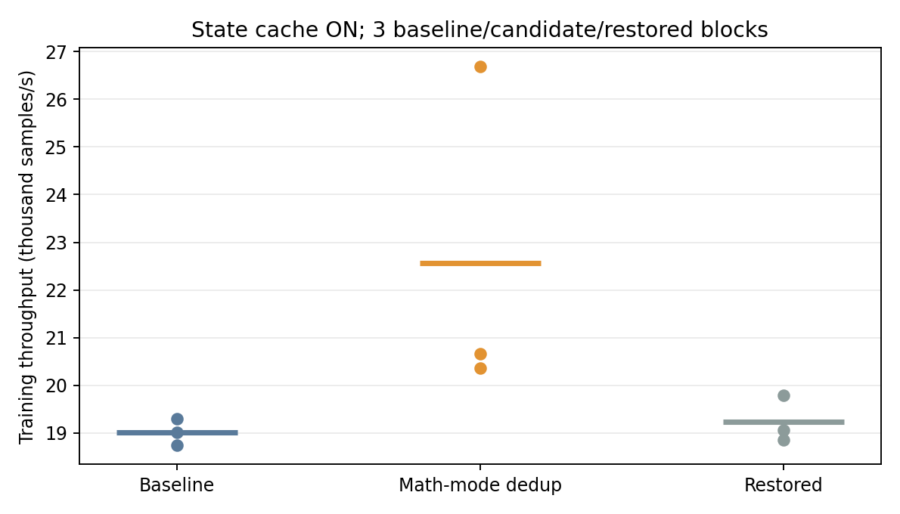

# BLAS math mode 중복 설정 제거 구현·검증 — 2026-10-22

이 문서는 배포 전 격리 검증 기록이다. 이후 릴리스 및 운영 적용 기록은 별도로 관리한다.

Guest 공통 호출 경로에 정식 코드를 구현했다. 기본값은 비활성이며,
`VMWEAVE_STATE_CACHE=1 VMWEAVE_BLAS_MATH_CACHE=1`인 새 애플리케이션 프로세스에서
사용한다. 일반 함수 진입과 명시적 `dlsym` 호출 모두 공통 경로를 지난다.
운영 배포, main commit/merge, 이미지·Helm 공개는 수행하지 않았다.

## 구현

- `runtime/shm/src/broker_client.c`: 기존 mutex 안에서 세션/handle별 마지막 성공한
  math mode를 최대 64개 보관한다. 최초 설정·값 변경·용량 초과는 원격 전달한다.
- 성공과 빈 응답을 확인한 설정만 기록한다. create/destroy는 보수적으로 전체
  math 기록을 지운다. device 변경, API 오류, close, 연결 실패와 epoch 변경도
  무효화한다. fork는 상속 mutex 접근 전에 거부한다.
- 기존 연결/소유 PID/50ms lease 검사 뒤에만 hit를 허용한다. 상태 확인 기능이
  없는 기존 peer와 직접 SHM 경로에서는 이 최적화가 적용되지 않는다.
- 새 옵션은 canonical 이름만 제공한다. 기존 상태 캐시 6-counter ABI는 유지하고
  `vmweave_broker_math_cache_stats(uint64_t[5])`를 별도로 추가했다.
- stream/workspace, 실제 행렬 계산, 큐/프로토콜/Worker 격리 구조는 변경하지 않았다.
- Worker의 현재 math 상태 변경 경로는 math setter와 handle 생성/삭제다.
  향후 새로운 상태 변경 API를 추가할 때 무효화 규칙도 함께 추가해야 한다.

캐시의 성공은 원격 Worker가 바로 지금 살아 있다는 보증이 아니다. 장애 관측 전의
lease 제한은 기존 기능과 동일하며, 반복 native setter에서만 드러나는 오류는
후속 전달 작업에서 관측될 수 있다. 매 setter마다 원격 확인이 필요한 애플리케이션은
옵션을 끈다. 같은 프로세스의 장애 후 자동 재연결은 지원하지 않는다.

## 검증

| 검증 | 결과 |
|---|---|
| full Guest ELF math cache 테스트 | 16개 통과: 기본값/비활성, 상태 캐시 OFF, 기존 Worker fallback, 변경·오류·객체별 구분, create/destroy/device, 용량, 동시 호출, fork, Worker/broker 장애, epoch, dlsym |
| full Guest ELF 기존 상태 캐시 회귀 | 20개 통과 |
| `make test-control` | 95개 실행, 94개 통과·1개 기존 조건부 skip |
| `make docs-check` | 문서 계약·strict build·링크 검사 통과 |
| 실제 GPU 학습 정확성 | 1·10·100 step의 loss·모든 weight·gradient가 `torch.equal`, 최대 절대 차이 0 |
| 실제 cuBLAS API | mode 0↔2, 4개 handle, 중복/변경, dlsym, 다중 thread, destroy/create 통과; 잘못된 enum은 두 번 모두 7 반환 |
| 실제 Worker child 강제 종료 | 캐시가 있던 동일 setter가 두 번 모두 14(INTERNAL_ERROR), enabled=0; 새 프로세스에서 다시 API 의미 검사 통과 |
| 실제 broker 강제 종료 | 캐시가 있던 동일 setter가 두 번 모두 14, enabled=0 |

Worker 장애 주입은 실험 Worker Pod UID와 `--session` child를 확인하고 pidfd로
해당 child 하나만 종료했다. 운영 Worker나 전체 GPU에 장애를 주지 않았다.
broker 종료 뒤 별도 채널/VM으로 transport를 새로 구성하고, 두 새 프로세스에서
GPU API 검사를 다시 통과했다. 기존 broker의 in-place 재시작이나 자동 복구를
검증한 것은 아니다. 실험·복구용 자원은 모두 회수했고 기존 VM UID와 채널 Ready를 확인했다.
[새 transport 복구](recovery-gpu-semantics-0.json), [두 번째 새 세션](recovery-gpu-semantics-1.json), [회수 증거](cleanup.json).

## 처리량

단일 workload: small MLP(32→64→8), batch 1024, resident, FP32.
모든 실행에서 기존 상태 캐시 ON, 30 warmup/200 측정 step, 마지막 GPU 완료까지
포함했다. 기준은 공개 v0.5.1 Guest, 후보는 정식 구현 ELF이며 Worker는 같은 공개
v0.5.1 digest다. Helper/Hook은 기존 실행기의 호환 이미지로 고정했다.
유휴 GPU `GPU-772181af-05a4-0c24-de59-8487bd37c142`, Guest 8 vCPU/16GiB,
Worker Core100/8192MiB; 기존 HAMi 설치를 변경하지 않았다.

| 블록 | 기준 samples/s | 변경 samples/s | 복원 samples/s | 변경/기준 |
|---|---:|---:|---:|---:|
| 1 | 19,306.43 | 26,677.84 | 19,795.20 | +38.18% |
| 2 | 19,015.79 | 20,354.79 | 18,859.59 | +7.04% |
| 3 | 18,741.80 | 20,663.00 | 19,068.60 | +10.25% |
| 산술평균 | 19,021.34 | 22,565.21 | 19,241.13 | — |

세 블록 모두 기준과 복원보다 빨랐다. 변경/직전 기준 비율의 기하평균은 **+17.70%**,
중앙값은 **+10.25%**, 복원 대비 기하평균은 **+16.38%**다.

**첫 블록의 큰 향상을 일반적인 기능 개선율로 해석하지 않는다.** 첫 후보 실행의
Guest CPU 시간도 2.883초로, 나머지 후보 3.999~4.010초 및 기준 4.025~4.125초보다
크게 낮았다. 단순 대기 시간 감소만으로 설명되지 않는 차이이며 이번 데이터로
실행 환경/스케줄링/CPU 상태 등의 기여를 분리하지 못했다. 첫 블록을 삭제하지 않고
전부 공개한다. 3회·고정 순서·단일 workload이므로 안정적인 +17.7%를 보장하지 않는다.
이전 시제품의 +6.2%와도 단순 합산하거나 곱하지 않는다.

모든 후보 실행에서 측정 구간 math hit가 **1,000회**, eligible miss는 **0회**였다.
별도 profile에서도 원격 math 설정은 기준 1,000회→후보 0회였다. Guest의 API 호출
횟수는 그대로다. 비계측 wire 요청은 기준 7,811~7,817회→후보 6,753~6,801회로
줄었다. health 횟수도 측정 시간에 따라 달라지므로 차이 전체가 math setter는 아니다.

Guest voluntary context switch는 기준 16,377~16,591회→후보 14,192~14,401회다.
QEMU/Worker Pod 내부 표본의 추정 CPU는 기준 약 1.32~1.36 core, 후보 약 1.31~1.34
core였다. 전체 호스트 CPU 비용이나 예약 CPU를 의미하지 않는다.
별도 계측은 요청 구조 확인용이며 처리량 결론은 비계측 9회에서만 계산했다.
최신 Passthrough 대비 비율 또는 전체 최적화 상한을 갱신한 실험은 아니다.

## 적용 판단 및 복구

작은 범위의 선택적 최적화로 구현·격리 검증을 완료했다. 기본 비활성을
유지하며 운영 적용 전 사용 workload와 장애 관측 제한을 확인해야 한다.
첫 블록의 큰 향상을 보장 수치로 삼아 배포하지 않는다.

옵션을 unset/0으로 설정한 새 애플리케이션 프로세스로 실행하면 기존 전달 동작으로
돌아간다. 프로세스가 연결한 뒤 환경 변수만 바꿔서는 동작이 바뀌지 않는다.
Worker child 장애 후에는 새 프로세스/새 세션, broker 자체 장애 후에는 기존
채널 수명주기 절차에 따른 새 transport가 필요하다. 이 변경은 자동 재연결 기능을
새로 추가하지 않는다.

## 산출물

- [정확성](correctness.json), [처리량 CSV](throughput.csv), [분석 JSON](summary.json)
- [GPU 의미·Worker 장애](raw/gpu-semantics-0.json), [새 세션·broker 장애](raw/gpu-semantics-1.json), [장애 주입 대상](worker-fault-injection.json)
- [빌드 식별값](build-identity.json), [canary 식별값](canary-identity.json), [Guest 파일 해시](raw/guest-hashes.txt)
- [구현 패치](implementation.patch), 정식 테스트 `tests/control/test_math_cache.py`, 문서 `docs/runtime/state-cache.md`
- [재현·복구 절차](reproduce.md), [실행기](run.py), [API 검사](gpu_semantics.py), [분석기](analyze.py)
- [math 테스트 로그](math-tests.log), [기존 회귀](state-tests.log), [전체 control 테스트](control-tests.log), [문서 검증](docs-check.log)
- 원시 로그·JSON·CSV: `raw/`. 텐서·ELF와 전체 audit: `.local/math-cache-20261022/`.
