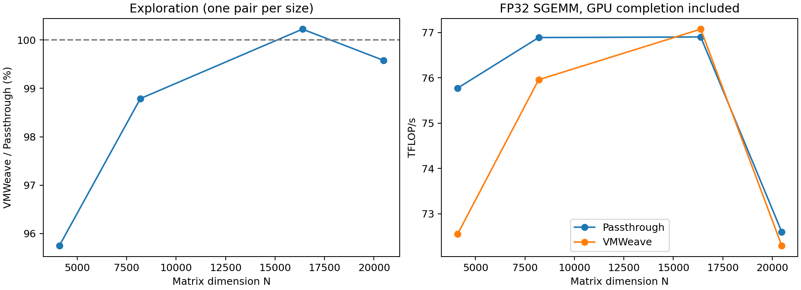
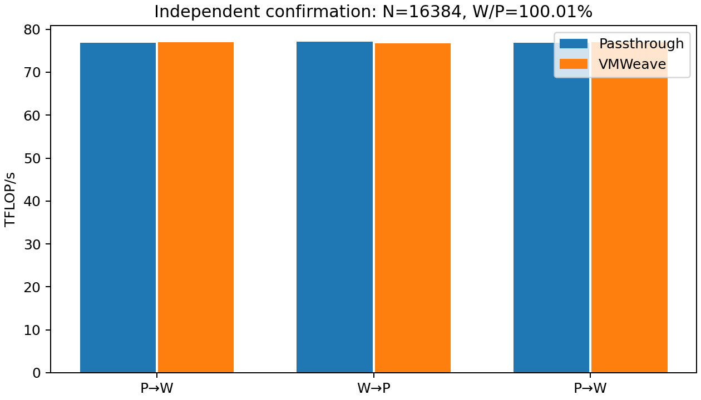

# Direct SGEMM: VMWeave / Passthrough best-case comparison (2026-10-22)

독립적인 3쌍 확인 실험에서 VMWeave/Passthrough 처리량 비율의 기하평균은 **100.01%**였다. 선택된 조건은 **N=16384 FP32 정방행렬 SGEMM**이다. 이 결과는 GPU 상주 행렬의 순수 반복 행렬곱 처리량이며, 모델 학습 처리량이나 모든 워크로드의 성능을 뜻하지 않는다.

## 실행 조건

- NVIDIA RTX PRO 6000 Blackwell Server Edition(드라이버 580.173.02, 전력 한도 600W), 같은 GPU GPU-772181af-05a4-0c24-de59-8487bd37c142(PCI 40:00.0)를 두 방식이 순차적으로 사용했다. VM 8 vCPU/16GiB, QEMU CPU 32–39, VMWeave Worker CPU 40–43, compute 100%, 8GiB 할당.
- v0.5.2 공개 Guest/Worker, 제품 조회 캐시·math mode 캐시 활성. cuBLAS 바이너리 SHA-256 및 입력 해시 일치. 정밀도 CUBLAS_PEDANTIC_MATH=2, host pointer mode=0, workspace 16MiB.
- 동일한 ctypes 직접 cuBLAS 호출. A/B/C와 workspace를 사전 할당하고 A/B를 GPU에 올렸다. 타이밍 중 데이터 전송·메모리 할당·설정 변경 없음. beta=0. 반복마다 같은 A/B/C를 재사용한다.
- 최소 30회 및 5초 워밍업 후, 16 GEMM마다 GPU 완료 동기화하며 최소 60초 측정했다. 마지막 GPU 완료까지 포함한다. 데이터 준비, 업로드, 정확성 대조는 처리량 측정에서 제외했다.
- 완료 GEMM 수 / 경과 시간 및 2×N³×완료 수 / 경과 시간으로 GEMM/s와 TFLOP/s를 계산했다. N은 행렬 한 변의 크기이며 학습 batch size가 아니다.

## 탐색 결과

| N | Passthrough TFLOP/s | VMWeave TFLOP/s | W/P |
|---:|---:|---:|---:|
| 4096 | 75.775 | 72.553 | 95.75% |
| 8192 | 76.891 | 75.960 | 98.79% |
| 16384 | 76.904 | 77.076 | 100.22% |
| 20480 | 72.600 | 72.294 | 99.58% |

20480 추가 측정 여부: True. 16384 비율이 8192보다 높고, 20480 정확성·메모리 조건을 만족하는 경우에만 추가하는 사전 규칙을 적용했다. 20480 정확성 자체는 GPU 재연결 횟수를 줄이기 위해 먼저 검증했다.

최고 W/P를 기준으로 하되 최고값과 상대 2% 이내인 후보 중 Passthrough TFLOP/s가 가장 높은 조건을 선택했다. 탐색값과 별도로 아래 3쌍을 측정했다. 각 측정은 새 benchmark 프로세스에서 입력 준비·할당·워밍업을 다시 수행했다. 연속된 같은 방식의 측정은 VM을 재사용하므로 모든 환경 변동이 통계적으로 독립이라는 뜻은 아니다.

## 독립 확인 실험

| 쌍 / 순서 | Passthrough TFLOP/s | VMWeave TFLOP/s | W/P |
|---|---:|---:|---:|
| b1 / P,W | 76.844 | 77.031 | 100.24% |
| b2 / W,P | 77.075 | 76.761 | 99.59% |
| b3 / P,W | 76.825 | 76.973 | 100.19% |

W/P 기하평균 100.01%, 각 쌍 범위 99.59–100.24%. 3회 반복만으로 통계적 동등성을 주장하지 않는다.

| 방식 | TFLOP/s 중앙값 | 표본 CV | (최대−최소)/중앙값 |
|---|---:|---:|---:|
| passthrough | 76.844 | 0.18% | 0.33% |
| vmweave | 76.973 | 0.19% | 0.35% |

## 정확성 및 메모리

| N | 전체 비교 원소 수 | 최대 절대 오차 | 허용 오차 초과 | P / W 준비 후 메모리 GiB |
|---:|---:|---:|---:|---:|
| 4096 | 16,777,216 | 0 | 0 | 0.760 / 0.748 |
| 8192 | 67,108,864 | 0 | 0 | 1.322 / 1.311 |
| 16384 | 268,435,456 | 0 | 0 | 3.572 / 3.561 |
| 20480 | 419,430,400 | 0 | 0 | 5.260 / 5.248 |

전체 C 출력에 atol=1e-5, rtol=1e-4를 적용했다. 두 방식 모두 비유한 값이 없고, 별도 CPU FP64 dot 기준 16개 표본도 통과했다. 메모리 사용은 8GiB의 80% 이내로 제한했다. Passthrough는 물리 GPU 전체 메모리가 보이고 VMWeave는 8GiB 한도가 보이므로 총 용량은 다르다. 원본 출력은 각 correctness 디렉터리의 tensors.pt이며, 확장자와 달리 column-major raw float32다.

## 별도 64 GEMM 진단

진단 계측 결과는 공식 처리량 값에 섞지 않았다. 아래 호출 경계 시간은 대기와 GPU 완료 시간을 포함할 수 있으므로 순수 전송 비용으로 해석할 수 없다. Client와 Broker 시간은 중첩되므로 합산하지 않는다.

| API | Client 호출 수 | Client 경계 시간 ms | Broker 호출 수 | Broker 교환 시간 ms |
|---|---:|---:|---:|---:|
| cudaDeviceSynchronize | 4 | 7181.952 | 4 | 7180.145 |
| cublasSgemm | 64 | 63.295 | 64 | 39.646 |
| session STATUS / health | 0 | 0.000 | 12 | 5.169 |

진단 GPU 완료 포함 경과 시간: 7.248491초 / 64 GEMM. client-api-timing.json의 state_cache는 추가 진단 shim의 캐시 여부이며 제품 캐시 활성 여부와 다르다. 제품 캐시는 result.json의 cache_before/after로 확인했다.

## 해석과 한계

큰 행렬곱은 하나의 CUDA/BLAS 요청에 많은 GPU 연산을 담는다. 16회마다 동기화하여 호출 전달 시간을 GPU 연산과 겹칠 여지를 주었다. API 전달이 없어지는 것은 아니며, 이 결과는 그 비용이 충분한 GPU 작업에 분산되는 조건을 보여준다. 기존 작은 MLP의 W/P 8.79%와는 작업 종류·호출 패턴이 다르므로 학습 성능 개선 배수로 비교할 수 없다. 데이터 로딩, CPU↔GPU 전송, optimizer, 실제 학습 정확도는 이번 측정 대상이 아니다.

탐색 후보 3–4개 중 선택한 결과이며 가능한 모든 워크로드의 이론적 최댓값을 보장하지 않는다. GPU 클럭·온도·전력은 고정하지 않았으며 각 측정 구간의 관측치를 summary.json에 보존했다. Kubernetes Ready 관측은 서비스 요청 성공률 검사가 아니다.

## 산출물 및 복구

- [summary.json](summary.json), [measurements.csv](measurements.csv): 모든 탐색·확인·진단 측정값과 GPU 관측 요약.
- [manifest.json](manifest.json), [selection.json](selection.json), [identity-validation.json](identity-validation.json): 사전 규칙, 선택 근거, 실행 버전·GPU·CPU affinity 확인.
- correctness/, explore/, b1/, b2/, b3/, diagnostic/: 원본 결과, stdout/stderr, GPU/CPU 로그, 정확성 출력 및 진단 계측.
- bench.py, run.py, execute.py, analyze.py, compare.py: 실행·검증 코드. audit/와 identities/: 자원 UID, 이미지, 라이브러리, 호출 기록.
- [cleanup.json](cleanup.json): 실험 VM·채널·프로파일·PV/PVC·관리 Pod 제거, GPU NVIDIA 드라이버 복귀, HAMi/DCGM/KubeVirt/DRA 설정 확인.
- 기존 서비스 관측 206회, UID/Ready/재시작 이상 관측 0회. [continuity-summary.json](continuity-summary.json)
- 운영 코드·이미지·Helm·main 변경 없음. 실험에 필요한 GPU 연결 전환은 원복했다.
