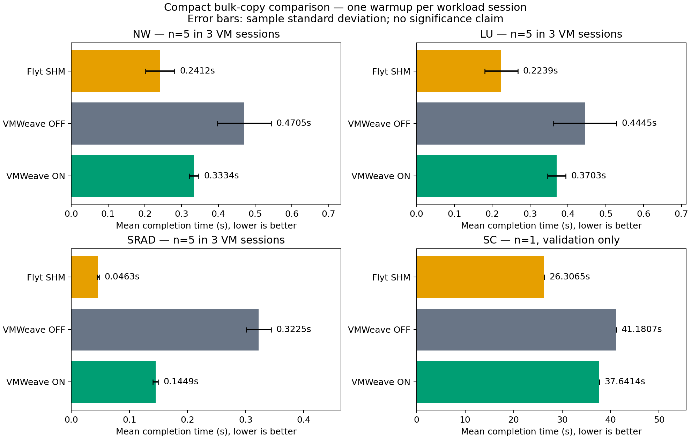
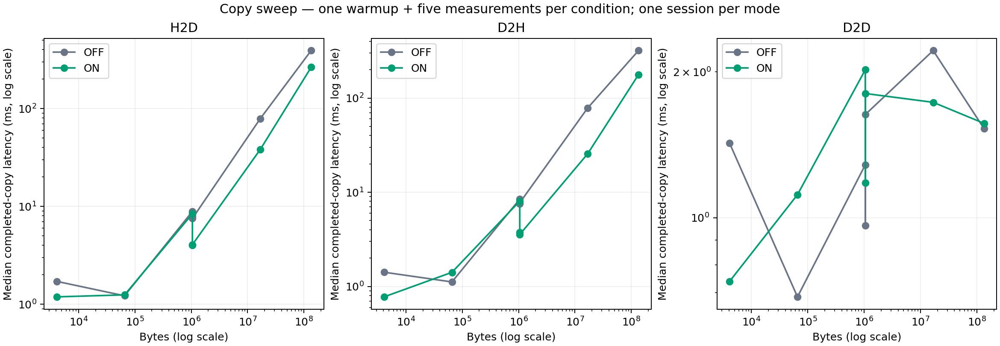

# 공유 버퍼 축약 성능 비교

[최종 보고서](REPORT.txt) · [원시 표본](raw.csv) · [통계](comparison.json) · [복사 비교](copy-comparison.json) · [경로 진단](diagnostic-summary.json)

NW·LU·SRAD는 방식당 5표본(3개 VM 세션), StreamCluster는 방식당 1표본의 최소 검증입니다. 워밍업은 세션당 1회입니다. 작은 표본으로 통계적 우위를 주장하지 않습니다.

시험 자원 정리·운영 상태 검증은 [cleanup.json](cleanup.json)에 기록했습니다. 운영 배포 변경은 없습니다.
