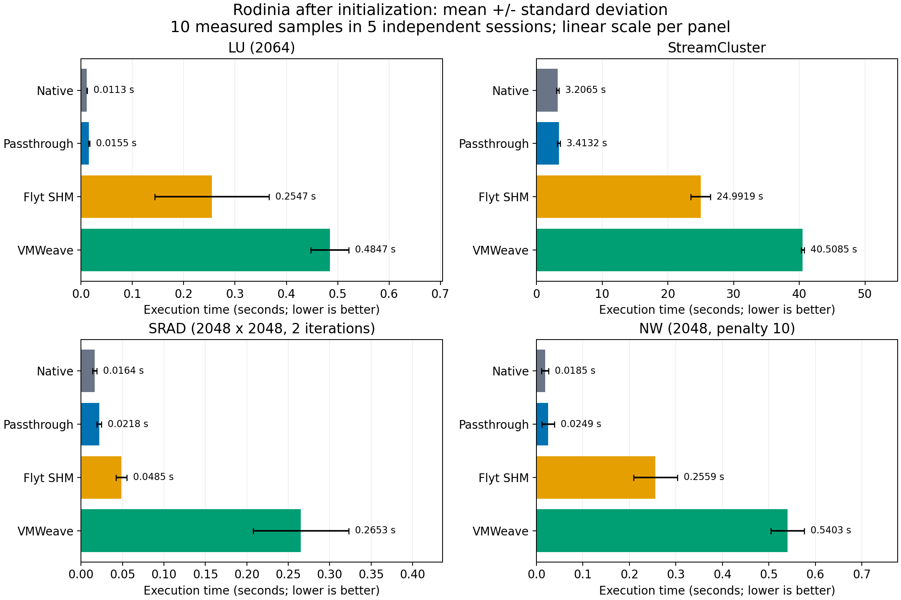
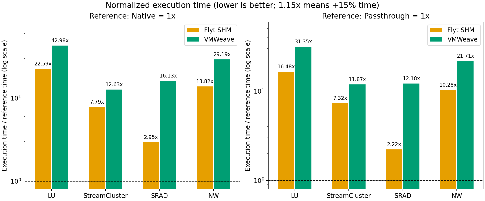

# Rodinia 정상 상태 실행 시간 비교 — 측정 재개

**측정·진단·검증·자원 정리가 완료됐습니다.** 4방식 × 4워크로드 × 10표본 = 160개 정식 표본과 별도 진단 16개 조합을 수집했습니다.

최종 결과는 네 워크로드 모두 Flyt의 평균 실행 시간이 VMWeave보다 짧습니다.
[보고서](REPORT.txt), [통계](comparison.json), [원시 표본](raw.csv), [API 진단](diagnostic-summary.json)을 참고하세요.

StreamCluster의 CUDATIME 내부 계측은 네 방식 모두에서 비활성화했습니다. 기존 표본은
`excluded/sc-internal-timers/`에 보존하고 최종 평균에서 제외합니다. 수정 근거는 `streamcluster-compatibility.json`에 있습니다.

비교군은 Native(호스트 직접 실행), Passthrough(VM 직접 실행), Flyt SHM, VMWeave입니다.
초기화를 포함했던 이전 실험과 달리 같은 프로세스에서 두 번의 완전한 작업 워밍업 후
실행 시간을 측정합니다. 각 방식·워크로드별로 독립 세션 5개, 세션당 측정 2회를 계획했습니다.

직접 측정값은 CPU 단조 시계로 관측한 작업 완료 시간입니다. 주 비교 지표는
`100 × (대상 평균 시간 / 기준 평균 시간 − 1)`이며 Native와 Passthrough 기준을 별도로 계산합니다.
GPU 커널만의 실행 시간이나 학습 samples/s가 아닙니다.

## 논문과의 관계

[Flyt 논문 §4.2·표 4](https://icpe2026.spec.org/preprint/FLYT_Transparent_and_Elastic_GPU_Provisioning_for_Multi-Tenant_Cloud_Services.pdf#page=6)는
Rodinia 실행 시간의 평균·표준편차와 n=10을 제시하지만, 정확한 입력 크기·타이머 경계·
워밍업 절차를 명시하지 않습니다. 따라서 같은 종류의 비교 실험이며 논문 수치의 정확한 재현은 아닙니다.
입력 크기는 원격 방식의 성능 관측 전에 고정했습니다. Native의 하드웨어도 논문과 다릅니다.

## 측정 경계

- NW/LU/SRAD: CPU 입력 준비 후 GPU 할당·입력 전송·알고리즘 실행·결과 전송·완료 동기화.
- StreamCluster: CPU 클러스터링 제어 흐름과 GPU 할당·전송·실행. 입력 생성/읽기와 결과 파일 쓰기는 제외.
- 일회성 CUDA 초기화, 워밍업, 출력 덤프/검증, 최종 자원 정리는 측정에 포함하지 않습니다.
- StreamCluster의 선택적 `CUDATIME` 내부 이벤트 계측은 네 방식 모두에서 끕니다.
  이에 따라 내부 계측용 이벤트 동기화도 제거됩니다. 알고리즘과 입력은 같습니다.
  원본 출력 타이머 대신 `EXPERIMENT_SAMPLE` JSON의 CPU 관측 시간을 사용합니다.

## 실험 소스의 보완

SRAD의 경계 밖 선행 읽기를 방지했습니다. CPU 구현과 4,194,304개 출력값을 대조하여
최대 절대 오차 4.77e-7을 확인했습니다. StreamCluster는 반복 실행을 위해 상태를 초기화하고,
해제되지 않던 CUDA 이벤트를 해제하며, 오래된 동기화 함수 이름을 현행 이름으로 바꿨습니다.
Flyt가 `cudaFree(NULL)`을 거부하므로 모든 방식에서 작은 메모리 할당·해제로 초기화합니다.
이 준비 구간은 시간 측정에서 제외합니다. 제품 코드나 운영 배포 버전은 수정하지 않았습니다.

초기 실패와 보완 전 실행도 `qualification/`에 남깁니다. 최종 실행 파일의 해시는 manifest에 고정합니다.
재빌드는 `reproduction/build.py`와 동결된 `src/`를 사용합니다.
