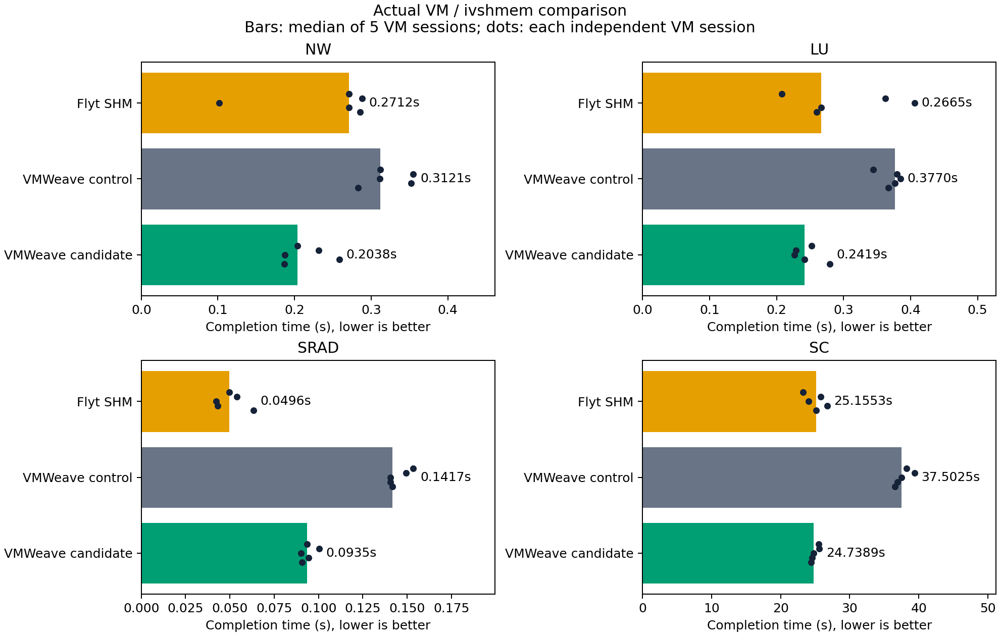
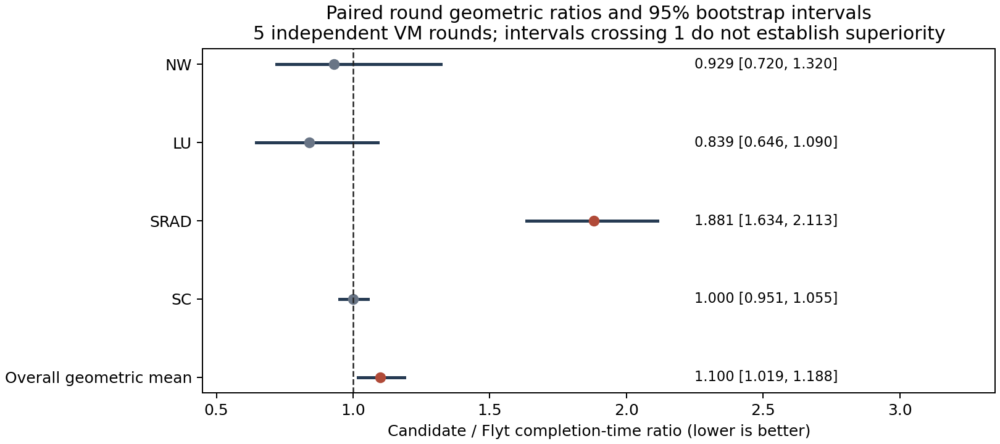
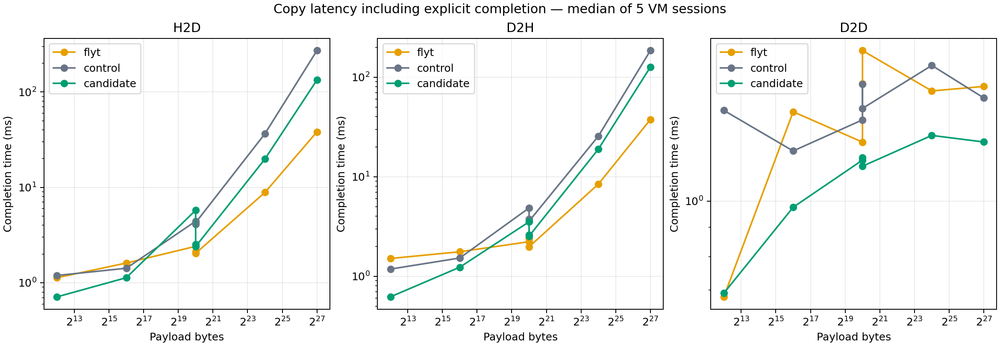

# VMWeave 경로 최적화: 실제 VM 검증 및 Flyt 비교

2026-10-27 KST. 판정: **DO_NOT_PROMOTE — Flyt 대비 승격 조건 미충족**.

최적화 후보의 기본 VMWeave 대비 실행시간 비율은 0.657 [0.637, 0.676], Flyt 대비 비율은
1.100 [1.019, 1.188]다. 비율은 작을수록 좋고 대괄호는 95% bootstrap 구간이다.
일부 workload의 개선을 전체 성능 우위로 판단하지 않았다. 개별 workload와 핵심
H2D/D2H 경로를 포함한 사전 승격 조건을 충족하지 못했으므로 운영 배포, main commit/push,
릴리스 이미지 발행 및 Helm 값 변경은 수행하지 않았다. 시험용 로컬 이미지만 만들었다.

## 정식 성능 결과

각 시간은 독립 VM 5개의 세션 중앙값을 다시 중앙값으로 요약한 초 단위 값이다.
오른쪽 비율/구간은 각 round의 candidate/Flyt 비율을 log 공간에서 결합한 값이므로,
표의 두 중앙값을 나눈 값과 다를 수 있다. 특히 NW처럼 반복 변동이 크면 차이가 커진다.

| workload | Flyt SHM | VMWeave control | 최적화 후보 | 후보/Flyt [95% 구간] |
|---|---:|---:|---:|---:|
| NW | 0.27117 | 0.31209 | 0.20383 | 0.929 [0.720, 1.320] |
| LU | 0.26651 | 0.37696 | 0.24192 | 0.839 [0.646, 1.090] |
| SRAD | 0.04961 | 0.14167 | 0.09348 | 1.881 [1.634, 2.113] |
| SC | 25.15533 | 37.50248 | 24.73893 | 1.000 [0.951, 1.055] |

원자료: [workloads.csv](workloads.csv), [comparison.json](comparison.json),
[formal/](formal/). 그래프의 점은 각 독립 VM이며, warmup은 제외했다.

## 복사 및 memset

다음은 API 호출부터 명시적 `cudaDeviceSynchronize` 완료까지의 ms다.
API 반환시간과 호출자 CPU 시간도 [micro-comparison.json](micro-comparison.json)에 별도로 보존했다.
모든 조건에 같은 동기화 경계를 적용했으나 순수 wire latency나 GPU DMA 시간은 아니다.
이 표도 시간 열은 VM 5개의 중앙값, 비율 열은 paired round 비율의 기하평균이다.

| 작업 | 크기 | Flyt | control | 후보 | 후보/Flyt [95% 구간] |
|---|---|---:|---:|---:|---:|
| H2D | 4 KiB | 1.130 | 1.192 | 0.712 | 0.980 [0.524, 1.836] |
| D2H | 4 KiB | 1.508 | 1.181 | 0.621 | 0.597 [0.349, 1.210] |
| H2D | 16 MiB | 8.851 | 36.545 | 19.834 | 2.231 [2.101, 2.377] |
| D2H | 16 MiB | 8.434 | 25.605 | 18.944 | 2.274 [2.185, 2.383] |
| D2D | 16 MiB | 1.556 | 1.723 | 1.301 | 0.930 [0.716, 1.215] |
| H2D | 128 MiB+1 | 38.193 | 271.705 | 133.501 | 3.477 [3.283, 3.695] |
| D2H | 128 MiB+1 | 37.579 | 185.335 | 126.536 | 3.304 [3.067, 3.574] |
| memset | 4 KiB | 0.912 | 2.092 | 1.017 | 1.141 [0.526, 2.725] |
| memset | 16 MiB | 1.481 | 1.944 | 1.107 | 1.008 [0.595, 1.762] |

128 MiB+1은 VMWeave에서 16 MiB chunk 9개로 나뉜다. Flyt의 4 GiB backing과
기존 chunk 정책은 이 크기를 한 요청으로 처리할 수 있다. 이 결과에는 요청 수 차이도
포함된다. 16 MiB 이하 결과는 이러한 대용량 분할 효과와 구별하여 읽어야 한다.

## 정확성·수명 검증

- 실제 KubeVirt VM의 ivshmem PCI BAR를 사용했다. 이전 host file-mapping harness 결과의 재사용이 아니다.
- 이전 root 권한 제한으로 건너뛴 layout permission 검사도 격리 container에서 실행해 6/6 통과했다.
  [로그](layout-permissions-root.log). 최초 도구 image의 Python 미설치 실패는 별도 보존했다.
- Flyt/control/candidate에서 memset 후 실제 검증 kernel 60회씩 통과했다.
  default stream, blocking stream 순서, nonblocking stream의 명시적 event completion을 검사했다.
- VMWeave OFF/ON에서 동기·비동기 H2D/D2H/D2D 경계 및 128 MiB+1 큰 복사,
  두 stream과 140회 연속 async enqueue 데이터 검사를 통과했다.
- 정식 workload 150개 timed sample 및 60개 warmup 출력이 고정 reference hash와 일치했다.
  microbenchmark는 15개 VM 각각 25개 셀의 반복 종료 후 데이터가 일치했다.
- 실제 VM에서 두 번째 client busy 거절, CUDA 자식만 SIGKILL한 후 cached client fencing,
  새로운 CUDA 세션의 kernel 검증을 통과했다. 이 경우 channel generation은 유지됐다.
- 동일 시험 VM을 Halted→Always로 재생성하고 VMI/Worker UID·allocation·generation이
  바뀐 것을 확인했다. 새 세대에서 다시 kernel 검증과 Ready를 확인했다.

근거: [qualification/](qualification/),
[실제 VM 장애 복구](qualification/qual-recovery/candidate/lifecycle/result.json),
[VM 재생성](qualification/qual-recovery/candidate/vm-recreation/result.json).

Compute Sanitizer는 두 시도 모두 Worker readiness 전 시작 단계에서 진행하지 못했다.
CUDA kernel까지 도달하지 않았으므로 sanitizer PASS가 아니다. HAMi/interposer와
도구 초기화의 상호작용은 추가 조사 대상이다. [상태](sanitizer-status.json),
[두 번째 시도](sanitizer-v2-startup.log). 기존 CPU ASan/UBSan 성공과 구별한다.

## 남은 비용의 해석

1. **복사 횟수:** 큰 동기 H2D 후보는 응용→Guest/Broker arena→VM SHM→Worker snapshot→child arena→CUDA다.
   P1/P3/P4가 이전 복사와 소켓 payload 이동을 줄였지만, 현재 host snapshot→child arena 복사는 남아 있다.
   D2H에도 child arena→부모 output→VM SHM→Broker arena→응용 경유가 남는다.
   Flyt SHM은 응용→BAR 복사 후 서버가 그 공유 영역으로 CUDA copy를 수행하는 짧은 경로다.
2. **검증 및 중계:** Worker의 bounded volatile payload snapshot, Python Broker의 framing,
   Guest/Broker 소켓과 부모/자식 제어 handshake는 계속 수행된다. P5는 Python 제거가 아니다.
3. **분할:** 128 MiB+1에서는 VMWeave의 9개 직렬 요청이 비용을 더한다. 다만 단일 chunk 크기에서도
   차이가 남으므로 분할 상한만 올리는 것을 해결책으로 삼을 수 없다.
4. **pool의 적용 범위:** P7a는 async H2D pinned/event 재사용이다. 이번 정식 workload와
   microbenchmark의 동기 `cudaMemcpy`에는 적용되지 않는다.

SRAD 입력은 2048×2048 float, 반복 2회로 16 MiB H2D와 D2H를 각각 두 번 수행한다.
16 MiB microbenchmark의 두 방향 지연 차이를 두 번 더하면 약 43 ms로,
SRAD 중앙값 차이 약 44 ms와 비슷하다. 서로 다른 측정 구간과 추가 동기화가 있으므로
정확한 기여율 분해는 아니지만, 큰 host payload 경로를 먼저 개선할 근거가 된다.

이는 측정 양상과 [보존한 소스](source-evidence/manifest.json)에 근거한 분석이다.
각 복사 단계의 배타적 시간을 계측한 결과는 아니므로 어느 단계가 몇 %를 차지한다고 단정하지 않는다.
HAMi 기반 VMWeave와 MPS 기반 Flyt의 backend 비용도 이 시스템 비교에 포함된다.
순수 통신 프로토콜만 분리한 비교로 해석하지 않는다.

우선 제안은 **metadata private 검증을 보존하면서 H2D payload를 child arena로 직접 snapshot하고,
D2H의 부모 임시 output 복사를 제거하는 것**이다. 이후 bounded payload copy,
Broker hot path, 큰 요청의 chunk/credit 설계를 독립적으로 검증한다.
변경 대상·불변 조건·검증 순서는 [NEXT-STEPS.md](NEXT-STEPS.md)에 있다.

## P6a 대기 profile 보조 실험

spin 0/10/50µs와 sleep 50µs를 비교했다. 각 profile당 새 VM 1개와 셀당 5개 timed sample이다.
정식 5회 비교에 섞거나 독립 VM 5회인 것처럼 계산하지 않았다. 아래 CPU는 microprobe 전체
과정의 합계로 초기화·정확성 검사용 추가 복사·Worker background thread도 포함한다.

| spin µs | 전체 probe 경과 s | Broker CPU s | Worker container CPU s |
|---:|---:|---:|---:|
| 0 | 6.552 | 0.600 | 2.544 |
| 10 | 6.107 | 0.620 | 2.442 |
| 50 | 6.432 | 0.630 | 2.559 |

세부 latency·caller CPU·메모리 기록은 [wait-profile-comparison.json](wait-profile-comparison.json)에 있다.
16 MiB H2D는 세 profile에서 19.56–21.52 ms, D2H는 17.56–19.08 ms였다.
이 탐색 결과로 대기 설정만 바꾸어 큰 복사 경로의 차이를 해소했다고 볼 수 없다.
profile별 1개 VM인 탐색 결과여서 기본값 변경이나 Flyt 대비 승격의 근거로 사용하지 않았다.

## 비교 조건과 한계

[protocol.json](protocol.json)을 정식 측정 전에 고정했다. 세 조건 × 새 VM 5개,
순서를 교차 배치했으며 NW/LU/SRAD는 VM당 warmup 1+측정 3회,
Streamcluster는 warmup 1+측정 1회다. inference 단위는 VM round이고 sample 150개를
독립 반복으로 취급하지 않는다. bootstrap은 paired round의 5^5개 재표집을 전수 계산했다.
VM 5회이므로 구간 정밀도가 제한되며 micro의 여러 구간에는 다중 비교 보정을 적용하지 않았다.

- GPU 0 고정, compute 100%, 8192 MiB; QEMU host CPU 32–39, backend 40–43.
- Flyt SHM payload+RPC control을 대조군으로 사용했다. TCP payload 대조군이 아니다.
- control/candidate는 같은 최종 ELF를 사용하고 신규 최적화 옵션 OFF/ON만 구별했다.
  양쪽 모두 기존 bulk ON이다. 운영 중 구버전 ELF를 그대로 사용한 비교는 아니다.
- 후보는 native memset, direct bulk, Broker/Worker reuse, gather, session arena,
  native owner, host eventfd, pinned pool을 함께 켰다. state/math cache는 양쪽 OFF다.
- 정식 측정에 상세 trace/sanitizer를 섞지 않았다. GPU 상태와 실제 VM/Worker identity를 보존했다.
- 초기 CUDA 세션 생성은 별도로 기록하고 warmup 이후 workload 구간을 비교했다.
  `exp_end`의 명시적 완료 대기까지 포함하며, 응용의 CPU 작업이 들어 있는 구간도 있다.
- 동시 사용자 작업이 있는 단일 호스트 결과다. GPU 3의 기존 작업을 중단하지 않았으며
  host 전체 독점이나 고정 clock을 보장하는 환경은 아니다. NUMA 메모리 정책도 별도로 고정하지 않았다.

개별 최적화 단계 전체의 성능 ablation, 모든 syscall 실패 주입, 장시간 동시성 부하,
전체 CUDA API/stream 의미 동등성, GPU sanitizer는 완료했다고 주장하지 않는다.
이번 결과는 결합 후보의 실제 VM 정확성·복구와 지정 workload의 비교다.

## 회수와 운영 보존

[final-audit.json](final-audit.json)에서 시험 Kubernetes 자원 회수, 시험 GPU compute idle,
운영 VM/VMI/channel/request spec 및 UID 보존, 운영 Worker UID·generation 보존과 Ready를 확인했다.
원본 runtime과 고정 후보 소스, 측정 바이너리 hash도 일치했다.

재현 자료는 [reproduction/](reproduction/), artifact 식별자는
[worker-images.json](worker-images.json), [test-binary-sha256.json](test-binary-sha256.json),
[candidate-source-manifest.json](candidate-source-manifest.json)에 있다.
로그의 초기 setup 실패는 삭제하지 않았고 성능 sample로 사용하지 않았다.
