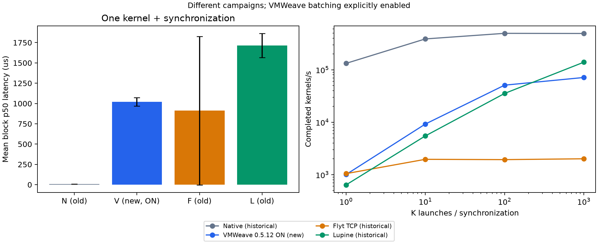
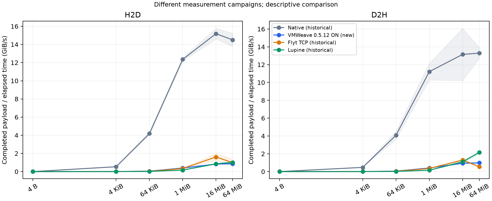
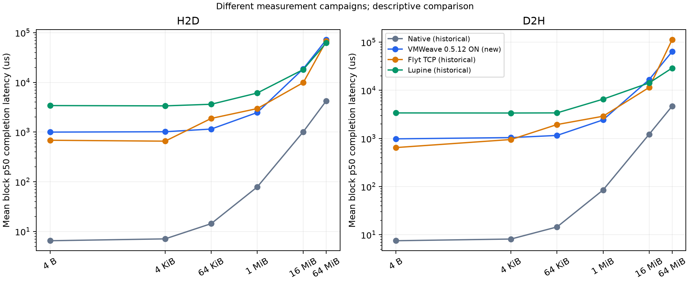
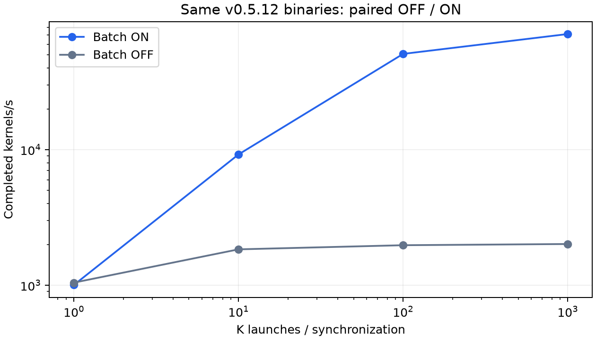

# GPU 통신 성능 비교 — VMWeave 0.5.12 결과 갱신

갱신 측정(KST): 2026-11-18T21:32:23+09:00 ~ 2026-11-18T22:45:49+09:00

## 보고 요지

**VMWeave만 현재 공개된 0.5.12로 재측정했다.** 주 비교 표의 VMWeave 80구간을 새 결과로 교체했고, Native·Flyt·Lupine의 기존 240구간과 집계값은 그대로 유지했다. 추가로 동일 바이너리에서 배치 OFF 커널 20구간을 측정했다. 새로 실행한 본 측정은 총 **100구간**이며, 예비 실행은 제외했다.

이전 VMWeave와 비교한 평균 처리량은 K=1000에서 **46.03배**, 64MiB H2D에서 **2.52배**, 64MiB D2H에서 **2.55배**다. 버전·옵션·측정 시점이 함께 바뀐 결과이며, 배치의 효과는 별도 OFF/ON 비교로 평가했다.

**주 비교의 VMWeave는 Broker 최적화 + 애플리케이션 bulk/direct + 커널 배치 ON이다. 제품 기본값이나 모든 운영 Pod의 설정을 뜻하지 않는다.** 배치 OFF는 같은 최적화 조건에서 배치만 끈 비교다.

**측정 시점이 다른 자료를 합친 비교다.** 새 VMWeave와 과거 Native·Flyt·Lupine 사이에는 대응 블록 관계가 없으므로 기존 V/F·V/L 대응 신뢰구간을 철회하고, 평균값 비율만 참고값으로 제시한다. 각 구성 자체의 5블록 신뢰구간은 유지하지만, 공통 시점 재실험·통신 방식만의 인과 효과·전체 애플리케이션 우열을 입증하지 않는다.

새 원시 지연 표본 **1,576,343개**의 개수·완료율·분위수·통계 및 실행 경로를 별도 구현으로 검증했다. 이전 VMWeave 원자료는 삭제하지 않았으며 [이전 보고서](REPORT-v0.5.11.md)와 [선택 규칙](analysis/selection.json)으로 구분한다.

## 핵심 실측 결과

값은 5개 블록 지표의 산술평균이며 대괄호는 블록 단위 95% t 구간이다. 지연은 **블록별 p50의 평균**이다. 개별 호출을 독립 반복으로 취급하지 않았다.

| 지표 | Native — 기존 | VMWeave 0.5.12 ON — 신규 | Flyt TCP — 기존 | Lupine — 기존 |
|---|---:|---:|---:|---:|
| 커널 1개 + sync p50 (µs) | 7.46 [7.42, 7.5] | 1,021 [969, 1,074] | 912 [-2.6, 1,826] | 1,715 [1,566, 1,864] |
| 64MiB H2D (GiB/s) | 14.5 [13.8, 15.2] | 0.862 [0.839, 0.885] | 0.985 [0.61, 1.36] | 1.01 [0.849, 1.16] |
| 64MiB D2H (GiB/s) | 13.3 [12.7, 13.9] | 0.978 [0.931, 1.03] | 0.549 [0.456, 0.641] | 2.15 [1.95, 2.34] |
| K=1000 처리량 (kernels/s) | 491,770 [490,171, 493,370] | 71,280 [70,588, 71,973] | 2,009 [1,358, 2,660] | 139,477 [118,557, 160,398] |

K=1000의 평균 처리량 비율은 새 VMWeave/기존 Flyt **35.48배**, 새 VMWeave/기존 Lupine **0.511배**다. 서로 다른 시점의 점추정 비교이며, 유의성 검정이나 대응 실험의 성능비로 해석하지 않는다.

64MiB 전송의 VMWeave/Flyt 평균 대역폭 비율은 H2D **0.875배**, D2H **1.783배**다. 비교 결과는 전송 방향·크기와 동기화 빈도에 따라 달라진다.

Flyt 단일 커널의 기존 블록 p50 변동이 커 산술 t 구간의 하한이 음수다. 원래 수치를 보존했으며 실제 음수 지연을 뜻하지 않는다.

## 전송 크기별 유효 대역폭

논리 payload 완료량을 전체 측정 경과 시간으로 나눈 값이다. 단위는 GiB/s이며 wire/NIC 대역폭 또는 비동기 최대 대역폭이 아니다.

| 방향·크기 | Native — 기존 | VMWeave ON — 신규 | Flyt — 기존 | Lupine — 기존 |
|---|---:|---:|---:|---:|
| H2D 4 B | 0.000573 | 3.83e-06 | 4.59e-06 | 1.2e-06 |
| H2D 4 KiB | 0.535 | 0.00382 | 0.00433 | 0.00124 |
| H2D 64 KiB | 4.18 | 0.0535 | 0.0353 | 0.0182 |
| H2D 1 MiB | 12.4 | 0.393 | 0.341 | 0.162 |
| H2D 16 MiB | 15.2 | 0.829 | 1.61 | 0.856 |
| H2D 64 MiB | 14.5 | 0.862 | 0.985 | 1.01 |
| D2H 4 B | 0.000492 | 3.88e-06 | 4.69e-06 | 1.2e-06 |
| D2H 4 KiB | 0.472 | 0.00371 | 0.00369 | 0.00124 |
| D2H 64 KiB | 4.08 | 0.0532 | 0.0339 | 0.0195 |
| D2H 1 MiB | 11.2 | 0.403 | 0.348 | 0.151 |
| D2H 16 MiB | 13.1 | 0.94 | 1.3 | 1.09 |
| D2H 64 MiB | 13.3 | 0.978 | 0.549 | 2.15 |

모든 크기의 p50·p95·신뢰구간은 [전체 집계](analysis/summary.csv)에 있다. 표본이 1,000개 미만인 세션은 p95를 계산하지 않았고 이를 위해 측정 시간을 연장하지 않았다.

## 동기화 빈도와 배치 OFF/ON

K회 launch 뒤 sync 한 번을 완료한 수로 처리량을 계산한다. 마지막 sync까지 측정하므로 로컬 enqueue 속도만 측정한 결과가 아니다. 커널 자체 계산이 빨라졌다는 의미도 아니다.

| K | Native — 기존 | VMWeave ON — 신규 | VMWeave OFF — 신규 | Flyt — 기존 | Lupine — 기존 |
|---:|---:|---:|---:|---:|---:|
| 1 | 132,428 | 1,005 | 1,046 | 1,047 | 638 |
| 10 | 387,344 | 9,224 | 1,840 | 1,962 | 5,478 |
| 100 | 494,982 | 50,871 | 1,974 | 1,936 | 35,359 |
| 1000 | 491,770 | 71,280 | 2,015 | 2,009 | 139,477 |

다음 표만 **이번 실험의 대응 비교**다. 각 블록에서 같은 VM/Worker/Broker에 새 클라이언트·CUDA 세션으로 OFF/ON을 실행하고, 블록별 순서를 번갈아 적용했다. K=1은 평균 완료 지연, K>1은 전체 경과 시간에서 계산한 커널당 완료 비용을 사용한다. 비율이 작을수록 ON이 유리하다.

| K | ON/OFF 비용비 | 95% 대응 로그비율 CI | 5% 이내 비열등성 |
|---:|---:|---:|---|
| 1 | 1.0412 | [0.9569, 1.1328] | 불확정 |
| 10 | 0.1995 | [0.1905, 0.2089] | 통과 |
| 100 | 0.0388 | [0.0372, 0.0404] | 통과 |
| 1000 | 0.0283 | [0.0269, 0.0297] | 통과 |

**K=1의 지연 증가가 5% 이내라고 확정할 수 없다.** 따라서 잦은 동기화에도 배치가 항상 유리하다고 해석하지 않는다.

이 판정은 해당 조건의 비용비 CI 상한 ≤1.05일 때 통과, 하한 >1.05일 때 저하 확인이다. 다중 비교 보정은 하지 않았으며 일반 서비스 SLA나 전체 모델 성능 보장이 아니다.

## 이전 VMWeave와의 변화

아래는 버전·옵션·측정 시점이 함께 달라진 기술 비교다. 배치 자체의 효과는 위 OFF/ON 비교로 구분한다.

| 지표 | 이전 0.5.11, bulk OFF | 최신 0.5.12, 최적화·배치 ON |
|---|---:|---:|
| K=1 p50 (µs) | 1,140 | 1,021 |
| 16MiB H2D (GiB/s) | 0.24 | 0.829 |
| 16MiB D2H (GiB/s) | 0.238 | 0.94 |
| K=1000 (kernels/s) | 1,548 | 71,280 |

## 고정 조건과 실행 경계

| 항목 | 조건 |
|---|---|
| GPU | 물리 GPU1, `GPU-772181af-05a4-0c24-de59-8487bd37c142`, RTX PRO 6000 Blackwell Server Edition. Guest에는 단일 논리 device 0으로 노출 |
| 예약 | 기존 HAMi DRA에서 cores=100·memory=97887Mi 전체 capacity 예약 |
| Guest | 이전과 동일 SHA256의 Ubuntu 24.04 이미지, 4 vCPU·16GiB, GPU passthrough 없음 |
| CPU | QEMU 8–11, Worker 12–15. 독점 CPU 및 strict 메모리 NUMA binding 없음 |
| 바이너리 | 공개 0.5.12 Guest/Worker digest 고정. 이전과 동일 probe 실행 파일·PTX·seed 20261117 |
| Broker | BULK_COPY=1, BROKER_REUSE=1, BROKER_GATHER=1, BROKER_OWNER=1 |
| 앱 | BULK_COPY=1, BULK_DIRECT=1. KERNEL_BATCH만 ON=1 / OFF=0 |
| 호출 | 한 client·default stream·pageable host buffer, 복사 하나 또는 K개 launch 뒤 sync |
| 시간 | 10초 및 최소 10회 warmup, 조건별 30초, 마지막 작업 완료까지의 실제 경과 시간 |
| 독립 반복 | 5블록·5회 새 VM 부팅. ON의 16조건 순서는 이전 프로토콜과 동일. OFF는 커널 4조건만 수행 |
| 검산 | 누적 커널 값·최종 sequence, 전송 버퍼 전체 바이트. 모든 중간 상태를 저장한 것은 아님 |

CPU 값은 1초 간격 QEMU·Worker Pod cgroup 누적량을 시각 보정 경계에 보간한 보조 추정치다. Guest CPU를 다시 더하지 않았다. 초기 clock-offset 이후의 시각 보정과 SSH 왕복 오차가 남으며, 관측 범위를 벗어나는 구간은 N/A로 유지했다.

| 구성 | p95 가능 구간 | CPU 추정 가능 구간 |
|---|---:|---:|
| Native 기존 | 80/80 | 80/80 |
| VMWeave ON 신규 | 70/80 | 80/80 |
| Flyt 기존 | 60/80 | 80/80 |
| Lupine 기존 | 73/80 | 78/80 |
| VMWeave OFF 신규 | 10/20 | 19/20 |

새 10개 세션의 환경 관측은 총 3,734회다. GPU1 외부 프로세스 관측 0건, hardware/thermal slowdown 표본 0건, GPU 조회 오류 0건, 프로세스 조회 오류 0건이다. 이는 주기적 관측 결과이며 관측 사이의 모든 상태를 증명하지 않는다.

## 해석 제한과 보존

- Native·Flyt·Lupine은 기존 캠페인의 결과다. 특히 당시 마지막 블록에는 외부 서비스 재배치가 관측됐다. 그 원자료와 환경 기록은 [이전 보고서](REPORT-v0.5.11.md)에 보존했다. 새 VMWeave와 같은 배경 부하였다고 가정하지 않는다.
- Flyt는 legacy TCP/ONC RPC + MPS 구성이다. gRPC CUDA 데이터 경로 또는 Flyt SHM으로 표시하지 않는다. Lupine 역시 기존 단독 TCP 실행 백엔드 조건을 유지한다.
- 실제 시간에는 interception·직렬화·Broker·dispatch·복사·동기화 비용이 포함된다. SHM 자체와 TCP 자체의 차이로 분해하지 않았다.
- Fractional 제어·다중 tenant·학습/추론·격리성·스케줄링·pinned/multistream 실험은 추가하지 않았다.
- 배치는 등록된 typed default-stream 경로의 선택 기능이다. 임의 모델·CUDA 전체 호환성이나 200µs 최대 지연 보장을 뜻하지 않는다.

## 복원 및 정리

- 기존 Running Pod 123개 대조: 상태 변화 0건. 기존 설정/spec 변화 0건.
- HAMi values 동일: True. 실험 GPU 프로세스 잔류 없음: True. GPU1 유휴 확인: True.
- 실험 전용 VM·Worker·Channel·DRA Claim·PVC/PV·디스크·관리 Pod·namespace를 정리했다. 운영 중인 GPU2 VM과 기존 Draining Channel은 변경하지 않았다.
- 운영 VMWeave 0.5.12 및 공용 HAMi/DRA/Operator 설정은 유지했다. 다른 작업이 사용하는 공개 이미지 캐시는 정리 대상에서 제외했다.
- 상태 대조는 서비스 요청 단위의 무중단 SLA 증명과 구분한다. 외부 상태 변화가 관측됐으면 원본 대조에 그대로 남기며 임의 복원하지 않는다.

[복원 대조](refresh-20261118/evidence/restoration.json) · [정리 완료](refresh-20261118/evidence/cleanup-complete.json) · [소유 자원 잔류 확인](refresh-20261118/evidence/final-resource-audit.json)

## 원자료와 재현

[주 비교 집계](analysis/summary.csv) · [320구간 선택 결과](analysis/blocks.csv) · [배치 OFF 집계](analysis/vmweave-off-summary.csv) · [OFF/ON 대응 비교](analysis/vmweave-batch-paired.csv) · [다른 시점의 참고 비율](analysis/cross-campaign-ratios.csv) · [독립 검증](analysis/independent-verification.json)

[새 고정 프로토콜](refresh-20261118/protocol/frozen.json)과 `refresh-20261118/results/b<block>-ON|OFF/`에 새 원자료가 있다. 기존 `results/b<block>-V/`는 역사적 결과로 보존되며 현재 집계에서 제외된다. 기존 N/F/L 원자료·집계는 동일성을 검증했다.

재분석은 [README](README.md)의 새 명령을 따른다. 예전 분석 스크립트는 원본 소스 해시 보존을 위해 그대로 두었으며 현재 갱신 보고서를 만드는 진입점이 아니다.
