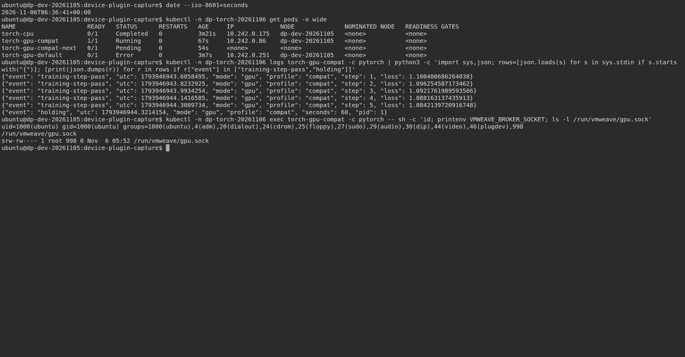
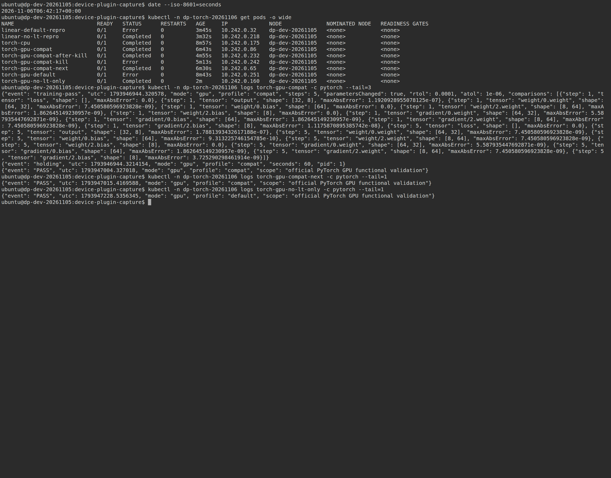
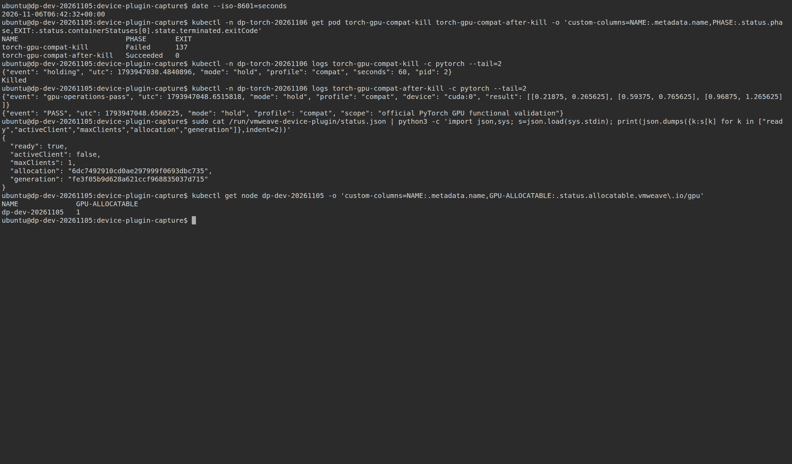

# 공식 PyTorch 이미지의 Device Plugin 기능 검증 결과

**공식 PyTorch 이미지를 수정하지 않고 GPU 기초 연산과 5-step FP32 MLP 학습을 실행했다.**
현재 조합에서는 기본 `Linear` 경로가 `libcublasLt.so.12`에서 종료 코드 139로 실패한다.
`DISABLE_ADDMM_CUDA_LT=1`을 적용하면 SGD 기본 옵션으로도 학습과 CPU 참조 검산이 통과한다.
이 조건을 포함한 사전 정의 `compat` 프로파일에서는 Pod 순차 할당, 정상 종료 및 SIGKILL 후 재사용도 통과했다.

2026-11-06에 수행한 **동작 가능성 검증**이며 성능 벤치마크는 수행하지 않았다.
기존 [Device Plugin v0.1 검증](../../../../docs/development/device-plugin-validation-2026-11-05.md)의
전용 workload 이미지 성공을 공식 PyTorch 성공으로 대체 해석하지 않고, 새 Pod로 실행했다.

## 실행 조건

| 항목 | 고정값 |
|---|---|
| 공식 이미지 | `docker.io/pytorch/pytorch:2.11.0-cuda12.8-cudnn9-runtime` |
| 실제 manifest digest | `sha256:eee11b3b3872a8c838e35ef48f08b2d5def2080902c7f666831310ca1a0ef2be` |
| 실제 PyTorch / CUDA / Python | `2.11.0+cu128` / `12.8` / `3.12.3` |
| VM / 내부 namespace | `vmweave-test-b/dp-dev-20261105` / `dp-torch-20261106` |
| VM 구성 | 4 vCPU, 8 GiB, Ubuntu 22.04.5, Kubernetes 1.35.9, CRI-O 1.35.10 |
| 실제 GPU / 외부 할당 | RTX PRO 6000 Blackwell Server Edition, compute 25%, VRAM 1024 MiB |
| Plugin / Guest | 공개 `device-plugin-v0.1.0`, Guest library SHA256 `32bf53906f6cd4fd681c7af9068aad6274ea8c972c31e57d5efaf009e74e1bc5` |
| Worker | 기존 v0.5.8 공개 digest; 이번에 runtime 소스·이미지를 변경하지 않음 |
| Pod 권한·자원 | UID 1000, supplemental GID 998, capability 제거, root filesystem 읽기 전용, `vmweave.io/gpu: 1` |
| 연결 | initContainer → emptyDir Guest library, `LD_PRELOAD`, adapter library 경로, `VMWEAVE_MIRROR_DEVICE_VA=1` |
| 모델 | FP32 Linear 32→64, ReLU, Linear 64→8; batch 32, MSE, SGD lr 0.01, seed 20261106 |
| 검산 | 5 step; step 1·5의 전체 loss/output/weight/gradient, `rtol=1e-4`, `atol=1e-6`; TF32 비활성화 |

[사전 계획](../../plans/functional.md), [고정 protocol](protocol.json), [전체 manifest](manifest.json),
[환경 원본](environment/), [소스 hash 목록](source-manifest.json)에 정확한 조건을 보존했다.
검증 코드는 `4ceebbe833e69ac3abeab1535c5acda2834330df`, 최소 재현 코드는 `linear-repro-source.json`의 커밋이다.
Pod에는 broker hostPath를 직접 선언하지 않았다. Device Plugin이 broker 소켓과 환경변수를 주입했고,
[실행 중 직접 조회](observations/injected-socket.txt)에서 소켓 접근과 `/dev/nvidia0` 부재를 확인했다.

## 실제 결과

| Pod | 조건·검증 | 결과 |
|---|---|---|
| `torch-cpu` | Guest adapter 없는 공식 이미지 import, CPU 참조 계산 | PASS, exit 0 |
| `torch-gpu-default` | 기본 옵션; CUDA 인식·H2D/D2H·덧셈·행렬곱 | 기초 연산 PASS; 학습 시작 후 FAIL, exit 139 |
| `torch-gpu-compat` | Lt 우회, SGD `foreach=False, fused=False`; 5-step 학습 | PASS, exit 0; 전체 tensor 검산·파라미터 갱신 확인 |
| `torch-gpu-compat-next` | 앞 Pod 점유 중 Pending, 종료 후 동일 학습 | PASS, exit 0 |
| `torch-gpu-compat-kill` | GPU 기초 연산 후 유지 중 Python에 SIGKILL | 의도한 exit 137; 세션·GPU 프로세스 회수 확인 |
| `torch-gpu-compat-after-kill` | 강제 종료 뒤 새 Pod에서 GPU 기초 연산 | PASS, exit 0 |
| `linear-default-repro` | optimizer 없는 단일 Linear forward | FAIL, exit 139; Python stack에서 `Linear.forward` 확인 |
| `linear-no-lt-repro` | 같은 코드에 Lt 우회만 적용 | PASS, exit 0; CPU와 출력 일치 |
| `torch-gpu-no-lt-only` | Lt 우회만 적용, SGD 기본 옵션 유지 | PASS, exit 0; 5-step 학습·전체 tensor 검산 통과 |

총 9개 Pod 중 6개는 Succeeded, 기본 Lt 경로 2개는 Failed(139), 강제 종료 시험 1개는 Failed(137)다.
기본 경로의 실패를 성공으로 바꾸어 집계하지 않는다. 기계 판독 결과는 [summary.json](summary.json)에 있다.
`torch-gpu-no-lt-only` 로그의 `profile=default`는 SGD 기본 옵션을 뜻하며,
[실제 선언](torch-gpu-no-lt-only/submitted.json)에 `DISABLE_ADDMM_CUDA_LT=1`이 별도로 들어 있다.

CPU 참조 행렬곱과 GPU 반환값은 모두
`[[0.21875, 0.265625], [0.59375, 0.765625], [0.96875, 1.265625]]`로 일치했다.
학습 검산은 실행마다 step 1·5의 20개 tensor를 전체 비교했고, 최대 절대 오차는 `1.7881393432617188e-7`이었다.
유한값, gradient 생성, 파라미터 갱신도 확인했다. A의
[전체 CPU/GPU tensor 원본](torch-gpu-compat/snapshots.pt)과 [학습 로그](torch-gpu-compat/pytorch.txt)를 보존했다.
5 step의 결과는 동작 확인이며 모델의 수렴·학습 성능 평가가 아니다.

## 기본 경로 실패와 필요한 설정

[기본 실행 로그](torch-gpu-default/pytorch.txt)는 CUDA 기초 연산 성공 뒤 `training`에서 끝나며,
[Pod 상태](torch-gpu-default/pod.json)는 exit 139다. Python 예외 처리로 잡히지 않는 native fault였다.
[커널 로그](observations/linear-kernel-faults.txt)에 `libcublasLt.so.12`의 general protection fault가 있다.

원인을 좁히기 위해 [단일 Linear 재현 코드](../../workloads/repro_linear.py)를 별도로 실행했다.
optimizer를 만들지 않아도 기본 forward에서 동일하게 실패했고,
[faulthandler 원본](linear-default-repro/pytorch.txt)에 `torch/nn/modules/linear.py`의 forward가 기록됐다.
같은 입력·코드에서 `DISABLE_ADDMM_CUDA_LT=1`만 바꾼
[대조 실행](linear-no-lt-repro/pytorch.txt)은 통과했다.
이어 [SGD 기본 옵션의 전체 학습](torch-gpu-no-lt-only/pytorch.txt)도 통과했다.
따라서 이번 MLP에서 SGD `foreach`/`fused` 변경까지 필수라는 결론은 내리지 않는다.

운영 시 이 이미지·모델 조합에는 PyTorch import 전에 다음 환경변수를 적용한다.

```yaml
env:
  - name: DISABLE_ADDMM_CUDA_LT
    value: "1"
```

이는 Guest 연결 설정에 추가하는 항목이다. 재현용 전체 선언은
[Lt 우회만 적용한 Pod](../../manifests/gpu-pod-no-lt-only.yaml),
[수명주기까지 검증한 compat Pod](../../manifests/gpu-pod-compat.yaml)를 참조한다.
선언의 namespace·node·GID는 이번 시험 값이므로 다른 VM에서는 실제 값으로 바꾼다.

현재 Guest의 중계 구현 범위와 native cuBLASLt 경로 사이의 호환성 문제가 남아 있다.
이번 실험은 실패 위치와 우회 조건을 확인했으며, native 내부 함수 단위의 원인까지 확정한 것은 아니다.
후속 runtime 개선 대상은 cuBLASLt 중계 지원 또는 미지원 경로의 명확한 오류 처리다.

## 실제 GPU 사용과 자원 반환

A 실행 중 B는 `Insufficient vmweave.io/gpu`로 Pending이었다.
[A 실행 상태](observations/compat-running-pod.json), [B Pending 상태](observations/next-pending-pod.json),
[실행 순서](compat-lifecycle.json)를 보존했다. A 컨테이너 종료 후 B가 시작되어 학습을 완료했다.
Node allocatable 값 자체를 현재 남은 자원 수로 해석하지 않았다.

[실행 중 GPU 조회](observations/compat-active-gpu.json)에서 물리 GPU PID `4096037`의
NSpid `1508`이 해당 Worker session PID와 일치했다. GPU 사용 메모리는 이 관측 시점에 724 MiB였다.
SIGKILL 시험도 [실제 session/GPU PID](observations/kill-active-gpu.json)를 확인한 뒤 수행했다.
exit 137 이후 세션이 사라졌고, 새 Pod가 GPU 연산을 완료했다.
모든 진단이 끝난 뒤 [Worker session·GPU process 없음](observations/all-tests-reclaimed-gpu.json),
[Broker activeClient=false](observations/final-broker.json), Node allocatable 1을 확인했다.

## 공식 이미지 보존과 준비 기록

이미지 선택은 [PyTorch 공식 Docker 안내](https://github.com/pytorch/pytorch#docker-image)와
[Docker Hub 태그 메타데이터](image-lock.json)에 근거했다. 공식 wheel·CUDA library는 교체하지 않았다.
CPU 및 GPU Pod에서 읽은 주요 PyTorch 파일 5개의 SHA256이 모두 같고,
모든 Pod의 `imageID`가 동일한 공식 digest와 일치한다.

큰 레이어의 다운로드가 느려 수신한 원본 byte를 보존한 뒤 구간 다운로드로 이어받았다.
중간 임시 registry token 만료와 갱신 기록도 보존했다.
최종 [원본 manifest](registry-manifest.json), 6개 레이어 및 config의 전체 SHA256을 검증한 뒤
VM 컨테이너 저장소에 등록하고, [공식 digest pull](canonical-pull.txt)로 다시 확인했다.
[등록된 image ID](official-image-inspect.json)는 config digest
`05e386c026b0e251378a79a93e878ed19829bbf556e57b90da61433cf6c7d43e`와 같다.
일부 Pod status의 `image`에는 dir import가 만든 로컬 캐시 alias가 표시되지만,
실제 제출한 `spec.image`와 `imageID`는 공식 registry digest다. 로컬 재빌드 이미지가 아니다.
[준비 기록](image-preparation.json)과 [최종 digest 검증](image-fetch.txt)을 함께 보존했다.

## 실제 터미널 캡처

PNG는 실제 VM 대화형 SSH 화면을 `tmux → ttyd → Chromium`으로 촬영했다.
출력 재생·재작성·합성은 하지 않았다. 04번은 A 실행/B Pending을 실시간 촬영했고,
완료·실패 화면은 보존된 Pod를 kubectl로 조회한 화면이다. 화면 시각은 UTC다.
[촬영 메타데이터](terminal-captures/capture.json)와 [명령·종료 코드](terminal-captures/commands.json)를 포함한다.

| 화면 | 원본 PNG |
|---|---|
| VM·Plugin·GPU 등록 | [01](terminal-captures/01-vm-and-device-plugin.png) |
| 기본 프로파일 Pod YAML 전체 | [02](terminal-captures/02-official-pytorch-pod-spec-1.png), [03](terminal-captures/03-official-pytorch-pod-spec-2.png) |
| 실행 중 학습 결과·다음 Pod Pending·주입 소켓 | [04](terminal-captures/04-compat-running-and-next-pending.png) |
| 공식 이미지 CPU baseline·파일 hash | [05](terminal-captures/05-official-image-cpu-baseline.png) |
| 기본 경로 실패·Linear 최소 재현 | [06](terminal-captures/06-default-failure-and-linear-repro.png) |
| 학습·후속 Pod 완료 | [07](terminal-captures/07-compat-training-and-reuse-completed.png) |
| 완료 Pod kubectl describe 전체 | [08](terminal-captures/08-describe-completed-pod-1.png), [09](terminal-captures/09-describe-completed-pod-2.png) |
| SIGKILL 이후 재사용·자원 반환 | [10](terminal-captures/10-sigkill-recovery-and-resource-return.png) |
| Lt 우회만 적용한 성공 조건 | [11](terminal-captures/11-no-lt-only-tested-condition.png) |







## 종료와 검증 범위

시험 VM을 정상 Halt했고, [종료 기록](shutdown.json)에서 VMI 제거 및 Channel `Stopped`를 확인했다.
강제 finalizer 제거 없이 GPU 할당을 반환했다. 검토용 VM/PVC·내부 Pod 기록·이미지 캐시는 보존했다.
다른 VM과 기존 사용자 작업 파일은 변경하지 않았다.

이번 검증 범위는 지정한 공식 이미지, 단일 VM quota, eager FP32 MLP다.
다중 CUDA client, 임의 모델·다른 이미지, AMP·분산 학습·CUDA Graph, VM 내부 HAMi 재분할의 지원을 뜻하지 않는다.
HAMi 추가 구성과 성능 벤치마크는 수행하지 않았다.

원본 파일 무결성은 이 결과 디렉터리에서 `sha256sum -c --quiet SHA256SUMS`로 확인한다.
