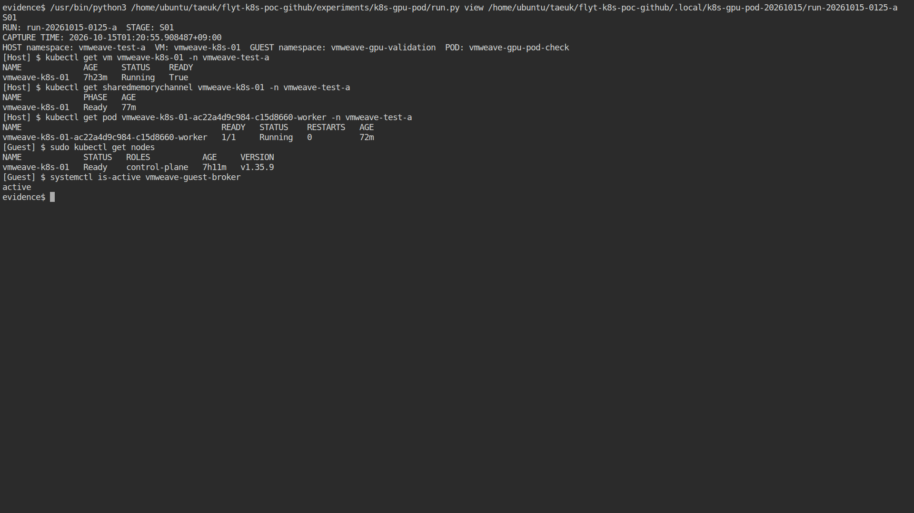
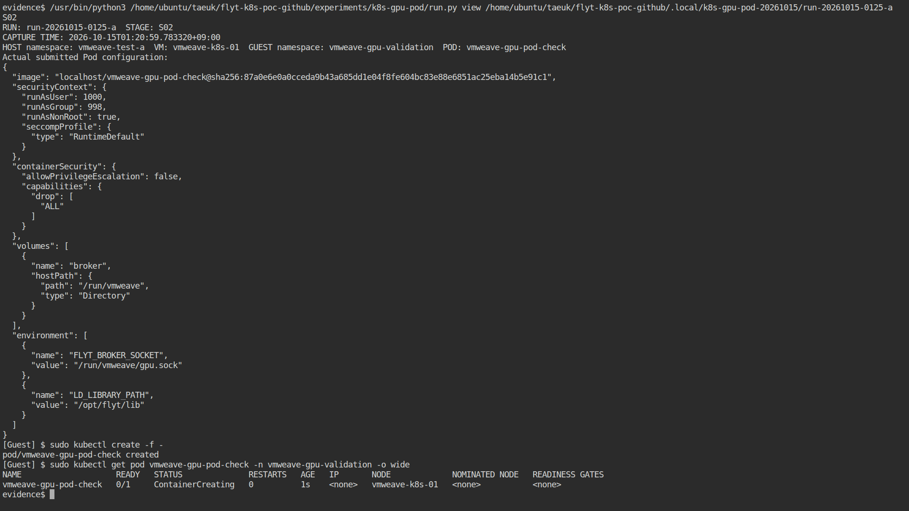
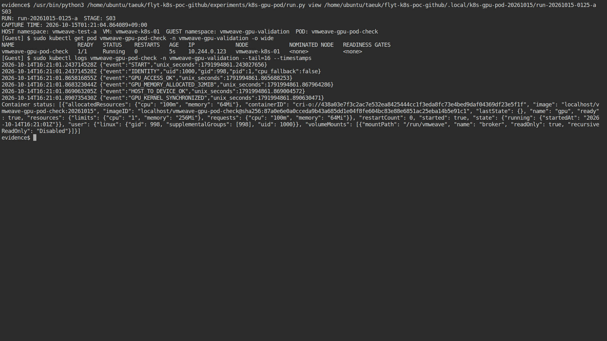
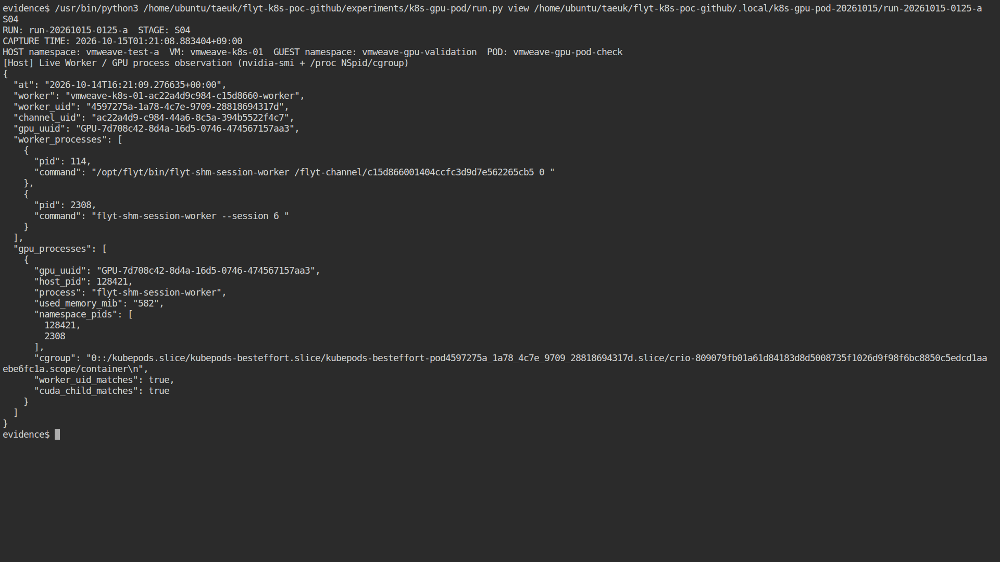
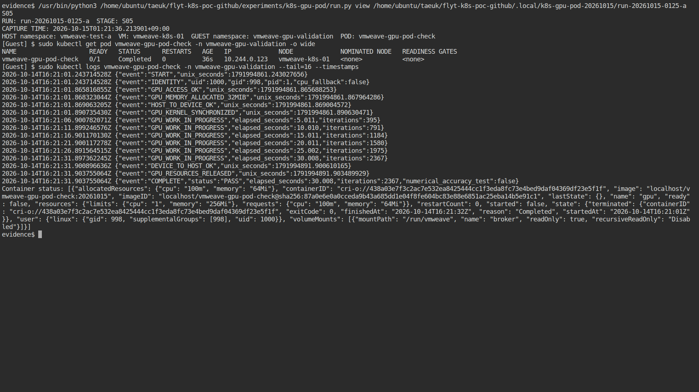
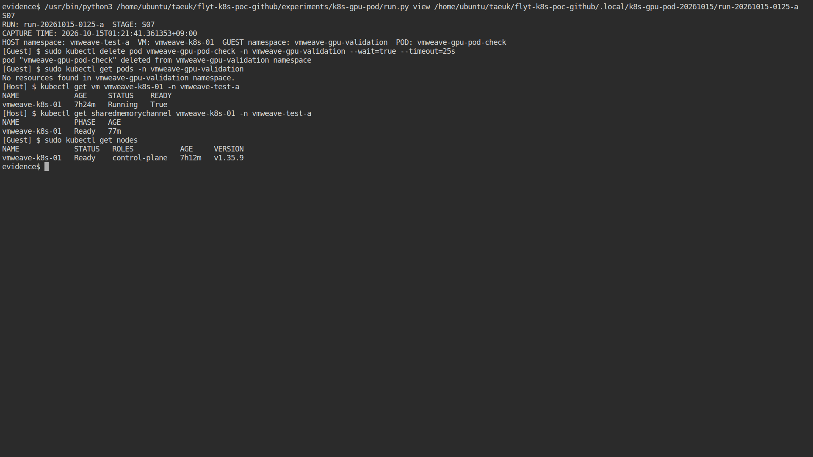

# VM 내부 Kubernetes GPU Pod 동작 확인 결과

실험일: 2026-10-15 KST

**판정: PASS.** 단일 Pod를 1회 실행했으며, `Succeeded`, 종료 코드 `0`, 재시작 `0`을 확인했다.

## 실행 환경 및 결과

| 항목 | 확인 결과 |
| --- | --- |
| run ID | run-20261015-0125-a (식별용 문자열이며 실제 시각은 아래 원본 타임스탬프 기준) |
| VM | vmweave-test-a/vmweave-k8s-01 / 내부 Kubernetes 1.35.9 |
| Pod | vmweave-gpu-validation/vmweave-gpu-pod-check |
| Pod UID | 0315ba68-6a3d-417f-a5b2-a427b8dd786b |
| 컨테이너 실행 | 2026-10-15 01:21:01~01:21:32 KST |
| GPU 작업 관측 구간 | 30.008초. 32 MiB 할당, 커널 실행·동기화·결과 복사·자원 해제 성공. |
| 최종 상태 | Succeeded / exit code 0 / restartCount 0. |

### 실행 권한 및 GPU 연결 방식

실행 권한: UID 1000 / GID 998 / 비특권 / capability ALL 제거 / RuntimeDefault seccomp.
컨테이너 이미지에 실행 파일과 Guest 라이브러리를 포함했고 broker socket 디렉터리만 read-only hostPath로 연결했다.
내부 Kubernetes의 nvidia.com/gpu 자원 요청이나 NVIDIA device plugin은 사용하지 않았다.

## 외부 GPU 실행 증거

Worker UID 4597275a-1a78-4c7e-9709-28818694317d의 자식 PID 2308과
호스트 GPU 프로세스 PID 128421을 NSpid 및 cgroup의 Pod UID로 연결했다.
GPU UUID: GPU-7d708c42-8d4a-16d5-0746-474567157aa3.
GPU 메모리 관측값 582 MiB는 CUDA context 등을 포함하는 프로세스 관측값이며
프로그램의 32 MiB 할당 요청과 동일한 의미가 아니다.
2367회 커널 반복은 화면 및 프로세스 관측을 위한 실행 횟수이며 성능 결과가 아니다.

## 화면 증거

S01 실행 전 환경, S02 Pod 생성·배치, S03 Running 및 GPU 작업 로그,
S04 Worker/GPU 프로세스 대응, S05 정상 완료, S07 정리 후 상태의 원본 PNG 6장.
실제 실행 중의 ttyd/tmux 터미널을 Chromium으로 캡처했다. 로그 재생·합성 이미지가 아니다.
S03/S04 촬영 시각은 컨테이너 실행 구간 안에 있으며 오프라인 검증기로 확인했다.
실패 Pod가 없으므로 S06 실패 화면은 해당 없음. 원본 파일과 연결 관계는 [스크린샷 색인](screenshots/index.json) 참조.


### S01 — 실행 전 환경



### S02 — Pod 생성 및 배치



### S03 — Running 및 GPU 작업 로그



### S04 — Worker와 GPU 프로세스 대응



### S05 — 정상 완료



### S07 — 정리 후 상태



## 오류 및 조치

GPU 실행 오류 0, 실패 Pod 0. 준비/관측/검증 도구 문제 7개 항목을 [errors.json](errors.json) 및 [오류·해결 기록](errors.md)에 분리 기록했다.
Playwright 경로, 이미지 반입 도구, crictl 대체 조회, C 컴파일 경고,
생성 직전 NotFound 처리, 오프라인 검증기의 생성 요청 시간 비교를 해결했다.
추가로 원본 로그의 공백·CRLF 보존 정책을 명시하여 Git 검사 문제를 해결했다.
원본 NotFound 2건과 최초 검증 실패 출력은 삭제하지 않았다. 미해결 오류 0.

## 정리 및 해석 범위

증거 보존 후 실험 Pod와 Guest에 복사한 임시 OCI 파일만 삭제했다.
전용 namespace와 반입한 이미지는 다음 사용을 위해 유지한다.
기존 VM·내부 노드 Ready, broker active, 채널 Ready를 확인했다.
VM 재시작, 프로그램 강제 종료, 동시 접근, 종료 후 재사용, PyTorch 확장 시험은 수행하지 않았다.
GPU 연산의 수치 정확성, 성능 및 범용 CUDA 호환성에 대한 결론을 내리지 않는다.

## 검증 방법

저장소 루트에서 다음 명령을 실행한다.

```bash
python3 experiments/k8s-gpu-pod/verify.py \
  experiments/evidence/results/2026-10-15-k8s-gpu-pod/run-20261015-0125-a
```

[SHA256SUMS](SHA256SUMS)는 증거 파일의 무결성을 확인하며 Git commit과 함께 보관한다.

## 주요 원본 자료

- [적용한 Pod 명세](pod.yaml)
- [최종 Pod 상태](pod-final.json)
- [컨테이너 실행 로그](container.log)
- [Kubernetes 이벤트](events.json)
- [GPU 프로세스 대응 증거](worker/live-S04.json)
- [오프라인 검증 결과](verification.json)
- [정리 후 상태](cleanup-state.json)
