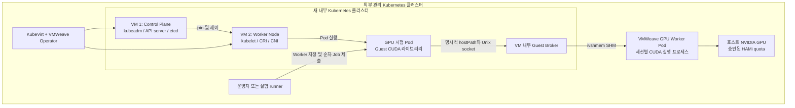

# VMWeave 기반 2노드 Kubernetes 및 GPU Pod 실험 계획

작성일: 2026-10-28 KST · 개정: **v6 — 최소 횟수의 기능·복구 검증** · 상태: **2026-10-28 실행 완료 — 기능 PASS, 외부 동시 변경에 따른 해석 제한 있음**

최종 결과와 접속 방법은 [REPORT.md](results/20261028-minimal/REPORT.md),
[HANDOFF.md](results/20261028-minimal/HANDOFF.md)를 참고한다.
실행 명세와 환경 보완은 [EXECUTION.md](installation/EXECUTION.md), 원본 증거는
[results/20261028-minimal](results/20261028-minimal/)에 기록한다. 아래 조사·실행 전 표현은 계획 작성 당시의 상태다.

## 1. 목표와 최종 범위

새 VM 두 대를 KubeVirt로 만들고, VMWeave GPU 실행 경로를 Worker VM에 연결한다.
각 VM에 Kubernetes 구성요소를 설치하여 `Control Plane 1대 + Worker Node 1대`로 구성한다.
그 클러스터의 **Worker VM에 배치한 Pod가 broker 소켓을 통해 실제 호스트 GPU 연산을 수행하고,
종료 후 CUDA 세션을 회수하여 다음 Pod가 GPU를 사용할 수 있는지** 검증한다.

GPU는 외부 관리 클러스터에서 Worker VM에 연결한다. 내부 Kubernetes의 GPU 시험 Pod에는
Guest 라이브러리, broker 소켓 마운트, 실행 환경변수와 CPU·메모리 설정을 제공한다.
시험 Pod는 지정한 Worker에 배치하고, 실험 runner가 한 번에 하나씩 실행한다.

| 구분 | 실험 질문 | 완료 조건 |
|---|---|---|
| A. 클러스터 | VM 두 대로 하나의 Kubernetes 클러스터를 운영할 수 있는가? | init/join, 두 Node Ready, 노드 간 Pod 통신·DNS·Service·재부팅 후 복구 |
| B. GPU 실행 | Worker VM 내부 Pod에서 실제 GPU를 사용할 수 있는가? | Guest 사전 확인 1회 → Pod A/B 각 1회 GPU kernel·수치 검증, 종료 후 CUDA 세션 회수·재사용 |

성공 여부는 실제 연산 결과와 호스트 GPU 실행 증거, CUDA 세션 종료와 재사용 증거로 판단한다.
장애 시에는 신규 시험 제출을 중지하고 기존 VMWeave 복구 절차를 따른다.

**실행 횟수 원칙:** 조건별 1회를 기본으로 하며, 재사용 검증만 서로 다른 Pod A/B를 한 번씩 실행한다.
단계별 통과 판정과 시험표가 같은 실행을 가리키면 증거를 공유하고 중복 실행하지 않는다.
성공한 조건은 종료한다. 실패 시에는 원인 수정 후 해당 조건과 직접 영향을 받는 조건만 재검증하고,
최초 실패와 수정·재검증 결과를 모두 보존한다. 통과할 때까지 자동으로 반복하지 않는다.

## 2. 기존 증거와 새로 확인할 부분

| 근거 | 이미 확인한 사실 | 이번 실험에서 보완할 부분 |
|---|---|---|
| [2026-10-15 GPU Pod 보고서](../evidence/results/2026-10-15-k8s-gpu-pod/run-20261015-0125-a/report.md) | 단일 VM 내부 K8s 1.35.9, 비특권 Pod 1회 성공. 32 MiB 할당, kernel 실행, 호스트 GPU PID 대응 | 2노드, 수치 정확성, 반복·회수·장애 복구는 당시 미검증 |
| [당시 환경](../evidence/results/2026-10-15-k8s-gpu-pod/run-20261015-0125-a/environment.json) | Cilium 1.20.2 및 kube-proxy 사용, 내부 Node IP `10.0.2.2` | 이 주소를 새 VM 두 대에 그대로 사용하지 않음. 직접 통신 가능한 고유 Node IP 필요 |
| [기존 실행 코드](../k8s-gpu-pod/run.py), [검증 프로그램](../k8s-gpu-pod/gpu_pod_check.c) | 소켓 디렉터리 read-only 마운트, Guest 라이브러리 포함 이미지, PID 증거 수집 | 기존 C 프로그램은 결과값 비교를 하지 않음. 새 correctness 프로그램과 2노드·조건별 실행용 수집·검증 확장 필요 |
| [VM lifecycle 안내](../../docs/getting-started/first-vm.md), [broker 구현](../../runtime/shm/control/guest_broker.py) | VM당 활성 CUDA 프로그램 1개, busy 접근은 오류 46, VM lifecycle Channel 지원 | 컨테이너 권한·FD 전달·세션 회수와 후속 Pod 실행 검증 |
| [2026-10-27 경로 최적화 보고서](../ai-passthrough/results/20261027-path-optimization-vm/REPORT.md) | 후보 판정 `DO_NOT_PROMOTE` | 후보를 기본값으로 승격하지 않음. 본 실험은 검증된 baseline digest를 고정 |

문서 조사 기준 저장소 HEAD는 `da0ae2a5d4fc1f426b425c70ab724edc98cc9aee`이며,
작업 트리에 기존 변경과 미추적 파일이 있다. 실제 실행 소스는 HEAD만으로 식별하지 않고
관련 파일 hash·diff·이미지 digest도 고정한다. 현재 배포 상태와 가용 자원은 아직 조회하지 않았다.

## 3. 목표 구조와 자원의 의미



- **VM 생성·부팅은 KubeVirt**, GPU 전달·수명 관리는 VMWeave의 역할이다.
- “Kubernetes Worker Node”는 VM 2, “VMWeave GPU Worker”는 외부 클러스터의 별도 Pod다.
- 내부 Kubernetes는 별도 API server·etcd·CNI·kubeconfig를 사용한다. VM 안에서 컨테이너를
  실행하므로 추가 VM을 중첩 실행하는 nested KVM은 요구하지 않는다.
- Control Plane VM에는 GPU Channel을 만들지 않는 것을 기본으로 한다. Worker VM에만
  `GPUProfile → GPURequest → SharedMemoryChannel(lifecycle=VM)`을 구성한다.
- Worker VM과 해당 SHM backing·VMWeave GPU Worker는 동일 물리 노드에 배치한다.
  이번 PoC에서는 두 VM을 같은 호스트에 둘 수 있으나, 물리 호스트 장애 내성은 입증하지 않는다.

**GPU 사용 범위:** Pod는 외부 VMWeave/HAMi에서 Worker VM에 승인한 GPU quota 안에서 연산한다.
내부 Pod의 CPU·메모리 제한과 외부 GPU quota를 구분한다. 처음에는
1 Pod / 1 GPU 사용 컨테이너 / 1 CUDA client 프로세스로 제한한다.

기본 시험에서는 이전 Pod와 CUDA 세션이 모두 종료된 뒤 다음 Pod를 제출한다.
이 순서는 실험 runner가 관리한다. 동시에 다른 Guest CUDA 프로그램을 실행하지 않는다.
Guest의 `nvidia-smi` 성공 대신 kernel 결과값과 외부 GPU 프로세스 대응으로 실제 실행을 확인한다.

## 4. 초기 구성안과 실행 전 확정 항목

아래는 예약 요청안이며 실제로 확보되었다는 뜻이 아니다.

| 항목 | Control Plane VM | Worker VM |
|---|---|---|
| 이름 | `vw-k8s-cp-01` | `vw-k8s-worker-01` |
| vCPU / RAM | 4 / 8 GiB | 4 / 16 GiB |
| 영구 OS PVC | 40 GiB | 80 GiB |
| OS | 호환 Ubuntu 22.04 이미지, 고정 checksum | 동일 기반 이미지 |
| GPU | 없음 | 승인 quota 1개: 초기 제안 compute 50%, memory 2 GiB |
| 기본 워크로드 | control-plane taint 유지 | CPU/GPU 실험 Pod |
| Pod의 GPU 연결 | 없음 | Guest 라이브러리 + broker 소켓 마운트 + 실행 환경변수 |

VM 외에 virt-launcher, GPU Worker, SHM PVC, 이미지 저장 공간과 호스트 메모리 여유를 별도 산정한다.
SHM backing PVC는 OS PVC와 구분하고, 크기·권한·local PV node affinity는 baseline 계약을 따른다.
50%·2 GiB는 설정값이며 실제 성능 비율이나 제한 정확도를 이미 보장한 수치가 아니다.

소프트웨어는 기존 성공 환경의 **Kubernetes 1.35.9 + CRI-O + Cilium 1.20.2**를 재현 후보로 삼는다.
0단계에서 CRI-O 정확한 버전, 패키지 공급 가능성, Guest kernel/CNI 호환성과 기존 Cilium 설정을
확인하여 `versions.json`으로 잠근다. 변경이 필요하면 두 VM에 동일한 새 조합을 적용하고 사유를 기록한다.
외부 클러스터 버전을 내부에 그대로 복사하거나 `latest`를 사용하지 않는다.

### Kubernetes 설치 스크립트 재사용

설치는 [Kubernetes_Installer_2026](https://github.com/WoogiBoogi1129/Kubernetes_Installer_2026)의
기존 스크립트를 기반으로 진행한다. 설치 로직을 새로 작성하지 않고 VM별 설정과 필요한 최소 변경만 준비한다.
확인한 소스는 commit `25b80e29bf2de6ec2363f052ea26e5c56210eb03`이며,
로컬 checkout과 조회 시점의 원격 HEAD가 일치했다.

| 대상 | 재사용할 파일 | 실행 단계 |
|---|---|---|
| Control Plane VM | [k8s-setup.sh](https://github.com/WoogiBoogi1129/Kubernetes_Installer_2026/blob/25b80e29bf2de6ec2363f052ea26e5c56210eb03/k8s-setup.sh) | `system-prep`, `apt-repos`, `install-packages`, `init-cluster`, `kubeconfig`, `install-helm`, `install-cilium` |
| Worker VM | [k8s-worker-setup.sh](https://github.com/WoogiBoogi1129/Kubernetes_Installer_2026/blob/25b80e29bf2de6ec2363f052ea26e5c56210eb03/k8s-worker-setup.sh) | `system-prep`, `apt-repos`, `install-packages`, `join-cluster` |

두 스크립트 모두 `--step <단계명>`과 `--from-step <단계명>`을 지원한다.
이번에 두 파일의 `bash -n`과 `--list-steps` 확인은 통과했다. 설치 본체는 실행하지 않았다.
실험에서는 `--step`을 사용해 준비·초기화·조인·CNI 완료 확인을 나누고, 실패 시 완료 상태를 확인한 뒤
해당 단계부터 재개한다. 기존 init/join 상태가 있으면 전체 재실행이나 자동 reset을 하지 않는다.
설치 명령은 새 Guest VM 안에서만 실행한다. 외부 관리 클러스터 호스트에 적용하지 않는다.

다음 차이는 실행용 복사본에 최소 수정 또는 고정 설정으로 반영하고 원본과의 diff를 보존한다.

| 확인 항목 | 소스에서 확인한 동작 | 실험에 적용할 설정 |
|---|---|---|
| Kubernetes/CRI-O 버전 | `KUBERNETES_VERSION`은 minor 형식(`v1.35`)이며 apt는 해당 저장소의 후보 패키지를 설치 후 hold | 두 VM에 동일 minor를 명시. 정확한 kubeadm/kubelet/kubectl·CRI-O 패키지 버전은 apt 가용 목록에서 고정하여 설치. minor 지정만으로 1.35.9가 보장된다고 가정하지 않음 |
| CRI-O 저장소 | CP는 `download.opensuse.org`, Worker는 `pkgs.k8s.io/addons` 사용 | 선택 minor와 정확 버전을 제공하는 동일 저장소로 통일 |
| API 및 Node 주소 | CP init은 Pod CIDR·CRI socket만 명시, Worker join은 endpoint·token·CA hash·선택 node name 입력 | 기존 init/join 호출에 실험용 kubeadm 설정 파일을 연결하여 CP IP·endpoint/SAN·양쪽 Node IP·Service CIDR·정확한 K8s 버전 고정. 지원하지 않는 환경변수로 설정한 것으로 간주하지 않음 |
| Cilium/Pod CIDR | `CILIUM_VERSION` 기본 1.18.6, `CIDR` 기본 10.85.0.0/16, IPAM은 `kubernetes` | 재현 후보인 Cilium 1.20.2와 충돌 없는 Pod CIDR을 명시. 커널·K8s 호환성 및 실제 Helm 값·MTU 확인. init 설정 파일과 `CIDR` 일치 |
| cgroup·서비스 | Worker는 CRI-O systemd 설정과 kubelet enable을 명시. CP는 같은 처리를 모두 명시하지 않음 | 양쪽의 kubelet/CRI-O cgroup 일치와 부팅 후 자동 기동 확인·필요 설정 보완 |
| 보조 도구 | Helm 설치기와 Cilium CLI는 실행 시 최신 배포를 조회 | 실행에 사용할 도구 버전·다운로드 checksum 고정. 단계별 실행에서도 동일한 설정 전달 |

Worker join 정보는 대화형 입력이다. 실행 도구는 endpoint·token·CA hash·node name을 순서대로
전달하고, token을 포함한 입력·초기화 출력·오류 로그는 공개 증거에 남기지 않는다.
CP taint를 해제하는 README의 단일 노드 예시는 적용하지 않는다. `shell-config`는 선택 사항이며,
CRIU 테스트·제거 스크립트는 이번 설치 실행 경로에 포함하지 않는다.

### 네트워크 설계

1. 우선안은 기존 사용 가능한 Multus/bridge 기반 실험망에 두 VM의 고유하고 지속적인 IP를
   부여하는 것이다. 관리용 기본 NIC와 클러스터용 NIC를 구분하고 kubelet Node IP 및
   API advertise address를 클러스터용 NIC로 명시한다.
2. 사용 가능한 공통 L2/라우팅 망이 없으면 네트워크 구성이 0단계의 선행 작업이다.
   기본 masquerade의 VM 내부 사설 IP가 두 VM에서 같을 수 있으므로 그대로 join하지 않는다.
   새 bridge/VLAN이나 별도 overlay가 필요하면 대상·라우트·롤백을 명세에 추가한 뒤 진행한다.
   ([KubeVirt 네트워크 문서](https://kubevirt.io/user-guide/network/interfaces_and_networks/))
3. 외부 Pod/Service CIDR, 호스트·VM subnet, VPN과 겹치지 않는 내부 Pod/Service CIDR을 정한다.
   API endpoint는 고정 CP IP 또는 그 IP를 가리키는 DNS로 고정하고 인증서 SAN에 반영한다.
4. Worker→CP API TCP 6443, CP→Worker kubelet TCP 10250, 노드 간 CNI transport 및
   DNS·registry 접근을 확인한다. etcd 포트는 단일 CP 내부 용도다. NodePort는 초기 필수 범위에서 제외한다.
5. Cilium의 사용할 모드·인터페이스·포트·MTU를 고정한다. 외부 망과 내부 터널의 encapsulation을
   고려해 작은 패킷과 MTU 근처 패킷을 모두 검사한다. kube-proxy는 기존 성공 환경처럼 유지한다.

## 5. 작업 단계와 통과 기준

### 0단계 — 읽기 전용 현황 확인 및 실행 명세 확정

- 외부 kube-context, KubeVirt/VMWeave/HAMi 상태, GPU UUID·사용량·승인 quota,
  가용 CPU/RAM/PV 및 기존 서비스 상태를 수집한다.
- 기존 두 VM을 재활용하지 않고 새 VM 두 대와 전용 namespace `vmweave-nested-k8s`를 사용한다.
  과거 GPU 번호·IP·UID를 하드코딩하지 않고 현재 조회 결과로 채운다.
- OS 디스크 원본, 각 이미지 digest, Guest/broker/Worker ABI, CNI 설정, IP/CIDR,
  root/SHM PVC와 node affinity를 실행 명세에 기록한다.
- 외부와 내부 kubeconfig는 별도 경로로 만들고 모든 실행 명령에 대상 context를 명시한다.
- 설치 저장소의 고정 commit·원본 파일 hash, VM별 입력과 최소 변경 diff를 실행 명세에 포함한다.
  버전·주소·저장소 설정표를 확정하고 설치 script의 단계별 실행을 기존 runner에 연결한다.

**Gate 0:** 버전·가용 quota·배치 노드·네트워크·스토리지와 기존 서비스 보호 범위가 확정되어야 생성에 진입한다.
현재 GPU 여유가 없거나 기존 시스템 재구성이 필요하면 그 의존성을 기록한다.

### 1단계 — VM 두 대 준비 및 설치 스크립트의 공통 단계 실행

- 영구 root PVC에서 부팅하도록 VM을 생성한다. 서로 다른 hostname, MAC, product UUID,
  machine-id와 SSH host key를 확인하고 기존 클러스터 인증서가 복제되지 않게 한다.
- 시간 동기화, DNS, 패키지/이미지 반입과 영구 root PVC 구성을 확인한다.
  재부팅 후 파일 보존은 4단계 K2/K3에서 확인하여 별도의 사전 재부팅을 추가하지 않는다.
- CP는 `k8s-setup.sh`, Worker는 `k8s-worker-setup.sh`의 `system-prep` → `apt-repos` →
  `install-packages` 단계를 각각 재사용한다. 독립된 두 VM의 준비는 동시에 진행할 수 있다.
  swap 비활성화, kernel 기능·sysctl, CRI 활성화와 kubelet/runtime의 systemd cgroup 일치를 확인한다.
  ([kubeadm 준비 조건](https://kubernetes.io/docs/setup/production-environment/tools/kubeadm/install-kubeadm/),
  [컨테이너 런타임 설정](https://kubernetes.io/docs/setup/production-environment/container-runtimes/))
- Worker의 broker·Guest artifact는 새 GPU binding 이전의 offline 디스크 또는 준비 단계에서 설치한다.
  VM lifecycle용 Channel을 만들고 새 부팅에서 config drive/layout을 받게 한다.
  활성 broker를 교체하거나 기존 SHM ring에 재접속하는 설치 방식을 사용하지 않는다.
- Channel Ready, broker active, 지원 CUDA smoke의 Guest 직접 실행을 1회 확인한다.
  이 성공 증거를 3단계 사전 확인에도 사용한다.

**Gate 1:** VM 두 대의 고유 IP·상호 통신·영구 root PVC 연결과 Worker의 baseline GPU 경로 성공.
GPU 경로가 실패해도 A의 CPU 클러스터 구축은 독립 진행할 수 있지만 B는 통과 처리하지 않는다.

### 2단계 — 설치 스크립트로 Control Plane 초기화 및 Worker 조인

1. CP의 `init-cluster` 단계를 실험용 고정 kubeadm 설정으로 실행한다. 이어 `kubeconfig`와
   `install-helm` 단계를 실행하고 API `/readyz`를 확인한다.
2. 제한된 수명의 token으로 Worker의 `join-cluster` 단계를 실행한다. API 도달성과 Node 등록을
   확인한다. CNI 설치 전 Node NotReady는 중간 상태이며 이 시점에 최종 Ready를 요구하지 않는다.
3. CP에서 고정 Cilium 버전·설정으로 `install-cilium`을 실행한다. 이 단계는 `cilium status --wait`를
   포함하므로 Worker 조인 뒤 실행하여, 일반 Pod 배치가 가능한 노드 없이 기다리는 순서를 피한다.
4. CP taint를 유지한다. 노드 간 통신 검사용 임시 CPU Pod에만 명시적으로 toleration을 준다.
5. 두 Node Ready, CoreDNS/CNI 정상, Node InternalIP·PodCIDR를 검사한다.
6. 양쪽 노드에 CPU Pod를 놓아 Pod IP 통신, DNS, ClusterIP Service, `logs/exec`를 검증한다.
   일반 Deployment의 생성·삭제·재생성을 1세트 확인하고 K1 증거로 사용한다.

**Gate 2 / A 기본 통과:** 두 Node Ready를 30초 간격으로 2회 확인하고, 노드 간 통신·DNS·Service 검사를 각각 1회 성공한다.
스크립트 종료 코드와 별개로 이 합격 기준을 확인한다. kubeadm 설정은
[공식 클러스터 구성 안내](https://kubernetes.io/docs/setup/production-environment/tools/kubeadm/create-cluster-kubeadm/)와 대조한다.

### 3단계 — Pod의 GPU 연산 및 순차 재사용 검증

- 기존 `experiments/k8s-gpu-pod/`의 이미지 구성·수집 방법을 새 실험 디렉터리에 이식한다.
  기존 결과와 runner를 덮어쓰지 않는다. Guest 라이브러리와 프로그램을 이미지에 포함하고 digest를 고정한다.
- 1단계 Guest smoke 성공 후 Worker에 Pod A를 1회 실행한다. A의 연산·회수 성공을 확인한 뒤
  같은 이미지의 새 Pod B를 1회 실행한다. 두 Pod의 UID와 CUDA 세션은 구분해 기록한다.
  GPU Pod는 실제 Worker의 hostname label을 nodeSelector로 지정하여 배치한다.
- 별도 CRI 컨테이너 실행은 정상 경로에서 생략한다. Pod 경계에서 문제가 발생한 경우에만
  Guest/CRI/Pod 중 실패 지점을 좁히는 진단으로 실행하고 정식 성공 표본과 구분한다.
- `VMWEAVE_BROKER_SOCKET=/run/vmweave/gpu.sock`, 호환 라이브러리 탐색 경로를 지정한다.
  UID 1000 및 **새 VM에서 조회한 vmweave GID**를 사용한다. 과거 GID 998을 고정하지 않는다.
- GPU 앱은 비특권, capability 제거, RuntimeDefault seccomp로 실행한다. broker 소켓 디렉터리만
  read-only 연결하고 BAR·`/dev/mem`·PCI sysfs·전체 `/dev`·hostPID는 앱에 제공하지 않는다.
  read-only 디렉터리 마운트가 소켓의 양방향 통신을 막는다는 의미는 아니다.
- Unix socket 접근, 필요한 memfd/SCM_RIGHTS 전달과 라이브러리 ABI를 확인한다.
  CPU fallback 없이 PTX vector 연산을 실행하고 모든 원소를 CPU reference와 비교한다.
  정수 연산은 정확 일치, FP32 확장 시에는 입력·연산별 허용오차를 사전에 고정한다.

**Gate 3 / B 기본 통과:** Pod A/B가 각각 exit 0·결과 일치하고, 외부 GPU 실행 증거와 대응하며,
A의 CUDA 세션 회수 후 B가 성공한다. 이 두 실행을 G1/G3의 증거로 공유한다.
기존 실행기의 API 성공 로그만으로 correctness를 대신하지 않는다. 고정 입력의
H2D → kernel → sync → D2H → 결과 비교 → free를 Pod당 1회 수행하며, 관측만을 위한
30초 kernel 반복이나 warmup은 넣지 않는다. 짧은 실행의 PID 증거를 놓치지 않도록 CUDA 세션
준비 후 수집기의 확인 신호를 받아 연산을 진행하며, 신호 대기는 Pod deadline 안에서 제한한다.
장애 주입용 Pod도 같은 준비 신호를 사용하고, 해당 조건의 장애 주입 후 연산 시도·오류를 관측한다.

#### GPU Job 명세와 실행 순서

**신규 개발 범위:** GPU Job 명세 생성, 소켓·UID/GID·배치 노드 확인,
수치 검증 프로그램, 순차 실행 및 GPU 세션 증거 수집·검증 도구.

아래는 Job의 Pod template에 넣을 **발췌 예시**다. 실제 명세에는 조회한 Worker hostname,
고정 이미지 digest, vmweave GID와 위의 비특권 보안 설정을 반영한다.

```yaml
spec:
  restartPolicy: Never
  nodeSelector:
    kubernetes.io/hostname: REPLACE_WITH_WORKER_HOSTNAME
  containers:
  - name: gpu
    image: "REPLACE_WITH_PINNED_IMAGE_DIGEST"
    env:
    - name: VMWEAVE_BROKER_SOCKET
      value: /run/vmweave/gpu.sock
    - name: LD_LIBRARY_PATH
      value: /opt/vmweave/lib
    resources:
      requests:
        cpu: "100m"
        memory: "128Mi"
      limits:
        cpu: "1"
        memory: "512Mi"
    volumeMounts:
    - name: broker
      mountPath: /run/vmweave
      readOnly: true
  volumes:
  - name: broker
    hostPath:
      path: /run/vmweave
      type: Directory
```

- 초기 Job은 `parallelism: 1`, `completions: 1`, `backoffLimit: 0`으로 설정하고
  Pod deadline을 지정하여 실패가 자동 재시도로 가려지지 않도록 한다.
- runner는 실제 배치 Node, 단일 GPU 컨테이너, 소켓 마운트, UID/GID와 이미지 digest를 확인한다.
- 하나의 Job 설정만으로 서로 다른 Job 사이의 동시 실행을 막을 수는 없다.
  runner는 실행 중인 시험 Pod·Guest 직접 실행·CUDA 세션이 없는지 확인하고 한 Job씩 제출한다.
- Pod 완료와 broker EOF/CUDA 자식 종료를 각각 관측한다. 이전 CUDA 자식이 남아 있으면
  다음 Job을 제출하지 않고 회수 실패로 기록한다. 정상 종료 후 다음 독립 Pod의 결과도 확인한다.
- 오류 발생 시 신규 제출을 중지하고 이미 실행 중인 시험 Pod와 CUDA 세션을 확인·정리한다.
  복구가 필요한 경우 기존 계약에 따른 VM 세대 교체 등을 수행하고, 이전 세션 회수와
  복구 후 검증 Pod 1회의 결과·회수 성공을 확인한 뒤 다음 조건으로 넘어간다.
  동일 복구 확인을 위해 Guest smoke와 Pod 실행을 중복하지 않으며, 원인 진단이 필요할 때만 추가한다.

### 4단계 — 조건별 1회의 운영·복구·제한 검증

아래 횟수는 최초 성공 경로의 실행 수다. 장애·재부팅마다 복구 후 검증 Pod 1회는 필요하며,
추가 반복 표본을 수집하지 않는다. 이미 완료한 K1/G1/G3는 여기서 다시 실행하지 않는다.

| ID | 시험 | 최소 실행 횟수 | 사전 판정 기준 / 증거 |
|---|---|---|---|
| K1 | 두 노드 CPU 클러스터 | 2단계 1세트 재사용 | Gate 2 통과 및 일반 Deployment 재생성 성공 |
| G1 | GPU 기본 연산 | 3단계 Pod A/B 각 1회 재사용 | 32 MiB급 버퍼, H2D → PTX kernel → sync → D2H → free, 두 Pod 모두 결과 일치 |
| G2 | 소켓 없는 대조 Pod | 1회 | 소켓 마운트가 없는 동일 이미지 Pod에서 GPU 경로 접근 실패, 호스트의 새 CUDA 세션 없음 |
| G3 | 순차 Pod 재사용 | 3단계 A → B 1세트 재사용 | A 완료 후 60초 내 CUDA 세션 회수 확인, 그 뒤 B의 결과 일치. 새 Pod 쌍 추가 없음 |
| G4 | Pod 삭제 및 SIGKILL | 정상 삭제 1회, SIGKILL 1회; 각 조건 후 검증 Pod 1회 | 실행 중인 시험 Pod/프로세스를 조건별로 종료. 60초 내 기존 CUDA 자식 종료, 후속 Pod 결과·회수 성공 |
| G5 | kubelet 재시작 | 1회 + 후속 검증 Pod 1회 | 실행 중이던 시험 Pod·CUDA 세션의 유지/종료 관측. 120초 내 Node Ready 확인, 기존 작업 완료·회수 후 후속 Pod 성공 |
| G6 | broker 장애와 수동 복구 | broker 중단 1회 + 복구 후 검증 Pod 1회 | 신규 제출 중지 후 실험 Worker VM의 broker만 중단. 실행 중 앱 오류/timeout과 CUDA 세션 관측. VM 세대 교체 등 복구 착수부터 10분 내 후속 Pod 성공 |
| K2 | Worker VM 재생성 | Halted→Always 1회 + 검증 Pod 1회 | workload 종료·신규 제출 차단 후 재생성. root 상태·노드 identity 보존, 새 VMI/Worker/allocation 세대, broker·Channel 확인을 거쳐 10분 내 Node/GPU/후속 Pod 복구 |
| K3 | CP VM 재생성 | 1회 + 검증 Pod 1회 | etcd·PKI·클러스터 identity 보존, 10분 내 API/두 Node/새 GPU Job 복구. 중단 중 API 사용 불가 |
| Q1 | VM GPU 메모리 quota | 이내: G1 재사용; 초과 1회 + 후속 작은 작업 1회 | 초과 할당은 명시적 오류, 후속 작은 작업 결과·회수 성공, CP·다른 서비스 영향 없음. 실패 시 제한 실패로 별도 판정 |

실행 순서는 K1 → G1/G3 → G2 → G4 → G5 → K2 → K3 → Q1 → G6이다.
G6의 복구에 VM 재생성이 필요해도 장애 복구와 정상 재생성은 조건이 다르므로 K2를 대체했다고 처리하지 않는다.
Q1의 작은 작업을 G6 장애 주입용으로 이어 쓰지 않는다. 각 조건은 이전 CUDA 세션 회수 후 시작한다.

G6에서는 현재 broker service의 `Restart=no` 및 transport 실패 후 새 VM runtime을 요구하는
계약을 고려한다. 무조건 service restart로 기존 SHM ring을 재사용하지 않는다.
backend 장애를 Kubernetes가 자동 감지·격리하는 것은 기본 합격 조건이 아니다.
발생·관측·운영 명령 시작·복구 시각을 각각 남긴다. 수동 또는 호출형 runner 복구를
“자동 복구”로 표현하지 않는다.

G4는 정상 Pod 삭제와 컨테이너 프로세스 SIGKILL을 시험한다. Node와 연결이 끊긴 상태에서
Pod API 객체만 강제 삭제하고 다음 시험을 시작하지 않는다. 이전 프로세스의 종료를 입증할 수 없다면
신규 제출을 막고 회수 실패로 기록한다. G5에서는 재시작 전 실행 중이던 Pod와 CUDA 세션의 상태도 확인한다.

Q1의 GPU 메모리 오류와 Pod의 CPU 메모리 제한으로 인한 OOMKilled를 구분한다.
메모리 quota에서 CUDA context 등의 비용을 고려하며 요청 바이트와 NVML 사용량을 동일시하지 않는다.
compute 50% 설정의 정밀한 성능 격리는 이번 필수 합격 조건이 아니며 별도 실험으로 남긴다.

**실행 시간 기록:** 위 시험에서 발생한 Pod 생성→Running, CUDA 연산·동기화,
종료→세션 회수, 장애→복구 시간을 부가 기록한다. 성능 비교용 독립 세션·warmup·반복 측정은
실행하지 않는다. 기록한 단일 실행 시간을 통계적 성능 결과나 안정성 보장으로 해석하지 않는다.

## 6. 접근 통제와 결과 해석 범위

- 기본 PoC의 사용자는 내부 클러스터를 신뢰하는 실험 사용자다. GPU 시험 Pod에는 broker 소켓과
  적절한 파일 접근 권한을 제공하고, 일반 CPU Pod에는 소켓을 노출하지 않는다.
- G2는 소켓 없는 대조 Pod의 접근 실패를 확인한다. 임의 hostPath를 사용할 권한이 있는 사용자가
  소켓에 접근하는 것까지 차단했다는 증거는 아니다. VM root나 클러스터 관리자의 우회 방지를 주장하지 않는다.
- Pod의 실행 순서와 동시 실행 방지는 실험 runner가 관리한다. 기본 workload는 종료하는 Job이며,
  하나의 Pod에서 복수 GPU 프로세스·sidecar가 동시에 접속하는 사용법은 현재 broker 계약 밖이다.
- 단일 CP는 HA가 아니다. CP 중단 시 API/스케줄링 중단, 유일한 Worker 중단 시 GPU 작업 중단은
  구조적 제약이다. 이번 “운영 가능”은 제한된 PoC의 기능 실행·재시작·회수 가능성을 뜻한다.
  장시간 연속 운영 안정성은 이번 검증 범위에 포함하지 않는다.
- GPU kernel 성공을 CUDA/PyTorch 전체 호환성으로 확대하지 않는다. 이번 실행은 고정 입력의
  기능·회수·복구 확인이며, 별도 학습 workload나 통계적 성능 비교는 포함하지 않는다.

## 7. 증거·판정·종료 상태

다음 구조로 실행 증거를 보존했다. 실제 결과는 상단 보고서 링크를 참고한다.

```text
experiments/nested-k8s-gpu/
  PLAN.md
  manifests/       # outer VM/Channel/PVC, inner kubeadm/CNI/Job
  installation/   # 설치기 원본 commit/hash, 최소 변경 patch, 비밀값 없는 VM별 설정
  runner/          # 준비·순차 실행·수집·검증·정리
  workloads/       # 수치 검증 프로그램과 고정 이미지 빌드 입력
  results/<KST-date-run-id>/
    inventory/    versions.json    object-identities.json
    cluster/      gpu/             lifecycle/        recovery/
    timings/      raw/             verification.json
    REPORT.md     errors.md        SHA256SUMS
```

- 대응 관계: 외부 VM/VMI/Channel/allocation UID → 내부 Node/Pod UID·container ID →
  broker session/epoch → 외부 VMWeave Worker UID·CUDA child PID → 호스트 GPU PID·UUID.
  PID namespace의 NSpid와 cgroup으로 연결하고 GPU 이용률 상승만으로 실행을 증명하지 않는다.
- 명령·종료 코드·원본 로그·이벤트·timestamps·manifest·hash를 보존한다. 실패한 시도도 남기고
  재시도는 새 attempt로 기록한다. 시간차는 각 호스트 offset을 수집하고 duration은 monotonic clock으로 잰다.
- SSH 비밀키, join token, kubeconfig credential, Secret 원문은 증거 공개 대상에서 제외한다.
- A/B/운영·quota를 각각 PASS/FAIL/BLOCKED/NOT_RUN으로 판정한다.
  A+B 및 G2/G3 통과 시 “2노드 클러스터에서 broker 소켓을 연결한 Pod의 실제 GPU 연산·회수·재사용 가능”으로 판정한다.
  운영 시험 G4/G5/G6/K2/K3까지 통과하면 “시험한 조건에서 2노드 GPU PoC의 순차 실행·수동 복구 확인”으로 판단한다.
  조건별 1회 성공은 장기 안정성·성공률·재현성의 통계적 검증이 아님을 결과에 명시한다.
  Q1 결과는 외부 VM GPU quota 판정으로 별도 표시하며 실패하면 자원 제한 보장을 주장하지 않는다.

**중단 기준:** 기존 서비스의 이상, 의도하지 않은 GPU UUID 사용, 데이터 불일치, 해제되지 않는 CUDA
프로세스/SHM mapping, 의도하지 않은 동시 CUDA 실행, 다른 namespace 영향이 발견되면 해당 단계의 신규 실행을 중지한다.
읽기 전용 증거를 수집한 뒤 실험 대상만 회수한다. 전역 GPU reset·드라이버 재바인딩·공유 Operator 업그레이드는 범위 밖이다.

**성공 후 기본 종료 상태:** 사용자가 이어서 확인할 수 있도록 새 VM 2대·클러스터·Worker GPU Channel을
유지하고, 테스트 Job·부하만 종료한다. quota 예약이 유지됨을 결과에 표시하고 접속 방법·재현 명령을 전달한다.
마지막 G6 복구 후 검증 Pod의 성공·세션 회수 증거를 인계 확인으로 사용하고,
추가 GPU smoke는 실행하지 않는다. 인계 문서에는 순차 Job 실행 방법과
backend 장애 시 신규 제출 중지·세션 정리·VM 복구 절차를 포함한다.

**실험 환경 철거 절차:** 증거와 필요한 OS/etcd 데이터를 보존 → 신규 제출 중지 →
내부 GPU Job 종료·CUDA 자식 회수 확인 →
Worker VM Halted 및 Channel의 정상 Stopped/detach 확인 → 계약에 따른 drain/최종 회수 →
실험 VM·Channel·Request 정리 → 비사용 확인 후 실험 PVC/PV·namespace 정리.
강제 finalizer 제거로 회수 완료를 꾸미지 않는다. 기존 서비스와 공유 인프라는 삭제 대상이 아니다.

## 8. 최종 실행 순서와 시간 기록

1. 현황·가용 자원·버전을 확인하고 새 VM 두 대를 준비한다.
2. Kubernetes_Installer_2026의 CP/Worker 스크립트로 독립 클러스터를 구성하고 K1을 확인한다.
3. Guest GPU 사전 확인 1회와 Pod A/B 각 1회로 연산·정확성·회수·재사용을 확인한다.
4. 나머지 대조·종료·재시작·quota·broker 장애 조건을 시험표의 최소 횟수만 수행한다.
5. 각 조건의 성공·실패와 원본 증거를 정리하고, 성공한 VM·클러스터는 검토용으로 유지한다.

단계별 고정 일수와 전체 작업일 추정은 실행 기준에서 제거한다. 환경 준비·설치·GPU 시험·분석의
실제 시작/종료 시각을 기록하고, 첫 설치와 Pod A/B 완료 후 남은 작업의 소요시간을 갱신한다.
시험표의 60초·120초·10분은 합격 판정을 위한 제한시간이며 예상 소요시간이나 의무 대기시간이 아니다.
조건이 충족되면 즉시 다음 시험으로 넘어간다. 실패 원인이나 환경 변경이 없으면 완료 조건을 반복하지 않는다.

이 문서의 최소 실행 횟수를 기준으로 실험을 완료했다. 설치·네트워크 실패와 수정 후 재검증은 별도로 보존했고,
GPU 조건은 성공 후 반복하지 않았다. 새 VM·클러스터·GPU Channel을 유지하며 상세 판정과 외부 동시 변경의 해석 제한은 결과 보고서에 기록했다.
