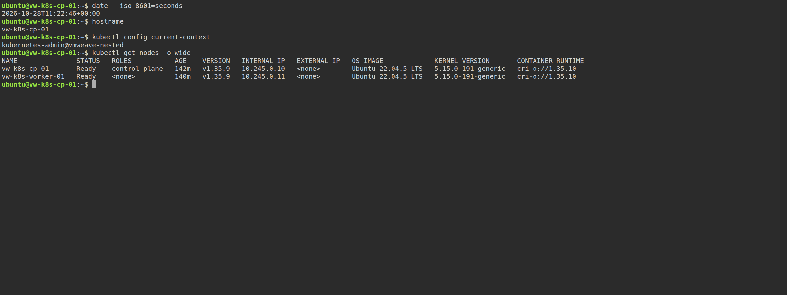

# VM 내부 Kubernetes·GPU Pod 실험

VM 두 대를 Control Plane과 Worker로 구성하고, Worker VM의 비특권 Pod에서 VMWeave broker를
통해 GPU 연산을 실행한 자료다. **완료된 실험과 앞으로 실행할 중앙 Operator 실습을 구분한다.**

| 구분 | 사용 Operator | 상태·자료 |
|---|---|---|
| 2026-10-28 최소 실험 | `vmweave-nested-system`의 전용 controller/webhook, 당시 중앙 배포와 동일 이미지 | 기능 PASS, [결과 보고서](results/20261028-minimal/REPORT.md) |
| 향후 중앙 Operator 실습 | 기존 `vmweave-system` controller/webhook, 실습 당일 배포 버전과 호환 release lock | **새 VM·GPU 실습 미실행**, [상세 실습 절차](lab/CENTRAL-OPERATOR-LAB.md) |

중앙 Operator의 관리 범위·Ready·이미지·RBAC 연결·admission 경로에 대한 읽기 전용 사전 점검은 통과했다.
이 결과는 중앙 Operator 경로의 전체 실습 성공을 뜻하지 않는다.
[사전 점검 원본](lab/preflight-observed-20261028.json) · [문서·도구 검증 범위](lab/VALIDATION.md)

## 완료된 결과

두 Node Ready, 노드 간 통신·DNS·Service, GPU Pod A/B의 정확성·회수·재사용을 확인했다.
각 정확성 작업은 32 MiB, 정수 8,388,608개, 불일치 0개, kernel 1회다.
소켓 없는 대조, 종료·재시작·VM 재생성·quota 초과·broker 수동 복구도 조건별 최소 횟수로 수행했다.
내부 Kubernetes용 Device Plugin이나 GPU Extended Resource는 사용하지 않았다.

운영 시험과 HAMi/DRA/modelserve의 외부 재배포가 겹쳤다. 기능 PASS는 관측 결과이며,
외부 환경 불변이나 장애 영향의 완전한 분리, 장기 안정성·성능·성공률을 입증하지 않는다.
VM·클러스터·Channel 및 quota는 실험 종료 시 유지했고 시험 부하는 종료했다.
현재 상태를 조작하기 전에는 인계 문서와 실시간 상태를 다시 확인한다.

- [실험 결과 보고서](results/20261028-minimal/REPORT.md): 조건별 결과·제한·GPU PID 대응·실제 경과 시간.
- [인계·접속·복구 문서](results/20261028-minimal/HANDOFF.md): 유지 자원 및 실험 당시 접속 정보.
- [최종 계획](PLAN.md), [설치기 수정 내역](installation/EXECUTION.md), [실패와 조치 기록](results/20261028-minimal/errors.md).
- [검증 판정 원본](results/20261028-minimal/verification.json), [리소스 식별자](results/20261028-minimal/object-identities.json).
- [Pod A GPU 활성 관측](results/20261028-minimal/gpu/g1-a-active.json), [A 연산 결과](results/20261028-minimal/gpu/g1-a-final.log).
- [Pod B GPU 활성 관측](results/20261028-minimal/gpu/g1-b-active.json), [B 연산 결과](results/20261028-minimal/gpu/g1-b-final.log).

## 실제 터미널 캡처

2026-10-28 **20:22:47 KST**, 기존 실험 CP VM에 SSH로 접속하여 `kubectl get nodes -o wide`를 실행했다.
두 VM이 같은 클러스터에서 Ready인 원본 화면이다. GPU 연산 화면이나 향후 중앙 Operator 실습 화면으로 인용하지 않는다.



[PNG 원본](results/20261028-nodes-capture/control-plane-kubectl-get-nodes-wide.png) ·
[명령 출력](results/20261028-nodes-capture/terminal.txt) ·
[촬영 방식·메타데이터](results/20261028-nodes-capture/README.md)

## 향후 실습과 파일 사용 범위

[중앙 Operator 실습 보고서](lab/CENTRAL-OPERATOR-LAB.md)는 사전 점검 → 새 VM·디스크 → 설치기 →
WireGuard → broker·GPU binding → init/join·Cilium → CPU/GPU 검증 → 캡처·복구·철거 순서다.
새 Operator를 설치하지 않고 중앙 관리 namespace를 사용한다. 24시간 유지와 성능 반복 측정은 포함하지 않는다.

`lab/render.py`는 새 이름·MAC·firmware UUID와 Halted VM manifest를 로컬 생성한다.
`lab/preflight.py`와 `lab/observe_gpu.py`는 각각 중앙 관리 경로와 GPU 프로세스 연결을 조회한다.
반면 **과거 `runner/`, `manifests/`, 캡처 스크립트는 기존 실험 환경·UID·경로에 고정된 보존 자료**다.
중앙 Operator 실습에 그대로 적용하거나 과거 GPU manifest의 UID/status를 재사용하지 않는다.

## 원본 무결성 확인

저장소 루트에서 실행한다. 원본 로그·manifest·스크립트는 해시가 가리키는 바이트 그대로 보존했다.

```bash
(cd experiments/nested-k8s-gpu && sha256sum -c results/20261028-minimal/SHA256SUMS)
(cd experiments/nested-k8s-gpu/results/20261028-nodes-capture && sha256sum -c SHA256SUMS)
```

첫 목록은 실험 디렉터리 기준 338개 파일, 두 번째는 캡처 디렉터리 기준 7개 파일이다.
새 실습 보고서와 `lab/` 도구는 과거 실행 해시에 소급하여 포함하지 않는다.
