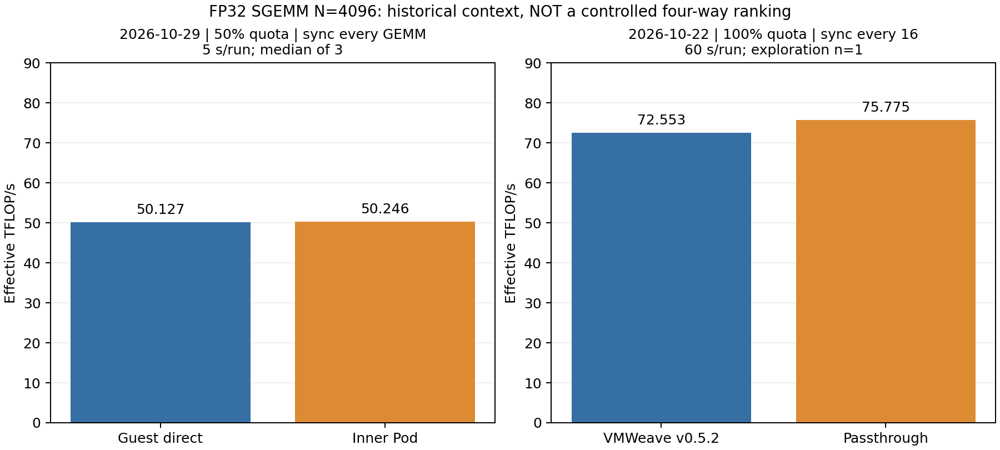
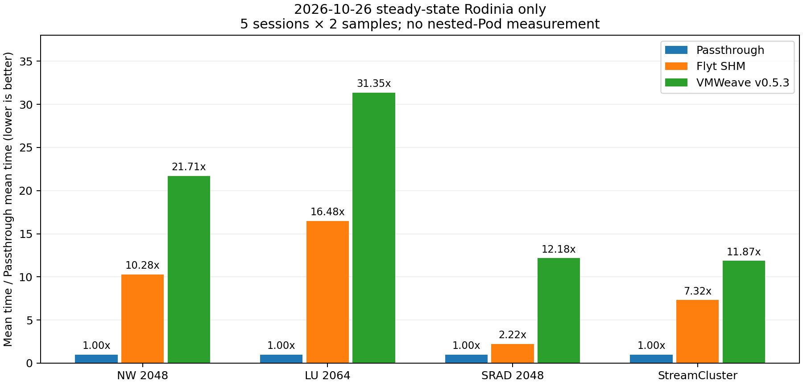

# VM 내부 Kubernetes 처리량과 VMWeave·Flyt·Passthrough 기존 실험 비교

작성일: **2026-10-29 KST** · 유형: **기존 실험 증거 재분석** · 이번 보고서 작성을 위한 GPU 재실행 없음

## 핵심 판단

1. **이번 Pod 실험은 동일 VMWeave Guest 대비 실행 위치의 차이를 확인했다.**
   SGEMM 4096 입력 상주 처리량 중앙값은 Guest 50.127 TFLOP/s, Pod 50.246 TFLOP/s다.
   반복별 차이 방향이 일정하지 않아 Pod에서 일관된 큰 저하를 관측하지 않았지만, 3쌍으로 동등성을 입증하지는 못했다.
2. **기존 SGEMM에서는 큰 입력을 GPU에 유지하고 동기화를 묶으면 VMWeave가 Passthrough에 근접했다.**
   10월 22일 N=16384의 별도 확인 3쌍에서 W/P 기하평균은 100.01%였다.
   이번 측정과 quota·버전·동기화·GPU UUID가 달라 이 비율을 현재 Pod에 적용할 수 없다.
3. **기존 정상 상태 Rodinia에서는 Passthrough가 가장 짧았고, Flyt SHM이 당시 VMWeave v0.5.3보다 짧았다.**
   이 결과는 여러 전송·API 호출을 포함하는 작업 완료 시간이다. 이번 SGEMM의 높은 TFLOP/s와 모순되지 않는다.
4. **현재 Pod·현재 VMWeave·Flyt·Passthrough의 동일 조건 4방식 순위는 아직 판정할 수 없다.**
   검토한 자료에는 Flyt의 대응 SGEMM 측정과 내부 Pod의 Rodinia 측정이 없다. 누락값을 0 또는 추정치로 채우지 않았다.

## 1. 비교 자료와 적용 범위

| 구분 | 원본 실험 | 실행 방식 | 주 지표·반복 | 본 보고서에서의 용도 |
|---|---|---|---|---|
| A | [10/29 내부 Kubernetes SGEMM](../20261029-sgemm-throughput/REPORT.md) | 같은 VM의 Guest 직접 / Pod | GFLOP/s, 조건별 3쌍 | Pod 추가 영향의 직접 비교 |
| B | [10/22 SGEMM](../../../ai-passthrough/results/20261022-sgemm-bestcase/REPORT.md) | VMWeave v0.5.2 / Passthrough | 탐색 N별 1회, 선택 N=16384 확인 3쌍 | 기존 연산 집약 조건의 처리량 참고 |
| C | [10/26 정상 상태 Rodinia](../../../ai-passthrough/results/20261026-rodinia-steady/README.md) | Native / Passthrough / Flyt SHM / VMWeave v0.5.3 | 평균 완료 시간, 5세션×2회 | Flyt 포함 동일 workload 비교 |
| D | [10/25 초기화 포함 Rodinia](../../../ai-passthrough/results/20261025-rodinia-threeway/README.md) | Passthrough / Flyt SHM / VMWeave v0.5.3 | 단발 시간 중앙값, 3회 | 초기화 경계에 따른 순위 변화 설명 |
| E | [10/27 경로 최적화 후보](../../../ai-passthrough/results/20261027-path-optimization-vm/REPORT.md) | Flyt SHM / VMWeave control / 후보 | 새 VM 5개, 세션 중앙값 | 후속 개선 결과와 미승격 상태 확인 |

Flyt는 보존된 개발 브랜치와 빌드 호환성 패치를 사용한 **SHM payload + RPC control** 비교군이다.
Flyt TCP payload 결과 또는 논문 표의 수치를 그대로 가져온 결과가 아니다.
Native는 물리 호스트 직접 실행, Passthrough는 GPU가 연결된 VM 직접 실행으로 서로 다르다.
아래 주 비교표의 Passthrough 열에 Native 값을 대입하지 않았다.

## 2. SGEMM 수치 비교

### 2.1 이번 실행: Guest와 Pod의 직접 비교

단위 GFLOP/s, 각 실행 방식의 3회 중앙값. 각 열은 같은 입력·동일 바이너리·라이브러리·GPU·quota를 사용한다.

| N | 구간 | VMWeave Guest 직접 | VMWeave 내부 Pod | 쌍별 Pod/Guest 변화 중앙값 |
|---:|---|---:|---:|---:|
| 1024 | 입력 GPU 상주, SGEMM+sync | 1,595.38 | 1,666.33 | +4.06% |
| 1024 | H2D+SGEMM+sync+D2H | 57.29 | 56.53 | −1.33% |
| 4096 | 입력 GPU 상주, SGEMM+sync | 50,126.66 | 50,246.01 | −0.53% |
| 4096 | H2D+SGEMM+sync+D2H | 200.33 | 203.12 | −3.01% |

마지막 열은 쌍별 비율의 중앙값으로, 앞의 두 중앙값을 나눈 값과 다르다.
예를 들어 4096 입력 상주 조건의 쌍별 변화는 +2.90%, −0.53%, −1.35%다.
평균·중앙값·쌍별 비율을 혼용하여 개선이나 저하를 주장하지 않는다.

근거: [이번 측정 CSV](../20261029-sgemm-throughput/measurements.csv),
[검산·GPU PID·회수 결과](../20261029-sgemm-throughput/summary.json).
시간은 Guest 단조 시계의 완료 관측값으로 VMWeave 호출·broker·SHM·동기화 비용을 포함한다.
Pod 생성, 이미지 준비, 초기 할당, 검산은 제외했다. GPU kernel event 시간은 아니다.

### 2.2 같은 N=4096의 과거 값과 나란히 보기 — 참고 비교

| 실행 조건 | TFLOP/s | 표본 | compute 설정 | 완료 동기화 | 측정 길이 |
|---|---:|---|---:|---|---|
| 10/29 VMWeave Guest | 50.127 | 3회 중앙값 | 50% | GEMM마다 | 회당 최소 5초 |
| 10/29 VMWeave Pod | 50.246 | 3회 중앙값 | 50% | GEMM마다 | 회당 최소 5초 |
| 10/22 VMWeave v0.5.2 | 72.553 | 탐색 1회 | 100% | 16 GEMM마다 | 최소 60초 |
| 10/22 Passthrough | 75.775 | 탐색 1회 | 물리 GPU 전용 사용 | 16 GEMM마다 | 최소 60초 |
| 대응 Flyt SGEMM | **자료 미확보** | — | — | — | — |



좌우 패널은 다른 실험이다. **50.246/75.775를 Pod의 Passthrough 대비 성능 유지율로 사용하지 않는다.**
GPU 모델과 N이 같아도 다음 차이가 있다.

| 항목 | 10/29 내부 Kubernetes | 10/22 기존 SGEMM |
|---|---|---|
| GPU 모델 / driver | RTX PRO 6000 Blackwell Server Edition / 580.173.02 | 동일 모델 / 동일 driver |
| 물리 GPU UUID | `GPU-7d708c42-8d4a-16d5-0746-474567157aa3` | `GPU-772181af-05a4-0c24-de59-8487bd37c142` |
| VMWeave 버전 | 유지된 v0.5.5 Guest/Worker | v0.5.2 Guest/Worker, state/math cache 활성 |
| VM / backend CPU | Worker VM 4 vCPU / 16 GiB, 별도 affinity 미고정 | VM 8 vCPU / 16 GiB, QEMU 32–39 / backend 40–43 |
| 원격 자원 설정 | compute 50% / VRAM 2048 MiB | compute 100% / VRAM 8192 MiB |
| 호출 코드 | C 바이너리, 기본 stream, GEMM별 sync | Python ctypes, 명시적 stream/workspace, 16회별 sync |
| 입력 / 검산 | 새 seed·입력, 전체 finite + FP64 참조 32개 위치 | 다른 seed·입력, 전체 P/W 출력 비교 + FP64 참조 16개 위치 |
| warm-up | 최소 3 GEMM·2초 | 최소 30 GEMM·5초 |
| 측정 시간 | 최소 5초 | 최소 60초 |

공통점은 FP32·column-major·alpha=1·beta=0·pedantic math mode=2·GPU 입력 상주다.
다만 cuBLAS/Guest 라이브러리의 실험 간 완전한 동일성은 이 비교에서 입증하지 않았다.
두 실험 모두 GPU clock/온도를 완전히 고정한 결과도 아니다.
compute 50% 설정을 근거로 이번 수치에 2를 곱하는 보정은 하지 않는다.
HAMi 설정값이 정확히 선형적인 GFLOP/s 비율을 보장한다는 측정 근거가 없기 때문이다.

### 2.3 기존 SGEMM의 확인 실험은 N=16384다

10/22 탐색 이후 선택한 N=16384의 별도 3쌍에서 Passthrough 중앙값은 **76.844 TFLOP/s**,
VMWeave는 **76.973 TFLOP/s**, 쌍별 W/P 기하평균은 **100.01%**였다(범위 99.59–100.24%).
GPU 입력 상주·16회별 sync·60초의 해당 조건에서는 원격 호출 비용이 큰 연산에 분산될 수 있음을 보여준다.
전체 workload, 이번 Pod, 전송 포함 실행 또는 AI 학습 처리량에 그대로 적용하는 결론은 아니다.
이번 4096 결과와 16384 확인 결과를 섞어 성능 향상률을 계산하지 않는다.

원본: [SGEMM manifest](../../../ai-passthrough/results/20261022-sgemm-bestcase/manifest.json),
[측정 CSV](../../../ai-passthrough/results/20261022-sgemm-bestcase/measurements.csv),
[집계](../../../ai-passthrough/results/20261022-sgemm-bestcase/summary.json).

## 3. Flyt·VMWeave·Passthrough를 같은 작업으로 비교한 결과

10/26 정상 상태 Rodinia 결과를 사용한다. 각 방식·workload당 **5개 독립 세션, 세션당 2회**다.
초기 CUDA 준비와 두 번의 완전한 작업 warm-up 이후를 측정했다.
NW/LU/SRAD는 할당·입력 전송·알고리즘·출력 전송·완료 대기, StreamCluster는 CPU 제어 흐름도 포함한다.

### 3.1 평균 작업 완료 시간

단위 초, 작을수록 빠르다. 표본 표준편차와 전체 범위는 원본 comparison.json에 있다.

| workload | Passthrough | Flyt SHM | VMWeave v0.5.3 | 내부 Pod의 동일 작업 |
|---|---:|---:|---:|---|
| NW 2048 | 0.024887 | 0.255875 | 0.540349 | 미측정 |
| LU 2064 | 0.015459 | 0.254684 | 0.484660 | 미측정 |
| SRAD 2048 | 0.021784 | 0.048450 | 0.265259 | 미측정 |
| StreamCluster | 3.413203 | 24.991950 | 40.508545 | 미측정 |

### 3.2 같은 workload 내 상대 처리량

아래는 새로 계산한 **평균 시간의 역수 비율** `100 × T_Passthrough / T_대상`이다.
동시 부하에서 직접 측정한 jobs/s, GFLOP/s 또는 순간 처리량의 평균이 아니다.

| workload | Passthrough 기준 | Flyt SHM | VMWeave v0.5.3 |
|---|---:|---:|---:|
| NW 2048 | 100% | 9.73% | 4.61% |
| LU 2064 | 100% | 6.07% | 3.19% |
| SRAD 2048 | 100% | 44.96% | 8.21% |
| StreamCluster | 100% | 13.66% | 8.43% |



그림은 처리량 표와 반대 방향인 `T_대상 / T_Passthrough`를 표시한다. **낮을수록 좋다.**
이 조건에서는 Passthrough가 가장 빨랐고, Flyt가 당시 VMWeave보다 빨랐다.
GPU0·100%/8192 MiB·v0.5.3의 결과이며 현재 GPU1·50%/2048 MiB·v0.5.5 Pod 수치로 대체할 수 없다.
Flyt의 MPS/서버 수명과 VMWeave의 세션·중계 경로 차이도 포함하므로 순수 SHM 프로토콜 비교는 아니다.

두 표는 [raw.csv](../../../ai-passthrough/results/20261026-rodinia-steady/raw.csv)에서 재계산하여
[기존 집계](../../../ai-passthrough/results/20261026-rodinia-steady/comparison.json)와 대조했다.
전체 160개 표본에는 Native 40개도 포함되며 위 주 표에는 요청한 세 방식 120개를 사용했다.
실험 중단·재개 이력, StreamCluster 내부 타이머 제외, 소스 호환성 보완과 진단 범위는
[기존 상세 보고서](../../../ai-passthrough/results/20261026-rodinia-steady/REPORT.txt)에 보존되어 있다.
10개 표본을 10개의 독립 세션으로 취급하지 않으며, workload 간 평균 성능 순위를 추가로 합성하지 않는다.

## 4. 다른 기존 보고서와 혼동하지 않아야 할 결과

### 4.1 10/25 초기화 포함 결과의 순위가 다른 이유

| 초기화 포함 단발 실행 중앙값(초) | Passthrough | Flyt SHM | VMWeave v0.5.3 |
|---|---:|---:|---:|
| NW | 1.624538 | 0.377979 | 1.359958 |
| LU | 1.615478 | 0.489624 | 1.218818 |

이때 주 경계는 pre-main 초기화와 첫 할당부터 최종 완료까지였다.
별도 진단에서 Passthrough의 초기 할당·초기화 약 1.60초, VMWeave 약 0.66~0.67초가 관측됐고,
Flyt는 이미 준비한 서버를 재사용했다. 따라서 위 표의 Flyt 우위를 GPU kernel 성능 우위로 읽으면 안 된다.
10/26 정상 상태 결과와 이번 SGEMM은 초기 준비를 제외하므로 다른 질문에 답한다.
[10/25 원본](../../../ai-passthrough/results/20261025-rodinia-threeway/REPORT.txt)

### 4.2 10/27 최적화 후보는 별도 비교군이다

각 시간은 독립 VM 5개의 세션 중앙값을 다시 중앙값으로 요약한 초 단위 값이다.

| workload | Flyt SHM | VMWeave control | 최적화 후보 |
|---|---:|---:|---:|
| NW | 0.27117 | 0.31209 | 0.20383 |
| LU | 0.26651 | 0.37696 | 0.24192 |
| SRAD | 0.04961 | 0.14167 | 0.09348 |
| StreamCluster | 25.15533 | 37.50248 | 24.73893 |

원본의 결합 실행시간 비율은 후보/control **0.657**, 후보/Flyt **1.100 [1.019, 1.188]**였다.
사전 승격 조건 미충족으로 판정은 **DO_NOT_PROMOTE**였다. 표의 중앙값으로 이 결합 비율을 재구성하지 않는다.
control/candidate는 같은 최종 ELF의 옵션 OFF/ON이고, 공개 구버전 ELF 그대로의 대조군은 아니다.
이 후보 결과를 이번 Pod가 사용하는 공개 v0.5.5의 측정값으로 간주하지 않는다.
또한 이 후보 실험에는 Passthrough와 내부 Pod가 포함되지 않았다.
[집계·신뢰구간](../../../ai-passthrough/results/20261027-path-optimization-vm/comparison.json)

## 5. 결과를 함께 읽었을 때의 의미

**연산 재사용과 요청당 작업량이 중요하다.** 기존 큰 SGEMM은 GPU에 올린 입력을 재사용하고 여러 GEMM의
완료 대기를 묶었다. 이번 SGEMM은 매번 sync하며, 전송 포함 조건에서는 매번 A/B/C를 이동한다.
따라서 연산 집약 조건의 높은 TFLOP/s와 전송·호출이 많은 작업의 긴 완료 시간이 함께 나타날 수 있다.

**이번 결과는 Pod 추가 비용과 기존 원격 실행 비용을 분리해서 해석해야 한다.**
Guest와 Pod는 이미 동일한 broker·SHM·GPU Worker를 공유한다.
Pod/Guest 차이가 작아도 양쪽에 공통인 원격 실행 비용이 작다는 증거가 되지는 않는다.
과거 Rodinia의 Flyt 대비 차이가 새 Pod에서도 같은 비율로 나타난다고 추정할 수도 없다.

**전송 경로 비용은 일관된 조사 대상이지만 기여율은 아직 분리하지 않았다.**
이번 4096 Pod는 입력 상주 약 2.735 ms/GEMM에서 전송 포함 약 676.639 ms/GEMM으로 증가했다.
과거 Rodinia 진단도 복사 API 경계의 긴 대기를 관측했다. 이는 전송을 포함한 경로의 중요성을 지지하지만,
PCIe, 메모리 복사, RPC, Python broker, 동기화 중 각각이 몇 %인지 입증한 결과는 아니다.

## 6. 동일 조건 4방식 비교를 위한 후속 조건

아래는 **미실행 제안**이다. 이 보고서 작성에서는 VM·GPU·Operator를 변경하지 않았다.

1. 동일 GPU UUID와 자원 조건에서 Passthrough, Flyt SHM, VMWeave Guest, VMWeave Pod를 순차 비교한다.
   전체 GPU가 보이는 Passthrough와 50% 원격 quota를 곧바로 같은 조건으로 취급하지 않는다.
2. 동일 SGEMM 소스·입력·행렬 크기·정밀도·stream/workspace·동기화 간격을 고정한다.
   Flyt에서 해당 cuBLAS 경로와 검산이 통과하는지 먼저 확인한다. 통과하지 않으면 미지원 상태로 남긴다.
3. 입력 상주와 전송 포함 구간을 별도로 측정하고, 초기화·Pod 생성 시간도 별도 지표로 보존한다.
4. 최소 3쌍 교차 순서를 사용하되 반복 변동이 큰 경우 효과를 단정하지 않는다. 모든 방식의 라이브러리·바이너리
   hash와 CPU 배치, 실제 GPU PID, quota, clock/온도·외부 부하를 기록한다.
5. Rodinia 비교를 원하면 이번 Pod에 동일한 NW/LU/SRAD/StreamCluster 바이너리와 타이머 경계를 적용한다.
   SGEMM 결과를 Rodinia 결과의 빈칸에 대입하지 않는다.

## 7. 검증과 산출물

- [comparison.json](comparison.json): 실험군별 집계와 비교 불가 상태.
- [SGEMM 참고 CSV](sgemm-reference.csv), [Rodinia 재계산 CSV](rodinia-steady.csv).
- [SGEMM PNG](sgemm-context.png) / [PDF](sgemm-context.pdf), [Rodinia PNG](rodinia-context.png) / [PDF](rodinia-context.pdf).
- [분석기](analyze.py): 기존 파일만 읽으며 클러스터·GPU를 조회하거나 변경하지 않는다.
- [인용 원본 SHA256](source-hashes.json), [검증 로그](validation.log), [현재 묶음 SHA256](SHA256SUMS).

이번 SGEMM 24개 측정 구간, 기존 SGEMM CSV, 정상 상태 Rodinia 160개 표본,
초기화 포함 Rodinia 18개 표본, 후보의 VM별 중앙값을 집계와 대조했다.
10/22·10/25·10/26에서 인용한 파일은 기존 hash 목록과도 대조했다.
이 검증은 보존 자료의 일치성을 확인하며 GPU 실험을 다시 실행했다는 뜻은 아니다.
과거 보고서와 10/29 SGEMM 원본·해시는 수정하지 않았다.

저장소 루트에서 파생 결과만 재생성하려면 다음을 실행한다. 그래프에는 matplotlib이 필요하다.

```bash
.local/evidence-venv/bin/python experiments/nested-k8s-gpu/results/20261029-performance-comparison/analyze.py
```

분석기는 이 디렉터리의 파생 파일을 덮어쓰므로 배포된 hash를 검증할 때는 재생성 전에 확인한다.

```bash
(cd experiments/nested-k8s-gpu/results/20261029-performance-comparison && sha256sum -c SHA256SUMS)
```
