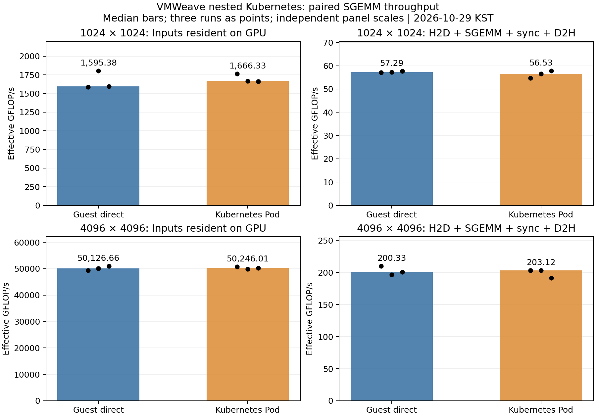

# VM 내부 Kubernetes SGEMM 처리량 분석

실행일: **2026-10-29 KST** · 실행·검산·회수: **PASS**

유지 중인 동일 Worker VM에서 Guest 직접 실행과 내부 Kubernetes Pod 실행을 비교했다.
FP32 행렬곱에서 양쪽 모두 정상 동작했고, Pod의 처리량 저하가 모든 반복에서 일관되게 나타나지는 않았다.
각 조건 3쌍의 짧은 측정이므로 성능 동등성이나 Kubernetes 오버헤드 부재를 통계적으로 입증한 것은 아니다.
두 실행 방식 모두 데이터 전송을 포함하면 처리량이 크게 낮아졌다.

## 측정 결과

각 수치는 독립 프로세스 3회 결과의 중앙값이다. 단위는 **GFLOP/s**다.
4096의 입력 상주 조건은 Guest 약 50.13 TFLOP/s, Pod 약 50.25 TFLOP/s에 해당한다.

| 정방행렬 크기 | 측정 구간 | Guest 직접 | 내부 Pod | 쌍별 Pod/Guest 변화율 중앙값 |
|---|---|---:|---:|---:|
| 1024×1024 | 입력 GPU 상주: SGEMM+sync | 1,595.38 | 1,666.33 | +4.06% |
| 1024×1024 | A/B H2D+SGEMM+sync+C D2H | 57.29 | 56.53 | −1.33% |
| 4096×4096 | 입력 GPU 상주: SGEMM+sync | 50,126.66 | 50,246.01 | −0.53% |
| 4096×4096 | A/B H2D+SGEMM+sync+C D2H | 200.33 | 203.12 | −3.01% |

마지막 열은 `median(100 × (Pod_i / Guest_i − 1))`이다. 앞의 두 중앙값을 나눈 값과 다르다.
따라서 개별 중앙값으로는 Pod가 높지만 쌍별 변화율 중앙값은 음수가 될 수 있다.



그래프 막대는 중앙값, 검은 점은 세 실행의 값이다. 패널별 세로축 범위가 다르다.
[PNG](throughput.png) · [PDF](throughput.pdf) · [24개 측정 원본 CSV](measurements.csv) · [분석 JSON](summary.json)

| 조건 | Guest 관측 범위(GFLOP/s) | Pod 관측 범위(GFLOP/s) | 쌍별 변화율 범위 |
|---|---:|---:|---:|
| 1024, 입력 상주 | 1,585.48–1,804.18 | 1,660.18–1,766.15 | −7.64%–+11.40% |
| 1024, 전송 포함 | 57.08–57.65 | 54.69–57.80 | −4.19%–+0.25% |
| 4096, 입력 상주 | 49,337.02–50,934.49 | 49,860.31–50,769.53 | −1.35%–+2.90% |
| 4096, 전송 포함 | 196.21–209.56 | 191.42–203.24 | −4.45%–+3.52% |

## 무엇을 측정했는가

`C = A × B`, FP32 cuBLAS SGEMM, column-major, alpha=1, beta=0, math mode=2(pedantic)다.
결정적인 해시 기반 입력 두 개를 사용했다. Guest/Pod의 연산 바이너리와 Guest 라이브러리는 SHA256이 동일하다.
Guest 직접 실행도 동일한 broker와 외부 GPU Worker를 거친다. Native GPU 또는 passthrough와 비교한 결과가 아니다.

- **resident_compute:** A/B를 GPU에 올린 뒤 SGEMM+`cudaDeviceSynchronize`를 반복한다.
  Guest의 `CLOCK_MONOTONIC`으로 완료까지 측정하므로 API 호출·broker/SHM 왕복·동기화 비용도 포함된다.
  CUDA event로 측정한 순수 GPU kernel 시간이나 GPU 최대 성능이 아니다.
- **transfer_inclusive:** 매 GEMM마다 A/B H2D, SGEMM, sync, C D2H를 완료한다.
  1024는 작업당 12 MiB, 4096은 192 MiB의 논리적 데이터 전송이다.
- 각 구간은 최소 5초·3 GEMM이며, 완료된 작업만 계수한다. `GFLOP/s = 2 × N³ × 완료 GEMM 수 / 초 / 10⁹`.
- 매 프로세스에서 최소 3 GEMM·2초 warm-up을 수행한다. 크기별 순서는 Guest→Pod, Pod→Guest, Guest→Pod다.
- 메모리 할당, 입력 생성, warm-up, 출력 검산, Pod 생성·이미지 준비·관측 barrier는 측정 구간에서 제외한다.
  `orchestration_seconds_including_barrier`는 관측 대기를 포함하므로 Pod 시작 성능으로 사용하지 않는다.
- 전체 12개 프로세스(Guest 6, Pod 6), 24개 측정 구간이다. 각 구간 내부에서 다수 GEMM을 반복하지만
  독립 실행 수는 조건별 3회다. GEMM 수를 독립 표본 수로 간주하지 않는다.

실행 구간은 **17:24:24.945–17:28:27.742 KST**, 약 4분 3초다.
이미지 준비·사전 점검·분석 시간은 포함하지 않는다. [시작](started.json) · [종료](completed.json)

## 해석

**이 구성에서 Pod 실행 자체가 큰 처리량 손실을 일관되게 만들었다는 증거는 없다.**
4096 입력 상주 조건은 쌍별 차이가 −1.35%~+2.90%였고, 1024 조건은 −7.64%~+11.40%로 더 흔들렸다.
일부 Pod 수치가 높은 것을 Kubernetes의 성능 향상으로 해석하지 않는다.
작은 행렬의 변동 원인은 이 실험에서 분리 계측하지 않았다.

**전송을 포함한 실행 경로의 비용이 훨씬 크다.** Pod의 GEMM당 중앙 경과 시간은
1024에서 입력 상주 1.289 ms / 전송 포함 37.990 ms,
4096에서 입력 상주 2.735 ms / 전송 포함 676.639 ms다.
이는 데이터 재사용 여부가 이 workload의 처리량에 큰 영향을 줌을 보여준다.
GPU PCIe 대역폭 자체나 H2D/D2H 각각의 병목 위치를 직접 측정한 것은 아니다.

이 결과는 VMWeave의 이미 연결된 quota를 사용하는 **실행 중 Pod**의 비교다.
Device Plugin 기반 GPU 스케줄링·할당, Pod 시작 지연, 다중 Pod 동시 처리량,
AI 모델 학습·추론 처리량을 검증하지 않았다.

## 환경과 동일성

| 항목 | 값 |
|---|---|
| 외부 Operator | 기존 별도 `vmweave-nested-system`; 중앙 Operator 재실습 아님 |
| Worker VM | `vmweave-nested-k8s/vw-k8s-worker-01`, 동일 VM·broker·Channel 재사용 |
| 내부 Kubernetes / CRI-O | 1.35.9 / 1.35.10 |
| 물리 GPU | NVIDIA RTX PRO 6000 Blackwell Server Edition, driver 580.173.02 |
| 대상 GPU UUID | `GPU-7d708c42-8d4a-16d5-0746-474567157aa3` |
| VM quota | compute 50%, VRAM 2048 MiB, 단일 실행 슬롯. 설정값이며 연산 비율 보장 검증 아님 |
| 실행 사용자 | Guest/Pod 모두 UID 1000, 기본 GID 998 |
| Pod CPU | request 100m, limit 없음; Guest 직접 실행과 별도 CPU quota 차이를 만들지 않음 |
| Pod RAM | request 256 MiB / limit 1 GiB |
| Pod 보안 | non-root, capabilities ALL drop, RuntimeDefault, broker 디렉터리 read-only |
| 이미지 | `localhost/nested-sgemm@sha256:389536c4f6910ee315f52a3d7b9252440f3570846940f50a92a2d21c725ccc01` |

[바이너리·라이브러리 동일성](inventory/binary-library.sha256), [이미지](inventory/image.json),
[Guest 환경](inventory/guest-environment-prepared.txt), [GPU 모델](inventory/gpu-model.csv), [Pod manifest](manifests/).
`started.json`의 source Git SHA는 작업 기반 커밋이며, 새 benchmark 소스는 이번 결과의 SHA256SUMS로 식별한다.

## 검증·환경 관측·제한

- 12개 실행 모두 PASS. 각 실행의 warm-up·상주·전송 구간 후 총 36회 검산.
  모든 출력 원소의 finite 검사와 구간별 32개 위치의 FP64 CPU 참조 비교를 통과했다.
  **전체 원소를 CPU 행렬곱 결과와 대조한 검증은 아니다.** 허용 오차는 `1e-4 + 2e-4 × |reference|`.
- 각 실행 전에 슬롯 idle 확인, 실행 중 호스트 GPU PID와 외부 GPU Worker CUDA 자식 PID 대응,
  종료 후 세션 회수를 확인했다. [관측 원본](observations/)
- 대상 GPU 관측 215개 샘플에서 다른 Worker의 GPU 프로세스와 관측 오류는 없었다.
  샘플 사이의 짧은 활동까지 배제한 연속 추적은 아니다. [GPU 시계열](gpu-monitor.jsonl)
- 측정 전후 외부 Deployment/DaemonSet의 UID·generation·spec hash 및 Pod UID·imageID·restartCount는 동일했다.
  Channel allocation/generation/GPU Worker UID도 동일했다. [분석 판정](summary.json)
- CPU affinity·GPU clock은 고정하지 않았다. 동일 호스트의 다른 GPU와 CPU 활동, 온도·clock 변동을
  완전히 통제한 실험은 아니다. 3쌍으로 통계적 동등성·성공률·장기 안정성을 주장하지 않는다.

## 준비 단계 오류와 종료 상태

이미지 안의 파일 hash를 읽는 임시 `podman run`이 제거된 기본 Podman CNI를 요구하여 실패했다.
이 단계에서는 GPU benchmark를 시작하지 않았다. 기존 이미지·바이너리를 보존하고
hash 검사 컨테이너를 `--network=none`으로 실행하도록 수정했다.
Kubernetes CNI·broker·Operator·VM 설정은 변경하지 않았다.
[최초 준비 실패](runner.log) · [준비된 이미지에서 측정한 기록](runner-prepared.log)

GPU 측정의 실패·재실행은 없었다. 새 내부 Job 6개는 모두 Complete이며 활성 Job/시험 CUDA 세션은 없다.
VM·클러스터·Channel 및 원래 quota는 유지했다. 새 이미지, 소스·바이너리와 완료 Job은 재검토용으로 남겼다.
[최종 Job](inventory/final-jobs.json) · [최종 idle](observations/final-idle.json)

## 재검토와 재실행

- [사전 계획](PLAN.md) · [측정 C 소스](../../throughput/sgemm.c) · [runner](../../throughput/run.py) · [분석기](../../throughput/analyze.py)
- 기존 기능 실험: [20261028-minimal](../20261028-minimal/REPORT.md). 과거 파일과 해시는 수정하지 않았다.
- `run.py`는 이 실행 환경에 고정된 보존 도구이며 기존 `started.json`이 있으면 재실행을 거부한다.
  새 측정은 새 결과 디렉터리·Guest 작업 경로·이미지 tag·Job prefix로 분리하고 사전 상태를 확인한다.
  `--prepared`는 GPU 측정 시작 전 준비 실패에서만 사용하는 복구 경로다.
- `analyze.py`는 GPU 없이 기존 raw 결과에서 CSV·summary·그래프를 재생성한다.
  파생 파일을 덮어쓰므로 원본 보존이 필요하면 결과 복사본에서 수행한다.

무결성 확인은 저장소 루트에서 다음과 같이 수행한다.

```bash
(cd experiments/nested-k8s-gpu && sha256sum -c results/20261029-sgemm-throughput/SHA256SUMS)
```
