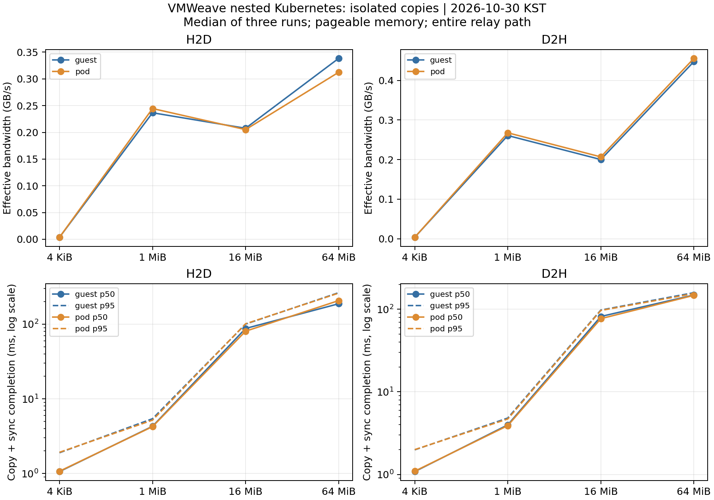
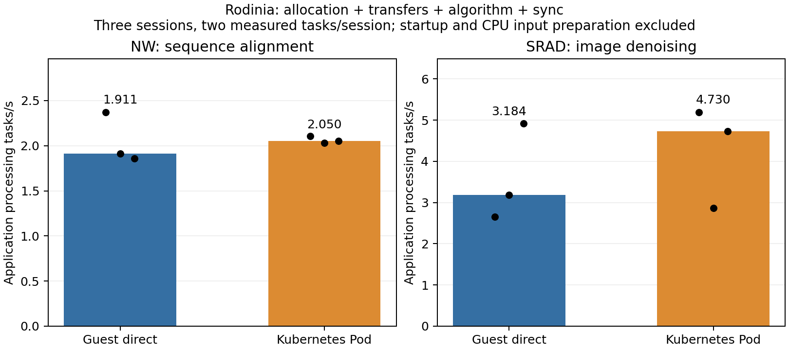

# VM 내부 Kubernetes 성능 통합 보고서 — 전송·애플리케이션 추가 측정

실행일: **2026-10-30 KST** · 추가 측정·검산·세션 회수: **PASS**

기존 Worker VM에서 **전송만 수행하는 H2D/D2H 실험**과 **Rodinia NW/SRAD 애플리케이션 처리량**을
추가 측정했다. Guest 직접 실행과 내부 Kubernetes Pod 실행 모두 정상 완료했다.
기존 SGEMM은 재실행하지 않았으며 아래에서 원래 결과와 함께 연결한다.

Pod의 64 MiB 유효 대역폭은 H2D **0.312 GB/s**, D2H **0.456 GB/s**였다.
Pod의 애플리케이션 처리량 중앙값은 NW **2.050 작업/s**, SRAD **4.730 이미지 처리/s**였다.
이는 아래에 정의한 알고리즘 처리 구간의 처리량이다. 초기화·입력 생성·Pod 시작을 포함하는
전체 서비스 처리량이나 AI 모델 추론·학습 처리량을 뜻하지 않는다.

**Pod 오버헤드의 일관된 방향이나 성능 동등성을 입증한 결과는 아니다.**
독립 프로세스는 조건별 3개이며 SRAD의 실행 간 편차가 컸다.
측정 중 다른 namespace의 Deployment 교체도 관측되어 공유 호스트 전체가 불변이었다고 주장하지 않는다.

## 기존 SGEMM과 이번 실험의 관계

| 질문 | 실험 | 확인 범위 |
|---|---|---|
| GPU 데이터 재사용 시 행렬곱 속도는? | [10/29 SGEMM](../20261029-sgemm-throughput/REPORT.md) | 입력 상주 SGEMM+동기화 GFLOP/s |
| 전송을 포함하면 행렬곱 속도가 어떻게 달라지는가? | 같은 10/29 실험 | H2D+SGEMM+sync+D2H 합산 GFLOP/s |
| 전송 자체의 지연·대역폭은? | **이번 추가 측정** | H2D/D2H별 API 반환·완료 지연, GB/s |
| 실제 알고리즘 처리량은? | **이번 추가 측정** | NW 서열 정렬, SRAD 이미지 처리 작업/s |

10/29의 4096×4096 SGEMM은 입력 상주에서 Guest **50,126.66**, Pod **50,246.01 GFLOP/s**,
전송 포함에서 Guest **200.33**, Pod **203.12 GFLOP/s**였다.
이 값과 이번 복사 측정은 날짜·작업·타이머 경계가 다르므로 빼거나 나누어 단일 병목 비용으로 계산하지 않는다.
[VMWeave·Flyt·Passthrough 과거 비교 보고서](../20261029-performance-comparison/REPORT.md)는
10/29 시점의 별도 역사적 비교이며 이번 자료를 소급해 포함하지 않는다.
이번에는 Flyt·Passthrough·Native GPU를 새로 측정하지 않았다.

## 1. 전송 지연시간 및 대역폭

**H2D**는 Guest/Pod의 CPU 메모리에서 외부 GPU 메모리로,
**D2H**는 외부 GPU 메모리에서 Guest/Pod의 CPU 메모리로 전송하는 방향이다.
Pod → Guest 라이브러리 → Guest broker → SHM → 외부 GPU Worker의 경로 비용이 포함된다.
GPU의 물리 PCIe 링크 최대 대역폭이나 GPU 내부 VRAM 대역폭을 측정한 것이 아니다.

| 크기 | 방향 | Guest GB/s | Pod GB/s | Pod 완료 p50 (ms) | Pod 완료 p95 (ms) |
|---|---|---:|---:|---:|---:|
| 4 KiB | H2D | 0.003669 | 0.003659 | 1.071 | 1.921 |
| 4 KiB | D2H | 0.003619 | 0.003514 | 1.094 | 1.996 |
| 1 MiB | H2D | 0.236656 | 0.244539 | 4.238 | 5.182 |
| 1 MiB | D2H | 0.260622 | 0.267521 | 3.899 | 4.696 |
| 16 MiB | H2D | 0.207625 | 0.205179 | 80.546 | 101.221 |
| 16 MiB | D2H | 0.199957 | 0.206655 | 77.022 | 96.778 |
| 64 MiB | H2D | 0.338374 | 0.312351 | 206.911 | 260.689 |
| 64 MiB | D2H | 0.447374 | 0.455501 | 147.544 | 155.012 |

모든 표 값은 **독립 프로세스 3개의 지표 중앙값**이다.
완료 지연은 `cudaMemcpy` 시작부터 뒤따르는 `cudaDeviceSynchronize` 반환까지다.
p50은 실행 안의 중앙값, p95는 nearest-rank 95백분위수이며 최종 표는 이 값들의 중앙값이다.
전체 복사 표본을 합쳐 계산한 백분위수가 아니고, 서비스 요청의 장기 p95도 아니다.

각 프로세스는 pageable host memory를 사용하고, 4 KiB / 1 MiB / 16 MiB / 64 MiB 순서로
H2D 후 D2H를 실행했다. 크기·방향마다 warm-up 3회 후 **최소 2초·20회**를 측정했다.
크기·방향 순서는 고정이며 Guest/Pod 실행 순서만 쌍별로 교대했다.
초기화·할당·buffer 준비·warm-up·관측 대기·검산은 시간에서 제외했다.
마지막 결과 전체 bytes를 각 구간 후 입력과 비교했다. 매 복사마다 검산한 것은 아니다.

```text
유효 GB/s = 논리 전송 bytes × 완료 복사 횟수 / 측정 구간 초 / 10^9
완료 지연 = cudaMemcpy + cudaDeviceSynchronize의 관측 경과시간
```

API 반환 시간도 [원시 로그·JSON](runs/)과 [실행별 CSV](transfer-runs.csv)에 따로 보존했다.
CUDA의 pageable H2D는 호출 반환과 최종 전송 완료 시점이 다를 수 있으므로 완료 동기화를 포함했다.
[NVIDIA API 동기화 정의](https://docs.nvidia.com/cuda/cuda-runtime-api/api-sync-behavior.html),
[대역폭·타이밍 측정 가이드](https://docs.nvidia.com/cuda/cuda-c-best-practices-guide/index.html).
이 문서는 측정 방법의 근거이며 VMWeave 내부 동작을 NVIDIA 문서만으로 추정하지 않는다.



[PNG](transfer.png) · [PDF](transfer.pdf) · [48개 측정 구간 CSV](transfer-runs.csv)

4 KiB의 완료 지연은 Pod 약 1.1 ms로, 작은 데이터도 중계·동기화 비용을 포함한다.
64 MiB H2D의 쌍별 대역폭 변화율 중앙값은 **−6.55%**, D2H는 **+0.81%**였다.
모든 크기에서 같은 방향의 Pod 차이가 관측된 것은 아니다.
16 MiB와 64 MiB의 byte당 성능도 달라 단일 대역폭으로 경로 전체를 대표하지 않는다.
Guest 복사·broker·SHM·Worker·GPU DMA 중 어느 단계가 지배적인지는 분해 계측하지 않았다.

## 2. 실제 애플리케이션 처리량

동일한 Rodinia 바이너리·입력을 사용한다. SGEMM을 애플리케이션 처리량으로 환산한 결과가 아니다.

- **NW**: Needleman–Wunsch 서열 정렬, 입력 길이 2048, penalty 10, 합성 서열.
- **SRAD**: speckle 잡음 제거용 확산 알고리즘, 합성 2048×2048 이미지,
  ROI 행·열 0..127, lambda 0.5, diffusion 2회. 작업 1개는 이미지 1개에 대한 두 확산 단계다.

[10/26 동결 소스와 측정 경계](../../../ai-passthrough/results/20261026-rodinia-steady/README.md)를
그대로 사용했다. **CPU 입력 준비 후 GPU 메모리 할당 → 입력 전송 → 알고리즘 → 결과 회수 → 완료 동기화**까지다.
초기 CUDA 준비, 입력 생성, 출력 파일 쓰기·검증, 최종 메모리 해제, Pod 시작·이미지 준비는 제외한다.
따라서 아래 값은 애플리케이션의 **정상 상태 처리 구간 처리량**이고 전체 프로세스·서비스 처리량은 아니다.

| 작업 | Guest 작업/s | Pod 작업/s | Pod 평균 작업 시간 중앙값 (ms) | 쌍별 처리량 변화율 중앙값 |
|---|---:|---:|---:|---:|
| NW 서열 정렬 | 1.911 | 2.050 | 487.885 | +6.29% |
| SRAD 이미지 처리 | 3.184 | 4.730 | 211.395 | -3.83% |

각 독립 프로세스에서 전체 작업 2회 warm-up 뒤 2회 측정했다.
프로세스별 처리량은 **2 / 두 측정 시간의 합**이며, 표는 독립 프로세스 3개의 중앙값이다.
SRAD의 작업/s는 위에서 고정한 합성 이미지 처리/s다. 실제 사진 데이터셋이나 모델 정확도를 평가하지 않았다.
마지막 열은 `median(100 × (Pod_i / Guest_i − 1))`로, 앞 두 중앙값을 나눈 값과 다르다.

| 작업 | Guest 관측 범위 (작업/s) | Pod 관측 범위 (작업/s) | 쌍별 변화율 범위 |
|---|---:|---:|---:|
| NW | 1.859–2.370 | 2.032–2.108 | -11.06%–+10.26% |
| SRAD | 2.650–4.919 | 2.873–5.193 | -9.79%–+95.93% |

특히 SRAD는 첫 쌍에서 Pod가 약 96% 높지만 나머지 두 쌍에서는 낮았다.
따라서 Pod 중앙값이 높다는 이유로 Kubernetes가 성능을 향상시켰다고 결론 내리지 않는다.
독립 실행 3회만으로 안정적인 애플리케이션 p95/p99나 통계적 동등성을 제시하지 않는다.



[PNG](applications.png) · [PDF](applications.pdf) · [12개 프로세스 CSV](application-runs.csv) ·
[warm-up 포함 48개 작업 표본](application-samples.csv)

warm-up 포함 **48개 출력 전체 SHA256**이 [기존 Native 참조](reference/native-outputs.json)와 일치했다.
NW는 출력 정수 2049×2049개, SRAD는 출력 FP32 2048×2048개에 대한 전체 파일 비교다.
새 CPU/Native 실행은 하지 않았다. 기존 SRAD의 CPU 검산·경계 보완 내역은 위 10/26 보고서에 있다.

## 3. 실행 환경과 GPU 연결 검증

| 항목 | 값 |
|---|---|
| 외부 Operator | 기존 별도 `vmweave-nested-system`; 중앙 `vmweave-system` 재실습 아님 |
| Worker VM | `vmweave-nested-k8s/vw-k8s-worker-01`, 4 vCPU / 16 GiB |
| 내부 Kubernetes / CRI-O | 1.35.9 / 1.35.10, CP 및 Worker 모두 Ready |
| GPU | NVIDIA RTX PRO 6000 Blackwell Server Edition, driver 580.173.02 |
| GPU UUID | `GPU-7d708c42-8d4a-16d5-0746-474567157aa3` |
| VM quota | compute 50%, VRAM 2048 MiB, 한 세션씩 실행. 설정값이며 성능 비율 보장 검증 아님 |
| Guest 라이브러리 | 기존 v0.5.5, SHA256 `32bf53906f6cd4fd681c7af9068aad6274ea8c972c31e57d5efaf009e74e1bc5` |
| Pod | non-root UID 1000 / GID 998, CPU request 100m·limit 없음, memory limit 1 GiB |
| Pod 연결 | Guest `/run/vmweave` read-only hostPath mount, 이미지 안 동일 Guest 라이브러리 |
| 실행 순서 | 각 작업별 Guest→Pod / Pod→Guest / Guest→Pod, 동시 GPU workload 없음 |

실행 이미지:
`localhost/nested-transfer-app@sha256:73d69accc7e535fd1ecd589e756f5d2ef765b76c42d29a3c43a2772f1bf20a6e`.
Guest CRI-O/Podman 저장소에 유지했으며 외부 registry에 공개한 이미지는 아니다.
내부 Kubernetes Device Plugin이나 GPU extended resource 요청은 사용하지 않았다.

Guest 직접 실행과 Pod의 실행 파일·라이브러리 **8개 해시가 일치**한다.
[해시](inventory/binary-library.sha256) · [이미지](inventory/image.json) ·
[Guest 환경](inventory/guest-environment.txt) · [GPU](inventory/gpu.csv) · [Pod manifest](manifests/).
Rodinia 최초 할당 후 관측용 barrier만 걸었으며 기존 알고리즘·제품 Guest 라이브러리를 수정하지 않았다.
관측 대기는 `EXPERIMENT_INIT`에 포함되므로 해당 원시 줄을 초기화 성능으로 사용하지 않는다.

전체 **18개 프로세스**, 전송 **48개 구간**, Rodinia **24개 측정 작업 + 24개 warm-up**이 완료됐다.
각 프로세스의 실행 전후 idle과 실행 중 외부 Worker의 CUDA 자식 PID ↔ 물리 GPU PID 대응을 확인했다.
[관측 원본](observations/) · [분석 판정](summary.json).

측정·관측 실행 구간은 **16:46:50.426–16:51:45.930 KST**, 약 **4분 55.5초**다.
빌드·사전 준비·보고서 작성 시간은 제외한다. [시작](started.json) · [종료](completed.json).

## 4. 외부 변화와 해석 제한

- 전후 Channel allocation/generation/GPU UUID/Worker Pod UID/resource prefix는 동일했다.
- `vmweave-system` 및 `vmweave-nested-system`의 Deployment/DaemonSet spec·generation·UID와
  관련 Pod UID/imageID/restartCount는 전후 비교에서 동일했다. 연속 불변을 보장하는 관측은 아니다.
- 다른 namespace의 **`aap-ate-system/k8s-credential-provider` Deployment와 해당 Pod가 교체**됐다.
  이번 runner가 요청한 변경은 아니다. 전후 [controller](inventory/after-controllers.json) 및
  [Pod inventory](inventory/after-outer-pods.json)에 보존했다.
- GPU monitor **264개 표본**에서 대상 GPU의 다른 Worker 프로세스나 monitor 오류는 없었다.
  표본 사이의 짧은 활동·GPU를 사용하지 않는 호스트 부하를 배제한 것은 아니다.
- CPU affinity·GPU clock을 고정하지 않았다. 다른 GPU·CPU 활동과 온도·스케줄링의 영향을 분리하지 않았다.
- 3쌍 최소 반복이며 SRAD 편차가 크다. 차이의 원인을 Pod 자체로 단정하거나 안정적 우열을 주장하지 않는다.
- pinned memory·비동기 전송·전송/연산 overlap·동시 Pod·다중 세션·AI 모델은 이번 범위 밖이다.
- 이전 Flyt/Passthrough 실험은 GPU UUID·quota·버전·반복 조건이 달라 이번 Pod 수치를 그대로 합쳐
  동일 조건 4방식 순위를 만들지 않는다.

## 5. 오류·종료 상태·재현

준비 중 관측용 `barrier.c`의 GNU 매크로 누락으로 컴파일이 한 번 실패했다.
GPU 실행 전 수정했으며 [준비 오류 기록](errors.md)에 설명했다. GPU 측정 실패·대체 표본은 없다.

내부 Job **9개 모두 Complete**, 활성 시험 Job 없음, [최종 GPU 세션 idle](observations/final-idle.json)이다.
VM·클러스터·broker·Channel·quota는 유지했다. 새 이미지와 완료 Job, Guest의 새 실험 경로는 검토용으로 남겼다.
[최종 Job 상태](inventory/final-jobs.json) · [최종 Node 상태](inventory/after-inner-nodes.json).
실험 코드·자료만 추가했으며 제품 코드나 controller/webhook 배포를 변경하지 않았다.

[실행·분석 도구와 전제조건](../../transfer-app/README.md) · [계획](PLAN.md) · [실행 로그](runner.log).
오프라인 재계산·기존 477개 파일 무결성·문법 검사·문서 빌드는 [검증 결과](validation.json)에 있다.
`prepared.json`의 Git SHA는 작업 기반 커밋이며 새 계측 코드의 식별자는
[소스 해시](source-hashes.json)와 이번 `SHA256SUMS`다. Guest에 배포한 소스와도 일치를 확인했다.
새 GPU 실험은 새 결과·Job·이미지 이름으로 분리해야 한다. 보존된 runner는 기존 측정이 있으면 재실행을 거부한다.
오프라인 분석은 저장소 루트에서 다음과 같이 실행할 수 있다.

```bash
python3 experiments/nested-k8s-gpu/transfer-app/analyze.py --no-plots
(cd experiments/nested-k8s-gpu && sha256sum -c results/20261030-transfer-app-throughput/SHA256SUMS)
```

기존 SGEMM 및 비교 보고서·원시 자료·해시는 그대로 보존한다.
이번 결과는 별도 디렉터리에서 통합 설명하고 실험 색인에 연결한다.
