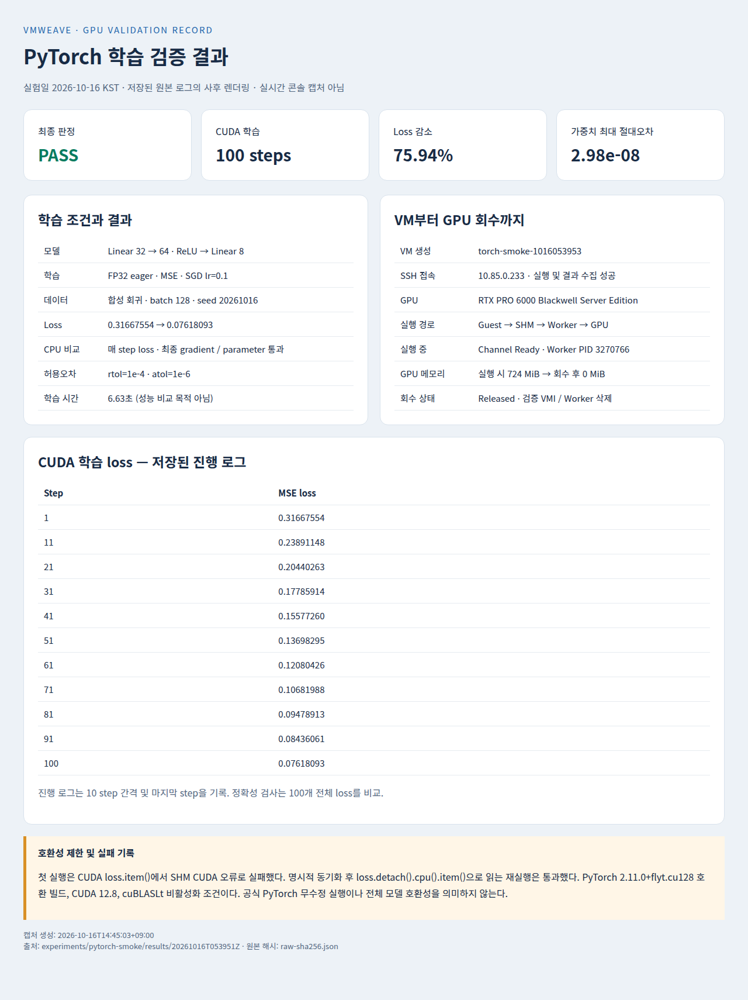
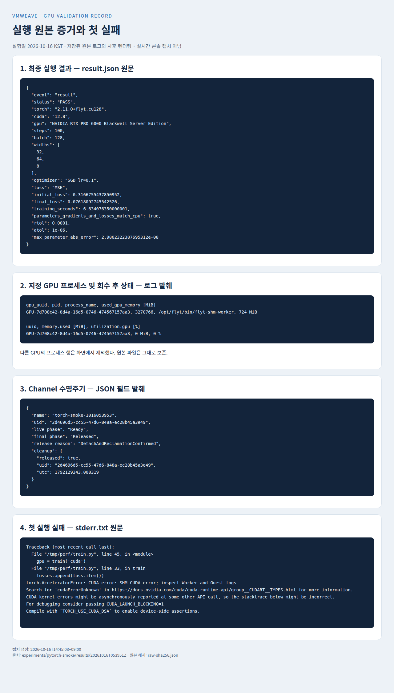

# PyTorch 학습으로 VMWeave 재검증 — 2026-10-16

새 VM 생성 → SSH 접속 → SHM을 통한 실제 GPU 학습 → 정상 회수를 검증했다.
최종 실행은 PASS이며, 첫 실행에서 발견한 CUDA `loss.item()` 호환성 실패는 별도 보존했다.

## 결과

| 항목 | 관측 |
|---|---|
| VM | `vmweave-test-a/torch-smoke-1016053953`, 8 vCPU, RAM 16 GiB |
| SSH | 새 VM `10.85.0.233` 접속 및 코드·환경 전송 성공 |
| 모델 | `Linear(32,64) → ReLU → Linear(64,8)`, FP32 eager |
| 데이터 | seed 20261016, 합성 입력 128개, 목표값은 입력 앞 8차원의 0.5배 |
| 학습 | MSE, SGD lr=0.1, 100 step, batch 128 |
| CUDA | PyTorch `2.11.0+flyt.cu128`, CUDA 12.8 |
| loss | **0.31667554 → 0.07618093 (75.94% 감소)** |
| 정확성 | 동일 초기값의 CPU 학습과 매 step loss·최종 전체 gradient·parameter 비교 통과 |
| 허용오차 | rtol=1e-4, atol=1e-6; parameter 최대 절대오차 **2.98e-8** |
| 학습 시간 | 약 6.63초; 작은 기능 시험이며 성능 비교 수치가 아님 |
| 실제 GPU | RTX PRO 6000 Blackwell Server Edition, UUID `GPU-7d708c42-8d4a-16d5-0746-474567157aa3` |
| 실행 증거 | CUDA loss/gradient device 검사, Channel `Ready`, GPU Worker PID 3270766, GPU 메모리 724 MiB |
| 회수 | 두 시도 모두 Channel `Released`; 최종 검증 VM의 VMI와 Worker 삭제 확인 |

CPU 실행은 수치 비교용 기준이다. GPU 학습은 모델과 데이터를 명시적으로 CUDA로 이동하며
CUDA 미사용 시 실패한다. CUDA 단계의 loss와 gradient가 CUDA 텐서인지 확인하고,
실제 가중치 갱신·loss 감소·NaN/Inf 부재도 검사했다. 기존 `vmweave-k8s-01`은 계속 실행 중이다.
VM/PVC/PV/Channel 객체는 실행 기록과 재검토를 위해 남겼으며 GPU 할당은 회수했다.

## 호환성 제한과 첫 실패

첫 실행은 첫 CUDA step의 `loss.item()`에서 `cudaErrorUnknown`으로 실패했다.
같은 학습을 `torch.cuda.synchronize()` 후 `loss.detach().cpu().item()`으로 읽도록 바꾼
두 번째 새 VM 실행은 통과했다. 로그만으로 첫 오류의 내부 원인을 확정하지 않는다.
이 CPU 복사는 결과 관측용이며 forward/backward/SGD는 CUDA에서 실행한다.

기존 VMWeave 호환 PyTorch 빌드와 현재 로컬 Guest/Worker 빌드를 사용했다.
`DISABLE_ADDMM_CUDA_LT=1`, `foreach=False`, `fused=False`, TF32 비활성화 조건이다.
따라서 일반적인 MLP 학습 구조의 실행은 확인했지만, 공식 배포 PyTorch의 무수정 실행,
임의 모델·optimizer·cuDNN·AMP·torch.compile 지원을 검증한 결과는 아니다.

## 코드와 증거

- [학습 코드](train.py), [사이트 전용 실행기](run.py)
- [최종 결과](results/20261016T053951Z/runs/torch-smoke-1016053953/result.json)
- [CPU/CUDA 학습 로그](results/20261016T053951Z/runs/torch-smoke-1016053953/train.jsonl)
- [실행 중 Channel](results/20261016T053951Z/runs/torch-smoke-1016053953/channel-live.json), [GPU 프로세스](results/20261016T053951Z/runs/torch-smoke-1016053953/gpu-live.txt)
- [회수 증거](results/20261016T053951Z/runs/torch-smoke-1016053953/channel-released.json), [회수 후 GPU](results/20261016T053951Z/gpu-after.txt)
- [첫 실행 실패 로그](results/20261016T053702Z/runs/torch-smoke-1016053705/stderr.txt)

재실행은 저장소 루트에서 `python3 experiments/pytorch-smoke/run.py`로 한다.
기존 실험의 로컬 이미지·bundle·SSH 키·Kubernetes 접근 권한이 필요한 사이트 전용 실행기다.
매번 새 VM 이름과 결과 경로를 생성하고 자신이 생성한 Channel UID를 확인한 뒤 drain한다.

## 검증 절차와 판정 기준

1. 독립 KubeVirt VM과 GPURequest/SHM Channel을 생성하고 VM 실행 및 SSH 접속을 확인한다.
2. 동일 seed·초기 가중치·입력으로 CPU 기준 학습과 CUDA 학습을 각각 100 step 수행한다.
3. CUDA 사용 가능 여부와 device 수, loss·gradient의 CUDA 위치를 검사한다.
4. loss가 초기값의 70% 미만인지, 가중치가 실제 갱신됐는지, 최종 가중치·gradient에 NaN/Inf가 없는지 검사한다.
5. 100개 loss 및 최종 모든 가중치·gradient를 CPU 결과와 rtol=1e-4/atol=1e-6으로 비교한다.
6. 종료 전 Channel Ready와 GPU Worker 프로세스를 수집하고, 종료 후 Released와 VMI/Worker 제거·GPU 메모리 회수를 확인한다.

학습의 PASS는 위 조건을 만족한 두 번째 실행을 뜻한다. 첫 실패를 성공 횟수에 포함하지 않으며,
독립 성공 반복은 1회다. 각 step의 gradient 전체를 저장하거나 비교한 것은 아니고 최종 gradient를 비교했다.

| 시도 | 실행 ID | 결과 | 회수 |
|---|---|---|---|
| 1 | `torch-smoke-1016053705` | 첫 CUDA loss.item() 관측에서 실패 | Released |
| 2 | `torch-smoke-1016053953` | 명시적 동기화 및 CPU 복사로 loss 관측, 학습·정확성 PASS | Released |

## 결과 스크린샷

아래 이미지는 **저장된 실행 로그와 JSON을 HTML로 렌더링한 사후 화면 캡처**다.
실험 당시 터미널·Grafana의 실시간 캡처가 아니며, 캡처를 만들기 위해 GPU 학습을 다시 실행하지 않았다.
요약 화면과 원본 증거 화면 모두 첫 실패 및 호환성 제한을 포함한다.

### 결과 요약



### 원본 증거와 실패 기록



## 기록 보존 및 재생성

- [요약 HTML](evidence/20261016/results-screen.html), [원본 증거 HTML](evidence/20261016/raw-evidence-screen.html)
- [캡처 시각·브라우저·이미지 SHA-256](evidence/20261016/capture.json)
- [화면 생성에 사용한 원본 SHA-256](evidence/20261016/raw-sha256.json)
- [학습 코드·Guest 라이브러리 SHA-256](results/20261016T053951Z/sources-sha256.json)
- [실행 환경 번들 정보](results/20261016T053951Z/bundle.json), [Worker 이미지와 배치](evidence/20261016/deployment-summary.json)
- [VM 실행 상태](evidence/20261016/deployment-summary.json), [회수 후 클러스터 기록](evidence/20261016/deployment-summary.json)

원본 로그는 기존 결과 디렉터리에 보존했다. GPU 프로세스 화면은 지정 시험 GPU의 행만
발췌했으며 다른 GPU의 프로세스가 포함된 원본 파일은 변경하지 않았다.
종료 후 prepare/reclaim Pod는 Succeeded 기록으로 남아 있고, 실행 Worker와 VMI는 제거됐다.

화면만 다시 생성하려면 저장소 루트에서 다음 명령을 실행한다. 로컬 Chromium 경로는
[생성 스크립트](capture_results.py)에 명시되어 있다. 이 명령은 기존 캡처를 갱신한다.

```bash
python3 experiments/pytorch-smoke/capture_results.py
```

공개 저장소에는 보고서·화면·검증에 필요한 선택 원본 및 배치 요약을 포함한다. 전체 명령 로그, SSH known-hosts, 전체 클러스터 스냅샷과 Guest 설정 파일은 로컬에 보존한다. 배치 요약은 원본 스냅샷의 선택 필드이며 원본 전체를 뜻하지 않는다.
