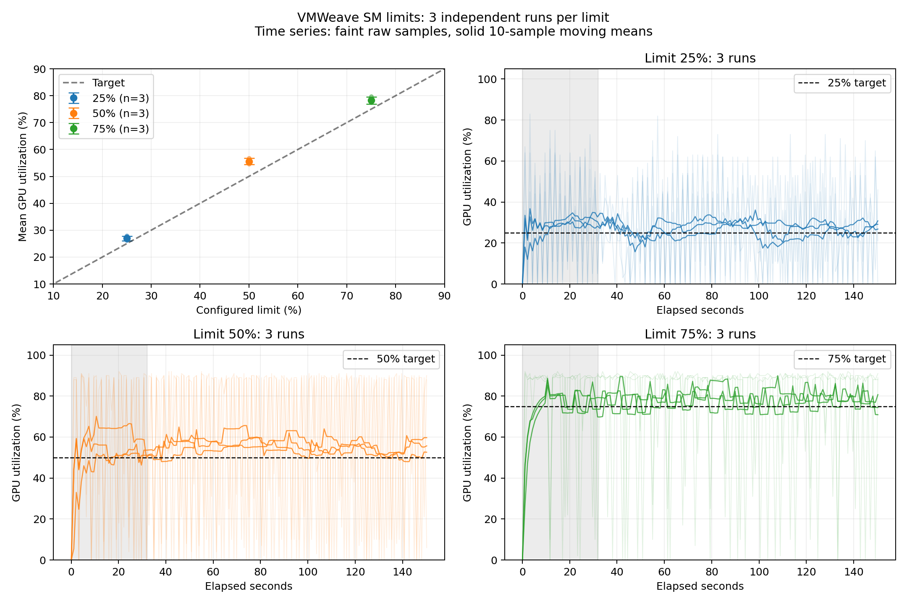

# VMWeave 제한률 25/50/75% 반복 검증

> 2026-10-16 배포 결정: 55.61% 관측값을 배포 차단 사유에서 제외하고
> 선형 보정 + idle-reset을 [배포용 HAMi 이미지](../../runtime/hami/README.md)에 포함했다.
> 아래 수치와 실험 당시의 배포 상태는 원 기록을 유지한다.

2026-10-15 KST. `idle-reset` 후보를 VMWeave의 실제 Guest → SHM → Worker → HAMi → GPU 경로에서 검증했다. **25/50/75% 설정에서 평균 26.94/55.61/78.26%를 관측했다.** 제한률별 평균과 완료 처리량이 뚜렷하게 구분되어, 이번 워크로드에서는 목표값 근처의 평균 사용률을 재현했다. 다만 50% 조건의 평균 오차는 +5.61%p로 기존 ±5%p 참고 기준을 조금 넘는다.

## 조건과 측정 방법

- RTX PRO 6000 Blackwell Server Edition, GPU 2, 188 SM, NVIDIA driver 580.173.02. 다른 GPU의 기존 서비스는 유지했다.
- HAMi-core 기준 커밋 `b216ba1be1b8e21488d1c7370ed3357b3049aad1`에 [선형 보정 + 유휴 적립 방지 패치](patches/0002-linear-sm-gain-with-idle-reset.patch)를 적용했다. 실제 로딩 SHA-256: `f30f08c8f4bbdada1856231f2ec269d50fc81e08881a4146c9c1bbb3173aebd8`.
- `GPU_CORE_UTILIZATION_POLICY=FORCE`, 메모리 제한 2048 MiB. 각 실행마다 새 VM, Worker, Channel 및 HAMi 상태를 사용했다. VM CPU 32–39, Worker CPU 48–51에 고정했다.
- 제한률별 3회, 총 9회. 순서: **25/50/75 → 75/50/25 → 50/25/75**. 고정 순서 편향을 줄이되 완전한 무작위 실험으로 간주하지 않는다.
- 회당 150초, Guest probe의 초기 30초는 준비 구간. 동일 합성 연산(grid 2048, block 256, 반복 1048576, 커널마다 동기화)을 사용했다.
- 장치 사용률은 호스트 `nvidia-smi`에서 약 1.05초 간격으로 수집하고 실행기 시작 **32초 이후** 표본의 산술평균을 계산했다. Guest 처리량 측정 구간과 호스트 표본 구간은 초기화/SSH 지연 때문에 완전히 동일하지 않다.
- 최종 평균은 **각 실행 평균 3개의 산술평균**, 표준편차는 그 3개 평균의 표본 표준편차다. 같은 실행의 연속 표본을 독립 반복으로 세지 않았다. 오차는 `실측 평균 − 설정값`이며 단위는 %p다.

## 결과

| 제한률 | 평균 GPU 사용률 | 설정 대비 오차 | 실행 평균의 표준편차 | 3회 평균의 범위 | 평균 launches/s |
|---|---:|---:|---:|---:|---:|
| 25% | 26.94% | +1.94%p | 0.86%p | 26.26–27.90% | 25.20 |
| 50% | 55.61% | +5.61%p | 1.12%p | 54.63–56.83% | 53.75 |
| 75% | 78.26% | +3.26%p | 1.29%p | 77.46–79.74% | 75.35 |

실행별 결과:

| 실행 순서 | 제한률 | 평균 GPU 사용률 | 오차 | launches/s |
|---|---:|---:|---:|---:|
| run-01-limit-25 | 25% | 27.90% | +2.90%p | 25.25 |
| run-02-limit-50 | 50% | 56.83% | +6.83%p | 53.91 |
| run-03-limit-75 | 75% | 77.46% | +2.46%p | 75.53 |
| run-04-limit-75 | 75% | 77.56% | +2.56%p | 75.03 |
| run-05-limit-50 | 50% | 54.63% | +4.63%p | 53.51 |
| run-06-limit-25 | 25% | 26.26% | +1.26%p | 25.22 |
| run-07-limit-50 | 50% | 55.38% | +5.38%p | 53.83 |
| run-08-limit-25 | 25% | 26.66% | +1.66%p | 25.14 |
| run-09-limit-75 | 75% | 79.74% | +4.74%p | 75.49 |

왼쪽 위 오차막대는 실행 평균의 표준편차이며 신뢰구간이 아니다. 나머지 패널은 제한률별 3회 전체 시계열이다. 옅은 선은 원시 표본, 진한 선은 10표본 이동평균이고 회색은 제외 구간이다. 순간 사용률은 평균과 다르므로 평균 근사성을 순간 상한 보장으로 해석하지 않는다.

## 해석 범위

이 검증은 긴 합성 커널, 단일 VM, 전용 시험 GPU 및 FORCE 정책에서 제한값 변화에 따른 평균 장치 사용률을 확인한다. 짧은 커널, 실제 모델 추론, 다중 VM 경쟁, 장시간 안정성의 일반적인 결과로 확대하지 않는다. 이전 [후보 비교](report.md)에서 관측한 짧은 커널 오차는 이번 실험으로 해소됐다고 주장하지 않는다.

후보는 실험 Worker의 mount namespace에만 적용했다. 전역 HAMi 라이브러리와 기존 서비스 Worker의 교체는 수행하지 않았다.

## 원시 기록과 재현

- [실행 프로토콜](evidence/limit-validation-20261015/protocol.json), [실행별 CSV 요약](evidence/limit-validation-20261015/summary.csv), [통계 JSON](evidence/limit-validation-20261015/summary.json), [PDF 그림](evidence/limit-validation-20261015/limits.pdf).
- 각 `run-XX-limit-YY` 디렉터리에 `gpu.csv`, `probe.stdout`, `result.json`, 실제 라이브러리 SHA, 실행 identity, controller 회수 완료 기록을 보관했다.
- [실행기](runner/validate_limits.py), [분석·그림 생성기](runner/analyze_limits.py), [빌드 및 환경 준비](README.md).
- 행정 명령 전체 감사 로그와 Guest 인증 관련 파일은 로컬에 보관한다. 공개 기록은 측정 결과 및 검증에 필요한 메타데이터로 구성한다.

9회 모두 서로 다른 Worker UID, 요청 제한률 및 후보 SHA 일치, 종료 후 `Released`를 확인했다. VM/Channel/PVC/PV/Profile 및 관리자 helper를 정리했으며, 전역 라이브러리와 기존 Worker SHA는 유지됐다. [정리 검증](evidence/limit-validation-20261015/cleanup.json).
