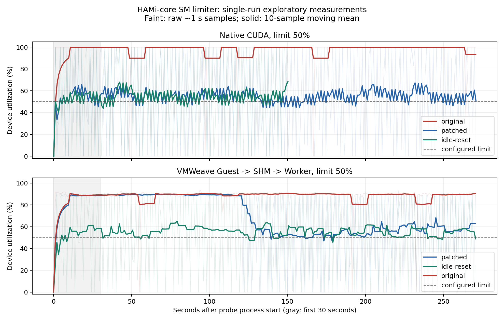

# VMWeave SM Core 제한 수정 및 실측 결과

25/50/75% 각각 3회 추가 검증은 [별도 보고서](limit-validation.md)를 참조한다. 아래는 추가 검증 전 후보 비교 기록이다.

2026-10-15 KST. **수정 후보 구현·실측 완료, 전역 배포 보류.** 계산식 수정은 제한값별 차이를 복원했지만, 모든 워크로드에서 최초 제안한 평균 ±5%p 기준을 만족하지 않았다. 원래 설치 라이브러리를 유지했다. 이번 결과를 SM 제한 문제의 완전 해결이나 정식 릴리스 검증 통과로 표시하지 않는다.

## 구현

- [계산식 패치](patches/0001-linear-sm-gain.patch): SM² 보정량을 SM 비례로 정규화하고 토큰 풀 계산을 64비트로 승격했다.
- [유휴 적립 보완 후보](patches/0002-linear-sm-gain-with-idle-reset.patch): 위 변경에 더해, 최초 커널 전 또는 커널 호출/대기가 1초 넘게 없고 사용률이 0인 상태에서 share와 토큰을 초기화한다. limiter 대기 중에는 활동 시각을 갱신한다. 두 패치는 같은 원본 커밋에 적용하는 대안이며 순서대로 적용하지 않는다.
- [빌드·재현 안내](README.md), Native/Guest probe, 실행기, 단위 검사, 분석·그림 생성 도구를 추가했다. 설치 경로를 전역 덮어쓰지 않고 새 시험 Worker의 mount namespace에만 읽기 전용 라이브러리를 적용했다.

근거는 [HAMi-core #274](https://github.com/Project-HAMi/HAMi-core/issues/274)와 [미병합 PR #286](https://github.com/Project-HAMi/HAMi-core/pull/286)이다. 유휴 적립 보완은 이번 실험에서 추가한 로컬 후보다.

## 환경과 대조군

- HAMi v2.10.0 / HAMi-core `b216ba1be1b8e21488d1c7370ed3357b3049aad1`.
- RTX PRO 6000 Blackwell Server Edition, 188 SM, SM당 최대 스레드 1536, NVIDIA driver 580.173.02, CUDA 12.8 빌드 도구.
- Native는 GPU 0, VMWeave는 GPU 2의 유휴 GPU를 사용했다. 두 경로 사이의 절대 성능 비교가 아니라 각 경로 안에서 후보를 비교했다. 기존 GPU 1 Worker와 GPU 3 모델 서비스는 시험 대상이 아니다.
- `original`은 현재 소스 커밋을 같은 도구체인으로 재빌드한 대조군이다. 원래 설치 바이너리의 미확인 빌드 옵션과 동일하다고 주장하지 않는다. 커밋만으로 후보를 구분할 수 없으므로 실제 바이너리 SHA를 확인했다. [빌드 기록](evidence/build.json)
- 모든 제한 비교는 `GPU_CORE_UTILIZATION_POLICY=FORCE`로 수행했다. 자동 정책 모드 전체의 검증 결과가 아니다.

## 결과

Native 긴 커널의 50% 제한에서 평균 장치 사용률은 **97.96% → 55.11%**, 처리량은 **94.34 → 52.77 launches/s**로 변했다. 실제 완료 처리량도 달라져 관측 표시만 바뀐 결과가 아니다.

계산식 패치의 Native 제한값별 결과:

| 설정값 | 평균 장치 사용률 | launches/s |
|---|---:|---:|
| 25 | 23.61% | 23.24 |
| 50 | 55.11% | 52.77 |
| 75 | 79.63% | 76.96 |
| 100 | 100.00% | 96.04 |

25·75·100 조건은 150초, 50 조건은 270초 실행했다. 각 조건 1회이며 첫 30초는 준비 구간이다. 따라서 이 표는 설정값별 차이가 나타난다는 예비 관측이며 정밀한 비례성 검증이 아니다.

VMWeave 긴 커널, 모두 50% 제한·270초 실행:

| 후보 | 준비 구간 이후 평균 | 120초 이후 평균 | launches/s |
|---|---:|---:|---:|
| original | 88.67% | 88.64% | 85.11 |
| patched | 68.18% | 55.95% | 65.50 |
| idle-reset | 55.64% | 54.97% | 53.69 |

Worker는 Guest 부팅 전부터 CUDA/HAMi를 초기화한다. 계산식만 바꾼 후보에서도 이 유휴 시간에 token/share가 적립됐고, 90초 예비 시험 종료 직전에도 약 420만 토큰이 남았다. 유휴 적립 보완 후보는 이 초기 backlog를 줄이기 위한 변경이다. NVML 피드백과 커널 제출 단위 때문에 남는 사용률 진동까지 해결한 것은 아니다.

짧은 커널의 50% 제한에서는 계산식 패치가 **41.15%**, 유휴 보완이 **40.82%**로 목표보다 낮았다. 긴 커널과 짧은 커널을 동시에 ±5%p 범위에 넣지 못했으므로 배포 기준 미달이다. 후반 구간만 골라 전체 실행의 초기 초과를 숨기지 않도록 두 구간을 함께 보고했다.

## 회귀 검사와 한계

- 실제 `delta()` 함수의 정규화·방향·상하한 단위 검사 통과(UBSan).
- 실제 유휴 판정 및 limiter 코드의 timeout 경계, 대기 생산자 활동 갱신, 100% fast path 검사 통과(UBSan).
- 메모리 quota: 세 후보 모두 2 GiB 설정에서 16 MiB 할당 성공, 3 GiB 할당은 `CUDA_ERROR_OUT_OF_MEMORY` 반환. [결과](evidence/memory/)
- 100% Native 처리량: 원본 96.03, 계산식 패치 96.04 launches/s. 상대 감소율 -0.01%로 이번 단일 비교에서는 5% 회귀 기준 이내다. 유휴 보완 후보의 100% 실측이나 통계적 무회귀 보장으로 확대하지 않는다.
- VMWeave에서 Guest SHM 실행, Worker의 단일 HAMi 매핑 및 실제 SHA, controller의 `Released` 및 자원 회수 기록을 확보했다. 원래 HAMi 파일과 기존 Worker SHA 유지 여부는 [정리 기록](evidence/cleanup.json)에 기록한다.
- 총 14개 사용률 측정은 조건별 1회 예비 시험이다. 3회 반복 전체 행렬, 15분 장시간, 두 VM 25/75·50/50 경쟁, 반복 유휴/재개는 미실행이다. 이미 예비 gate에서 기준 미달이 확인되어 확대 배포 단계로 넘어가지 않았다.
- 수치는 전용 시험 GPU의 장치 사용률이다. HAMi watcher 로그의 프로세스 피드백은 별도 원시 증거이며 물리 SM 점유율·전용 할당·성능 SLA와 동일시하지 않는다.

## 후속 수정의 초점

현재 두 후보 중 어느 것도 정식 배포 후보로 승격하지 않는다. 다음 변경은 추가 SM 배율 조정보다 **커널 길이에 따른 제어 오차와 토큰 누적·반납 정책**을 다뤄야 한다. launch 소비량은 grid 크기에 의존하지만 실제 실행 시간은 커널마다 달라서, 선형 보정만으로 일정한 제어 응답을 보장하지 못한다. 이는 소스와 이번 워크로드별 결과에 근거한 다음 검증 가설이다.

다음 실험에서는 짧은/긴 커널, 유휴 후 재개를 고정하고 refill 단위·잔여 토큰 상한·피드백 지연을 하나씩 바꿔 평균 오차와 진동을 함께 비교해야 한다. 두 워크로드의 기준을 통과한 후보만 다중 VM 및 장시간 시험으로 확대한다.

원시 결과와 창별 통계: [analysis.json](evidence/analysis.json). 빌드/실행 재현: [README](README.md).
