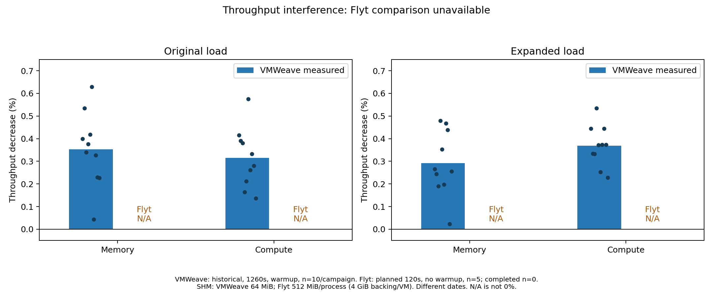
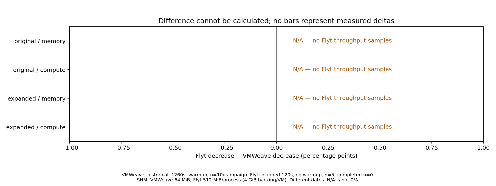
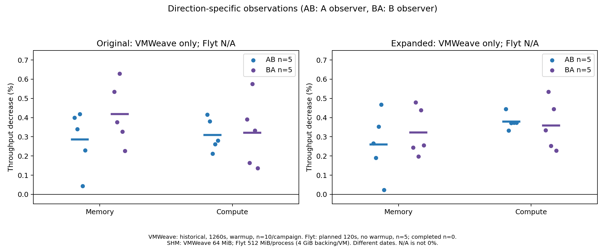

# Flyt MPS 성능 간섭 비교 — 초기화 실패 및 측정 미완료 보고서

2026-10-26 KST. **Flyt 유효 측정 0구간 / 계획 30구간. 성능 차이 계산 불가.**

Flyt SHM 경로로 기존 MLP를 실행하려 했으나 PyTorch import에서 중단됐다. 기존 VMWeave 자료는 재집계했고 신규 GPU 재측정은 하지 않았다. 아래 값은 기존 VMWeave 실측값이며 Flyt 결과가 아니다. N/A는 0% 또는 무간섭을 뜻하지 않는다.

## 실행 결과와 근거

1. 두 시험 VM(각 8 vCPU/16GiB RAM)과 분리된 Flyt 백엔드·SHM backing을 준비했다. 대상 GPU는 RTX PRO 6000 Blackwell Server Edition, 드라이버 580.173.02다.
2. 같은 MPS 데몬을 두 백엔드가 사용하도록 구성했다. A 백엔드 로그에는 94 SM 및 2GiB 요청과 virtual server 초기화가 기록됐다. GPU 컨텍스트의 실제 SM 제한과 메모리 한도 강제 적용, 두 VM의 동시 MLP 실행은 검증 단계에 도달하지 못했다.
3. 기존 Rodinia 방식으로 Flyt 클라이언트를 `libcudart.so.12`로 로딩하면 `libc10_cuda.so`에서 `cudaGetDriverEntryPointByVersion` 심볼을 찾지 못해 PyTorch import가 실패했다. [원시 오류](diagnostics/a-process.log), [심볼 점검](diagnostics/client-symbol-audit.txt)을 보존했다. 해당 심볼 부재는 확인했으나 이것이 유일한 호환성 문제라고 단정하지 않는다.
4. 제품 변경 없이 실제 CUDA runtime과 Flyt LD_PRELOAD를 함께 사용하는 대체 설정을 진단했다. A의 재사용 백엔드와 B의 새 백엔드 모두 40초 내 초기화를 마치지 못했고 종료 코드 124였다. 두 진단의 출력은 0바이트이며 timeout 내부 원인은 미확인이다. [진단 상태](diagnostics/loader-diagnostics.json). 이들은 성능 반복으로 세지 않는다.
5. 사전 승인된 실패 중단 기준에 따라 남은 반복을 실행하지 않았다. 웜업·별도 성능 파일럿·p99 분석·제품 코드 수정은 수행하지 않았다. 시험 환경 정리 결과는 [cleanup.json](cleanup.json)에 기록한다.

## 처리량 감소율 비교

D = 100 × (1 − 동시 부하 처리량 / 동일 반복 baseline 처리량). 표는 반복별 D의 동일 가중 평균이다. ΔD = Flyt 평균 D − 기존 VMWeave 평균 D (%p).

| 부하 규모 | 상대 부하 | 기존 VMWeave 감소율 | 신규 Flyt | 차이(%p) |
|---|---|---:|---|---|
| original | memory | 0.352% | N/A | N/A |
| original | compute | 0.315% | N/A | N/A |
| expanded | memory | 0.291% | N/A | N/A |
| expanded | compute | 0.369% | N/A | N/A |






## 방향별 결과와 변동



기존 VMWeave는 각 캠페인 AB/BA 각각 5회다. 전체 반복 점과 방향별 평균을 표시했다. 신규 Flyt는 유효 반복이 없어 평균·표준편차·방향 가중 결과를 계산하지 않는다. [반복별 기존 자료](vmweave-reference.csv), [방향별 집계](direction-comparison.csv), [비교 집계](comparison.json)에 원시 정밀도 수치를 제공한다. 통계적 유의성이나 시스템 우열은 판정하지 않는다.

## 절대 처리량 — 감소율 해석용 기존 참고값

| 규모 | 조건 | 기존 VMWeave 평균 처리량(건/초) | Flyt |
|---|---|---:|---|
| original | baseline | 10.1266 | N/A |
| original | memory | 10.0909 | N/A |
| original | compute | 10.0946 | N/A |
| expanded | baseline | 10.1016 | N/A |
| expanded | memory | 10.0721 | N/A |
| expanded | compute | 10.0643 | N/A |


## 비교 조건과 제한

| 항목 | 기존 VMWeave | 계획/준비한 Flyt |
|---|---|---|
| 측정 기간 | 조건당 1260초 | 목표 120초; 실제 측정 시작 못함 |
| 반복 | 원/확대 각각 10회 | 각각 5회 계획; 완료 0회 |
| 웜업 | 수행 | 생략 계획; 실행도 없음 |
| 워크로드 | FP32 eager MLP 1024→2048→1024, batch32 | 동일 소스 기반, import 실패 |
| 자원 | VM별 8 vCPU/16GiB, 연산 50%/2GiB | 같은 VM 크기, 외부 50%/2GiB 및 Flyt 94 SM/2GiB 요청; 실제 강제 적용 미검증 |
| SHM | 64MiB | 사용자 승인한 512MiB/process, VM별 4GiB backing |
| 시점 | 2026-10-12~14 | 2026-10-26 준비/실패 진단 |

처리량은 결과 D2H 전송·CPU 검증·로그 비용을 포함하는 기존 관측 루프 기준이다. 제품 경로·시점·웜업·관측 길이·SHM 차이가 있으므로 유효 측정을 얻더라도 MPS만의 효과로 귀속할 수 없다. 이번에는 유효 Flyt 값 자체가 없으므로 성능 우열·간섭 크기·무간섭에 관한 결론을 낼 수 없다. Rodinia 성공이 이 PyTorch 번들의 호환성을 보장하지 않음을 확인했다.

## 재현 및 파일 안내

저장소 루트에서 Python과 `matplotlib==3.9.4`, `Markdown==3.10.2`를 준비한 뒤 다음 명령으로 공개 증거의 해시 검증, 기존 결과 재집계, PNG/SVG/PDF 그래프, Markdown/독립 HTML 보고서를 재생성한다. GPU·클러스터 접근은 하지 않는다.

```sh
python3 experiments/thesis-isolation/runner/analyze_flyt_mps_comparison.py
```

[PDF 보고서](REPORT.pdf), [manifest](manifest.json), [protocol](protocol.json), [입력 해시](source-sha256.json), [검증](validation.json). 그래프는 `figures/`의 PNG/SVG/PDF로 제공한다. HTML은 그래프를 내장한다. PDF 보고서는 생성된 HTML을 Chromium의 headless print-to-pdf로 출력한 추가 배포본이며 위 집계 명령은 PDF 보고서를 재생성하지 않는다(그래프 PDF는 재생성한다). 전체 클러스터 로그·자격증명·대형 바이너리는 공개에서 제외했다. [실행 계획](../../config/flyt-mps-comparison-plan-20261026.md)의 측정 조건과 중단 기준을 따른다.

다음 측정을 위해서는 동일 PyTorch 번들을 지원하는 Flyt CUDA API 경로를 확보하고 초기화를 확인해야 한다. 제품 API 구현 변경이나 다른 PyTorch/워크로드로 전환하는 후속 작업은 이번 결과에 포함하지 않았다.
