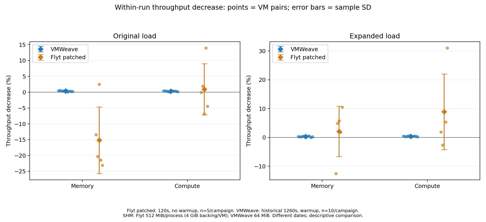
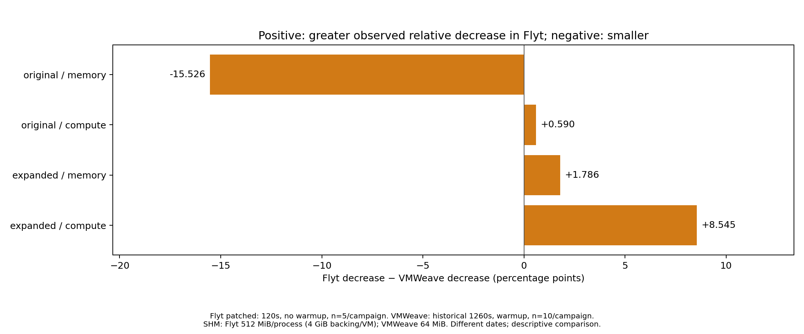
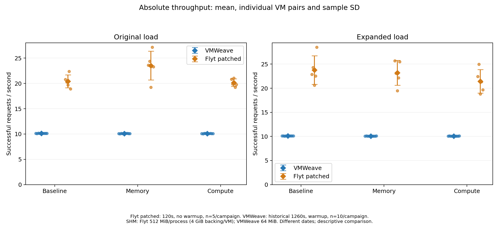
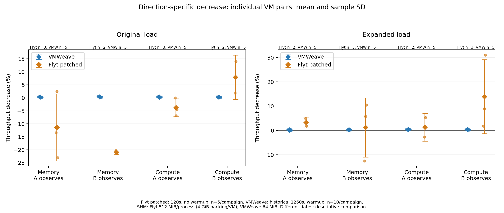

# 호환 패치 Flyt MPS와 기존 VMWeave의 처리량 간섭 비교

Flyt 신규 10개 독립 VM 쌍·30구간을 완료했다. 원/확대 캠페인별 총 5회이며, 기존 VMWeave 각 10회 전체와 비교했다. 정상 완료 요청은 **79,511건**, 요청 오류·정확성 불일치는 **0건**이다. 최대 절대 오차는 5.81145287e-07이며 기존 rtol=1e-4, atol=1e-6 검사를 유지했다. 네 조건의 Flyt 평균 감소율은 -15.173~+8.913%이며, 기존 VMWeave와의 차이는 -15.526~+8.545%p다. 수치는 각 반복의 baseline 대비 감소율을 평균한 기술적 비교다.

## 처리량 감소율

| 캠페인 | 부하 | VMWeave 감소율(%) | Flyt 감소율(%) | ΔD(%p) | Flyt SD / 최소 / 최대(%) |
|---|---|---|---|---|---|
| original | memory | 0.352 | -15.173 | -15.526 | 10.508 / -23.065 / 2.447 |
| original | compute | 0.315 | 0.905 | +0.590 | 8.079 / -6.860 / 13.961 |
| expanded | memory | 0.291 | 2.077 | +1.786 | 8.727 / -12.504 / 10.472 |
| expanded | compute | 0.369 | 8.913 | +8.545 | 13.106 / -2.685 / 31.049 |


D=100×(1−동시 부하 처리량/같은 반복 baseline 처리량), ΔD=평균 D(Flyt)−평균 D(VMWeave). 감소율 단위는 %, 차이 단위는 %p다. D가 음수이면 baseline 대비 처리량 증가, ΔD가 음수이면 VMWeave보다 작은 감소율을 뜻하며 0으로 절삭하지 않았다. SD는 요청 단위가 아닌 독립 VM 쌍 간 표본 표준편차다.

Flyt의 네 조건 표본 SD는 8.079~13.106%p로, 기존 VMWeave의 0.091~0.165%p보다 컸다. 확대 연산 부하의 평균 감소율이 가장 컸지만 개별 반복에는 처리량 증가도 있어 일관된 감소라고 단정하지 않는다. 원 메모리 부하의 음수 평균도 동시 실행의 인과적 이득을 입증하지 않는다. 웜업 생략·짧은 관측·실제 부하량 등 조건 차이와 반복 변동을 함께 고려해야 한다.





## 절대 처리량과 부하의 실제 실행량

| 캠페인 | 시스템 | baseline (건/초) | memory (건/초) | compute (건/초) |
|---|---|---|---|---|
| original | VMWeave | 10.127 | 10.091 | 10.095 |
| original | 호환 패치 Flyt | 20.414 | 23.535 | 20.152 |
| expanded | VMWeave | 10.102 | 10.072 | 10.064 |
| expanded | 호환 패치 Flyt | 23.770 | 23.189 | 21.434 |


baseline도 두 VM을 준비한 상태에서 상대 VM이 유휴인 조건이다. 처리량은 결과 검증을 마친 정상 완료 수/전체 관측 경과 시간이며, 실행 시간이 목표 120초를 조금 넘으면 실제 경과 시간을 사용했다. 두 시스템의 절대 처리량 차이와 상대 감소율은 구분해야 한다.



| 캠페인 | 부하 | VMWeave 실제 부하 (커널/초) | Flyt 실제 부하 (커널/초) |
|---|---|---|---|
| original | memory | 69.24 | 176.31 |
| original | compute | 45.83 | 140.09 |
| expanded | memory | 116.62 | 256.25 |
| expanded | compute | 62.27 | 38.37 |


부하 실행량은 각 부하의 실제 전체 실행 구간에서 완료 커널 수/경과 시간으로 계산했다. Flyt 부하 목표 130초, 관측 목표 120초이며 준비 이후 부하가 관측 종료까지 계속됐음을 기록으로 확인했다. 기존 VMWeave 부하도 보관된 load 완료 기록으로 재집계했다. 커널/초는 시스템 간 동일한 GPU 점유율을 뜻하지 않는다. 제출 경로·작업 배출 속도 차이는 간섭률 해석에 포함해야 한다. GPU/CPU 원시 telemetry는 [입력 manifest](manifest.json)와 raw 자료에 보존했다.

## 방향과 반복 변동

| 캠페인 | 부하 | Flyt 반복 동일 가중(%) | Flyt 방향 50:50(%) | 50:50 ΔD(%p) |
|---|---|---|---|---|
| original | memory | -15.173 | -16.126 | -16.478 |
| original | compute | 0.905 | 2.076 | +1.761 |
| expanded | memory | 2.077 | 2.287 | +1.995 |
| expanded | compute | 8.913 | 7.652 | +7.284 |




원 P는 A 관측 3회/B 관측 2회, 확대 P는 A 2회/B 3회다. 주 결과는 5회 동일 가중이며 방향 50:50은 보조 결과다. 개별 5회 전체는 [flyt-per-run.csv](flyt-per-run.csv), 방향별 표본 수·SD·최솟값·최댓값은 [direction-comparison.csv](direction-comparison.csv)에 있다. 2~3회 방향 표본에 bootstrap 구간이나 유의성 검정을 붙이지 않았다.

## 비교 조건과 해석 범위

| 항목 | 신규 Flyt | 기존 VMWeave |
|---|---|---|
| 모델 | FP32 eager MLP 1024→2048→1024, batch 32, seed 20261012 | 동일 |
| Python / PyTorch / CUDA | 기존 번들 복사본: 3.10.12 / 2.11.0+flyt.cu128 / 12.8 | 기존 번들 |
| GPU / 자원 | 같은 GPU UUID, 94 SM 요청·실효 조회 94, 2GiB 제한, VM 8vCPU·16GiB | 기존 기록의 조건; 재측정 없음 |
| 원/확대 부하 | 128MiB/1024MiB 버퍼, 1024²/8192² 행렬, 동기화 규칙 유지 | 동일 작업 정의 |
| SHM | 프로세스당 512MiB, VM별 backing 4GiB | 64MiB |
| 반복 / 관측 | 캠페인별 5회 / 조건당 120초 | 캠페인별 10회 / 조건당 1260초 |
| 웜업 | 없음; 첫 요청과 초기 비용 포함 | 기존 웜업 있음 |
| 소프트웨어 | **실험용 호환 패치 적용 Flyt** | 기존 보관 결과 |

Flyt 패치는 진입점 조회, PCI 탐색, 내부·구조체 포인터 보존, 필요 커널의 지연 조회를 포함한다. 실제 GPU 가상주소를 보존하는 이 시험 빌드는 체크포인트·이동을 명시적으로 거부하며, 일반 배포 또는 모든 CUDA API 지원을 검증한 것이 아니다. [호환성 복구 보고서](../20261026-flyt-compatibility/REPORT.md)에 근거·패치·검증·제한을 분리했다. 기존 VMWeave 패키지와 결과는 수정하거나 삭제하지 않았다.

원 P 첫 세 반복은 부하 커널 동기화 후 완료 이벤트를 받았지만, 그 뒤 버퍼 삭제·캐시 회수까지의 별도 확인 응답은 없었다. 나머지 7회에는 대기열에 `observe 0` 제어 명령을 보내 회수 뒤 응답을 확인했다(요청 0개, GPU 연산 없음). 첫 세 반복의 조건 전환 시 회수 작업 중첩 여부는 로그만으로 확정할 수 없다. 해당 표본을 제외·재측정하지 않고 모두 주 집계에 포함했으며, 이는 절차 차이와 해석 제한이다.

**ΔD는 이번 조건에서 관측한 차이이며, MPS 자체의 인과 효과나 시스템의 일반적 우열을 확정하지 않는다.** 측정 시점, 실행 경로, 실제 부하량, 웜업, 관측 길이, SHM 및 호환 패치 차이가 함께 포함된다. 작은 차이나 음수 감소율을 무간섭·동등성으로 해석하지 않는다. 본문·도표에 지연시간 백분위수 비교는 포함하지 않았다. 기존 요청 기록의 start/latency는 결과 검증·출력까지의 정확한 완료 시각을 제공하지 않으므로 과거 첫 120초를 잘라 별도 표본으로 사용하지 않았다.

## 방법·검증·재현

- 각 반복은 새 VM 쌍과 독립 세션을 사용했다. 3조건 순서는 고정 seed로 사전 결정하고 가능한 범위에서 위치를 균형화했다. [protocol.json](protocol.json)에 방향과 순서를 모두 기록했다.
- 진단·호환성 검증은 본실험에 합산하지 않았다. VMWeave는 신규 실행하지 않았으며 원본 각 10회를 임의 선별하지 않았다.
- 원시 요청 수, 정확성 코드, 경과 시간, 부하 완료·관측 종료 순서와 CSV를 교차 검산했다. [validation.json](validation.json), [cleanup.json](cleanup.json), [source-sha256.json](source-sha256.json)을 참조한다.
- 그래프는 같은 CSV/JSON에서 PNG·SVG·PDF로 생성했다. 오차 막대는 표본 SD이며 신뢰구간이 아니다.

저장소 루트에서 Python 환경에 matplotlib와 Markdown을 설치한 뒤 다음 읽기 전용 명령으로 보고서·표·그래프를 재생성한다.

```sh
python3 experiments/thesis-isolation/runner/analyze_flyt_mps_recovered.py
```

[comparison.csv](comparison.csv) · [comparison.json](comparison.json) · [VMWeave 전체 참조](vmweave-reference.csv) · [부하 실행량](load-throughput.csv) · [HTML 보고서](REPORT.html) · [PDF 보고서](REPORT.pdf)
