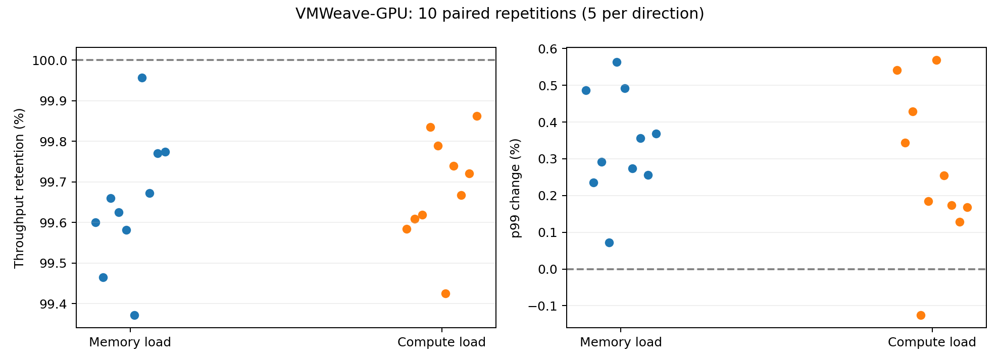
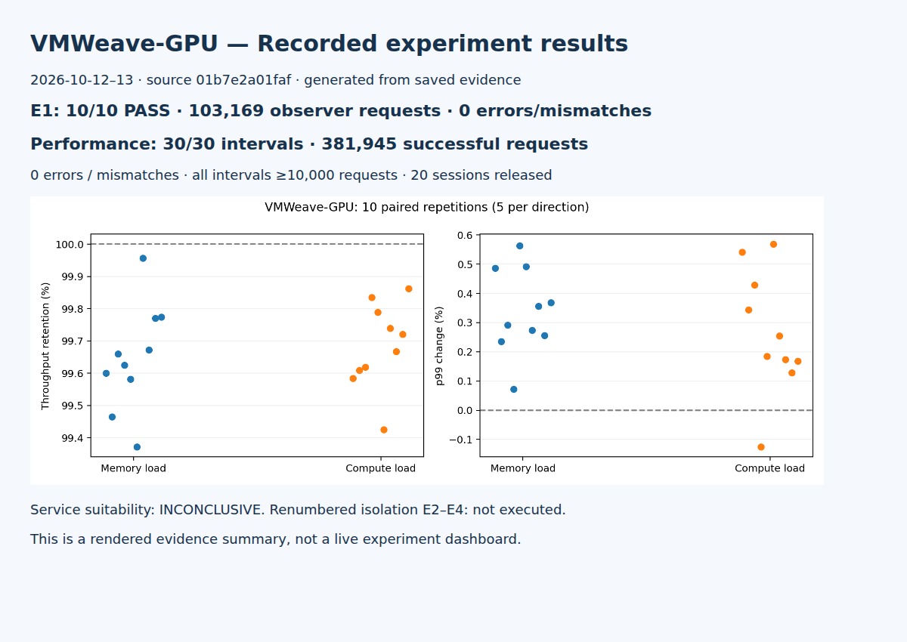

# VMWeave-GPU 실험 결과 — 2026-10-12~13

## 목적과 범위

동일 GPU를 사용하는 두 VM에서 VRAM 할당량과 성능 경합을 측정했다. 사용자가 단계별로 승인한 원래 성능 실험을 완료했다. 이후 수정된 계획서는 성능 실험을 삭제하고 데이터 접근 검사를 E2로 재번호화했으므로, 아래에서는 **성능 경합 P**로 구분한다. 수정 계획의 E2~E4를 수행한 것으로 표시하지 않는다.

## 환경과 재현

시험 대상 소스: `01b7e2a01fafaaaadbc43c5913bcbd8eca5458e5`. 결과 게시 커밋은 이 문서가 속한 커밋이며 시험 대상 소스와 다르다.

- GPU: RTX PRO 6000 Blackwell Server Edition, 시험 GPU 1대, 드라이버 580.173.02.
- VM 각각 8 vCPU/16 GiB RAM, 독립 Worker·64 MiB SHM·클라이언트 1개. 연산 설정 각각 50%.
- E1: 역할을 교환하며 관측 VM 4096 MiB/할당 VM 1024 MiB. 성능 P: 각각 2048 MiB.
- P: Python 3.10.12, PyTorch 2.11.0+flyt.cu128, CUDA 12.8, FP32 eager MLP 1024→2048→1024, batch 32, seed 20261012.
- 정확성: CPU FP32 기준과 모든 출력 비교, rtol=1e-4/atol=1e-6. 지연시간은 forward+GPU 동기화이며 CPU 복사·검증은 제외한다. 처리량 경과 시간에는 검증이 포함된다.
- 요청 타임아웃 설정 40초, 본 측정 구간 1260초. 방향별 5회, 각 반복에서 세 조건 순서를 고정 seed로 무작위화. 첫 완료 측정을 포함해 10회/30구간.
- 메모리 부하: 자기 128 MiB 버퍼의 반복 곱셈. 연산 부하: 자기 1024×1024 FP32 행렬 곱, 행렬 합계 12 MiB. CUDA 동기화 후 완료 횟수 기록.

이미지 digest 및 준비 당시 설정은 [config](config/)에, 실행 당시 순서·seed는 아래 원시 묶음의 각 protocol.json에 있다. 초기 protocol.json의 pending 표시는 준비 시점 스냅샷이며 최종 성능 조건은 이 보고서와 묶음의 stage6/plan.json을 따른다.

## 결과 요약

| 실험 | 수행 | 결과 | 판정 |
|---|---:|---|---|
| E1 VRAM 할당량/OOM 회복 | 10회 | 관측 103,169건, 오류·불일치 0; 10회 OOM 및 동일 프로세스 회복 | 실행기 PASS 10/10 |
| P 성능 경합 | 10회 × 3조건 | 정상 381,945건, 오류·불일치 0, 모든 구간 ≥10,000건 | 측정 완료; 서비스 적합성 INCONCLUSIVE |
| 수정 E2 데이터 읽기·쓰기 격리 | 0회 | 단계별 승인된 성능 작업 범위에 포함되지 않음 | 미실행 |
| 수정 E3 GPU 실행 오류 전파 | 0회 | 이번 단계 범위 밖 | 미실행 |
| 수정 E4 Worker 종료 전파 | 0회 | 이번 단계 범위 밖 | 미실행 |

## 성능 결과

| 조건 | 평균 처리량 (건/초) | 반복별 p99 평균 (ms) | 처리량 유지율 | p99 증가율 |
|---|---:|---:|---:|---:|
| baseline | 10.1266 | 88.211 | 100.000% | 0.000% |
| memory | 10.0909 | 88.511 | 99.648% | 0.340% |
| compute | 10.0946 | 88.446 | 99.685% | 0.267% |

변화율은 동일 반복의 기준 조건과 짝지어 계산한 뒤 동일 가중 평균했다. 평균 p99는 요청 전체를 합친 p99가 아니다.



## 해석과 한계

시험한 MLP와 부하에서 처리량·p99의 변화가 작았고 결과 불일치는 관찰되지 않았다. GPU 포화 부하임을 입증한 것은 아니며 다른 워크로드나 물리 GPU 격리 보장으로 일반화하지 않는다. 요청 자기상관, 방향별 5회 반복의 한계가 있어 통계적 유의성을 주장하지 않는다. 서비스 SLA가 없어 적합성은 판정 보류다. E1의 OOM은 이번 할당량 설정에서의 관측이며 모든 드라이버 상태의 증명이 아니다.

초기 성능 파일럿은 잘못된 Python 번들 경로로 준비 실패했고 본 측정에 포함하지 않았다. 수정 후 단계 3 정확성 확인과 단계 4 파일럿을 거쳐 본 측정을 시작했다. 실패 원본과 전체 명령/인벤토리 로그는 로컬 `results/`에 그대로 보존했다. 인증·클러스터 정보가 섞일 수 있는 전체 원본은 공개 묶음에서 제외했다. 선택된 측정 원시 자료는 원본 바이트와 해시로 보존했다.

## 근거와 재현

- [방향별 상세 분석](evidence/20261013/analysis.md), [반복별 CSV](evidence/20261013/per-run.csv), [기계 판독 집계](evidence/20261013/summary.json).
- [원시 증거 묶음](evidence/20261013/raw-evidence.tar.gz), [원본 파일별 SHA256](evidence/20261013/raw-sha256.json), [E1 집계](evidence/20261013/e1-summary.json).
- [집계 도구](runner/summarize_performance.py), [단일 반복 실행기](runner/measure_e2_repeat.py), [반복 제어기](runner/repeat_e2_campaign.py), [워크로드](probes/mlp.py).
- 재집계: 저장소 루트에서 아래 명령을 실행한다. 새 GPU 실험을 시작하지 않는다.

```bash
mkdir -p experiments/thesis-isolation/results/20261012-campaign
tar -xzf experiments/thesis-isolation/evidence/20261013/raw-evidence.tar.gz -C experiments/thesis-isolation/results/20261012-campaign
python3 experiments/thesis-isolation/runner/summarize_performance.py
```

실제 GPU 재실행은 로컬 키·번들·클러스터 준비가 필요하며 일반 클론만으로 즉시 실행되지 않는다. 하드코딩한 기존 실행 ID에 덮어쓰지 않도록 새 캠페인 경로를 사용해야 한다. 20개 성능 세션의 정상 회수 기록이 원시 묶음에 있다.

## 결과 화면

아래는 저장된 결과를 HTML로 렌더링한 화면 캡처다. 실험 당시 실시간 Grafana 화면으로 표시하지 않는다.


