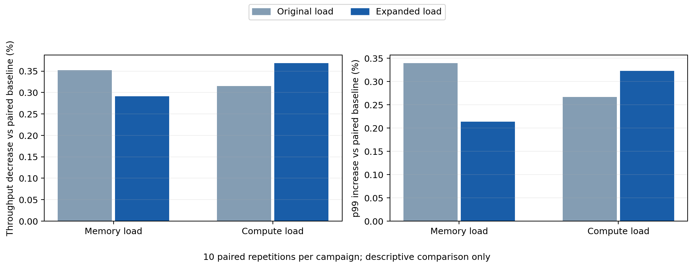
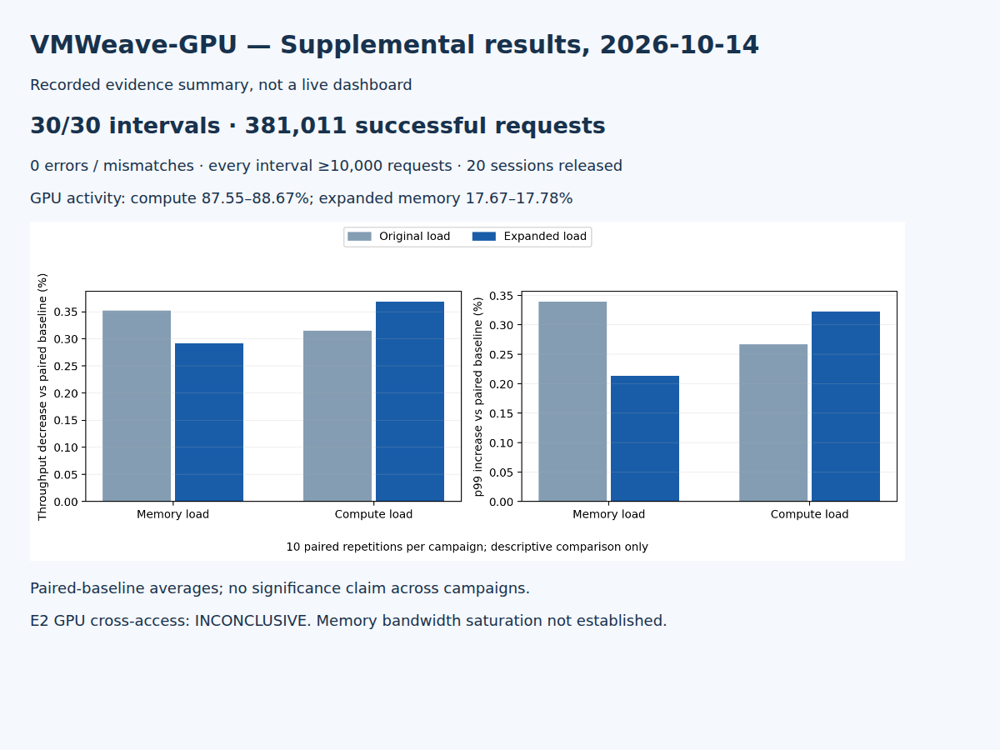

# VMWeave-GPU 실험 결과 — 2026-10-12~13

## 목적과 범위

동일 GPU를 사용하는 두 VM에서 VRAM 할당량과 성능 경합을 측정했다. 사용자가 단계별로 승인한 원래 성능 실험을 완료했다. 이후 수정된 계획서는 성능 실험을 삭제하고 데이터 접근 검사를 E2로 재번호화했으므로, 아래에서는 **성능 경합 P**로 구분한다. 성능 P와 별도로 2026-10-13 E2 데이터 접근 시험 40회를 완료했다. E3는 10회 완료했으며 E4도 10회 완료했다.

## 환경과 재현

시험 대상 소스: `01b7e2a01fafaaaadbc43c5913bcbd8eca5458e5`. 결과 게시 커밋은 이 문서가 속한 커밋이며 시험 대상 소스와 다르다.

- GPU: RTX PRO 6000 Blackwell Server Edition, 시험 GPU 1대, 드라이버 580.173.02.
- VM 각각 8 vCPU/16 GiB RAM, 독립 Worker·64 MiB SHM·클라이언트 1개. 연산 설정 각각 50%.
- E1: 역할을 교환하며 관측 VM 4096 MiB/할당 VM 1024 MiB. 성능 P: 각각 2048 MiB.
- P: Python 3.10.12, PyTorch 2.11.0+flyt.cu128, CUDA 12.8, FP32 eager MLP 1024→2048→1024, batch 32, seed 20261012.
- 정확성: CPU FP32 기준과 모든 출력 비교, rtol=1e-4/atol=1e-6. 지연시간은 forward+GPU 동기화이며 CPU 복사·검증은 제외한다. 처리량 경과 시간에는 검증이 포함된다.
- 요청 타임아웃 설정 40초, 본 측정 구간 1260초. 방향별 5회, 각 반복에서 세 조건 순서를 고정 seed로 무작위화. 첫 완료 측정을 포함해 10회/30구간.
- 메모리 부하: 자기 128 MiB 버퍼의 반복 곱셈. 연산 부하: 자기 1024×1024 FP32 행렬 곱, 행렬 합계 12 MiB. CUDA 동기화 후 완료 횟수 기록.

이미지 digest 및 준비 당시 설정은 [config](config/)에, 실행 당시 순서·seed는 아래 원시 묶음의 각 protocol.json에 있다. 초기 protocol.json의 pending 표시는 준비 시점 스냅샷이며 최종 성능 조건은 이 보고서와 묶음의 stage6/plan.json을 따른다.

## 결과 요약

| 실험 | 수행 | 결과 | 판정 |
|---|---:|---|---|
| E1 VRAM 할당량/OOM 회복 | 10회 | 관측 103,169건, 오류·불일치 0; 10회 OOM 및 동일 프로세스 회복 | 실행기 PASS 10/10 |
| P 성능 경합 | 10회 × 3조건 | 정상 381,945건, 오류·불일치 0, 모든 구간 ≥10,000건 | 측정 완료; 서비스 적합성 INCONCLUSIVE |
| 수정 E2 데이터 읽기·쓰기 격리 | 40회 | 상대 패턴 노출·변경 미관찰; 커널 실행 20회 거절 | INCONCLUSIVE: GPU 교차 접근 미검증 |
| 수정 E3 GPU 실행 오류 전파 | 10회 | CUDA 오류 700 확인, 상대 VM 오류·불일치·타임아웃 0 | 시험 범위에서 PASS 10/10 |
| 수정 E4 Worker 종료 전파 | 10회 | 전용 Worker 종료 확인, 상대 VM 오류·불일치·타임아웃 0 | 시험 범위에서 실행기 PASS 10/10 |

## E2 데이터 접근 결과 — 2026-10-13 추가

시험당 새 VM 쌍과 4096바이트 합성 패턴 버퍼를 만들고, 제어기가 기록한 대상에만 4바이트 읽기/쓰기를 요청했다. 각 경로는 방향별 5회, 총 40회다. 기존 Worker 검증을 유지했으며 커널 주소 인자는 정상 포인터 인자로 등록했다. 시험 대상 제품 코드는 변경하지 않았다. 대상 소스는 기존 `01b7e2a`이며 실행기 작성 당시 저장소 HEAD는 `0f5645f`였다.

| 경로 | 횟수 | 관측 | 판정 범위 |
|---|---:|---|---|
| API 읽기 | 10 | 코드 0, 상대 패턴이 아닌 요청 VM의 패턴 반환 | 같은 숫자의 핸들이 자기 세션에 해석됨 |
| API 쓰기 | 10 | 코드 0, 상대 버퍼 전체 유지 | 거절 성공 아님; 자기 버퍼 쓰기 여부는 사후 readback 미수행 |
| 등록 포인터 커널 읽기 | 10 | launch=1, sync=0, copy=0 | GPU 커널 교차 접근 미검증 |
| 등록 포인터 커널 쓰기 | 10 | launch=1, sync=0, copy=0 | GPU 커널 교차 접근 미검증 |

상대 버퍼 전후 검증 실패 0건, 실행·회수 오류 0건, 80개 세션 회수 완료. 커널 거절은 소스상 Guest 포인터 조회에서 설명되지만 Worker 도달 여부를 독립 계측하지 않았으므로 거절 계층을 실측 확정하지 않는다. API 핸들 충돌과 커널 실행 거절로 인해 **전체 E2 판정은 INCONCLUSIVE**다. 관측된 데이터 노출이 없다는 사실을 GPU 주소 공간 격리 합격으로 확대하지 않는다.

[경로별 집계](evidence/20261013-e2/summary.json) · [40회 CSV](evidence/20261013-e2/trials.csv) · [원본 요청/검증/회수 로그](evidence/20261013-e2/raw-evidence.tar.gz) · [원본 해시](evidence/20261013-e2/raw-sha256.json) · [감사·집계 코드](runner/summarize_data_access.py)

공개 묶음은 선택된 원본 이벤트·회수·대상 기록을 바이트 변경 없이 보존한다. 전체 원본 verdict와 클러스터 상태는 로컬 `results/20261012-campaign/data-access-20261013/`에 보존한다. 집계 스크립트 전체 재실행에는 이 로컬 verdict 자료도 필요하며, 공개 CSV의 접근 코드·패턴·대상 전후 확인은 공개 이벤트로 대조할 수 있다.

## E3 GPU 실행 오류 전파 — 2026-10-13 추가

독립된 VM 쌍을 매 시험 새로 만들고 방향별 5회 실행했다. 정상 실행을 확인한 뒤 한 시험 CUDA 컨텍스트에서 인자 없는 단일 null-address store 커널을 실행했다. 다른 VM 주소는 전달하지 않았으며 제품 검증 경로를 변경하지 않았다. 모든 시험에서 모듈·ABI 등록·launch는 0, 동기화 오류는 CUDA 700이었다. 대상 제품 소스는 `01b7e2a`, 실행기 작성 당시 저장소 HEAD는 `754b62e`다.

| 항목 | 결과 |
|---|---:|
| 실제 CUDA 오류 확인 | 10/10회 |
| 주입 전 정상 관측 요청 | 102,945건 |
| 주입 관측 구간 요청 | 171,955건 |
| 상대 VM 오류·결과 불일치·관측된 타임아웃 | 각각 0건 |
| 상대 Worker UID 유지·정상 상태 | 10/10회 |
| 시험 세션 회수 | 20/20개 |

주입 전 정상 관측은 각 60초 이상이다. 오류 주입 직전에 약 100초 관측을 시작했으며, 원시 로그상 CUDA 오류 확인부터 마지막 정상 완료까지 모든 시험에서 최소 99.907초였다. 171,955건은 주입 직전 요청도 포함하는 구간 합계이며, 전부 엄밀한 주입 이후 요청이라는 뜻은 아니다. 모든 관측 요청 지연이 설정한 40초보다 작았고 요청 ID의 누락은 없었다.

**판정: 시험한 단일 오류 700과 관측 시간 범위에서 PASS 10/10.** 다른 GPU 오류 종류·장시간 영향·자동 복구 또는 모든 장애 격리까지 검증한 것으로 확대하지 않는다. 오류를 일으킨 VM의 치명적 컨텍스트 종료 자체는 실패로 처리하지 않는다.

[집계](evidence/20261013-e3/summary.json) · [반복별 CSV](evidence/20261013-e3/trials.csv) · [원시 관측·오류·회수 로그](evidence/20261013-e3/raw-evidence.tar.gz) · [원본 해시](evidence/20261013-e3/raw-sha256.json) · [Worker 상태 선별 감사](evidence/20261013-e3/worker-audit.json) · [집계 코드](runner/summarize_context_fault.py)

Worker 상태 JSON 전체는 로컬 원본에 보존하고 공개 감사에는 UID·상태·재시작 수·원본 해시만 선별했다. 집계 코드 전체 재실행에는 로컬 Worker 원본과 초기 identity 기록도 필요하다. 공개 관측 및 오류 로그로 요청 수·오류 코드·지연·시간 범위를 재검산할 수 있다.

## E4 지정 Worker 종료 영향 — 2026-10-13 추가

방향별 5회 독립 VM 쌍에서 시험했다. Channel 소유 관계와 Pod UID를 종료 직전 다시 확인하고, 해당 Pod cgroup의 `/opt/flyt/bin/flyt-shm-worker`, 채널 allocation 경로, 슬롯 0을 검증했다. 프로세스 시작 시각을 재확인한 pidfd로 SIGKILL을 보냈으며 종료 확인도 수집했다. 공유 supervisor나 Pod 전체를 종료하지 않았다.

- 10회 모두 지정 Worker의 종료 확인. 종료 대상 쪽은 모두 세션 EOF로 끝났으며 성공 응답은 관찰되지 않았다. CUDA 요청 오류 코드가 반환된 것으로 표현하지 않는다.
- 정상 관측 구간 103,339건, 종료를 포함한 관측 구간 173,054건에서 상대 VM 오류·결과 불일치·관측된 타임아웃 0건.
- 상대 Worker의 UID·실행 상태·재시작 0회를 확인했고, 시험 세션 20개를 정상 회수했다.
- 종료 확인부터 마지막 정상 요청 완료까지 최소 99.302초. 종료 관측 구간에는 종료 직전 요청도 일부 포함된다.
- 정상 관측 루프는 60초로 설정했다. 첫 요청 시작부터 마지막 완료까지의 실측 최솟값은 59.999976495초이며, 2회에서 60초보다 약 14~24마이크로초 짧았다. 요청 구간은 루프 설정·출력 시간을 포함하지 않는다. 엄밀한 요청 수행 구간 60초 충족을 주장하지 않는다.

**시험 범위에서 장애 전파 미관측, 실행기 PASS 10/10.** 위 시간 측정 한계를 보존하며 모든 프로세스 장애·장기간 영향으로 일반화하지 않는다. 제품 소스는 `01b7e2a`, 실행기 작성 당시 저장소 HEAD는 `e19bf67`이다.

[집계](evidence/20261013-e4/summary.json) · [반복별 CSV](evidence/20261013-e4/trials.csv) · [원시 관측·종료·회수 기록](evidence/20261013-e4/raw-evidence.tar.gz) · [원본 해시](evidence/20261013-e4/raw-sha256.json) · [상대 Worker 감사](evidence/20261013-e4/worker-audit.json) · [집계 도구](runner/summarize_worker_exit.py)

전체 Pod/Channel 인벤토리는 로컬 `results/20261012-campaign/worker-exit-20261013/`에 보존한다. 공개 묶음은 선택 원본이며 전체 집계 도구 재실행에는 로컬 인벤토리도 필요하다.

## 성능 결과

| 조건 | 평균 처리량 (건/초) | 반복별 p99 평균 (ms) | 처리량 유지율 | p99 증가율 |
|---|---:|---:|---:|---:|
| baseline | 10.1266 | 88.211 | 100.000% | 0.000% |
| memory | 10.0909 | 88.511 | 99.648% | 0.340% |
| compute | 10.0946 | 88.446 | 99.685% | 0.267% |

변화율은 동일 반복의 기준 조건과 짝지어 계산한 뒤 동일 가중 평균했다. 평균 p99는 요청 전체를 합친 p99가 아니다.


## 해석과 한계

시험한 MLP와 부하에서 처리량·p99의 변화가 작았고 결과 불일치는 관찰되지 않았다. GPU 포화 부하임을 입증한 것은 아니며 다른 워크로드나 물리 GPU 격리 보장으로 일반화하지 않는다. 요청 자기상관, 방향별 5회 반복의 한계가 있어 통계적 유의성을 주장하지 않는다. 서비스 SLA가 없어 적합성은 판정 보류다. E1의 OOM은 이번 할당량 설정에서의 관측이며 모든 드라이버 상태의 증명이 아니다.

초기 성능 파일럿은 잘못된 Python 번들 경로로 준비 실패했고 본 측정에 포함하지 않았다. 수정 후 단계 3 정확성 확인과 단계 4 파일럿을 거쳐 본 측정을 시작했다. 실패 원본과 전체 명령/인벤토리 로그는 로컬 `results/`에 그대로 보존했다. 인증·클러스터 정보가 섞일 수 있는 전체 원본은 공개 묶음에서 제외했다. 선택된 측정 원시 자료는 원본 바이트와 해시로 보존했다.

## 근거와 재현

- [방향별 상세 분석](evidence/20261013/analysis.md), [반복별 CSV](evidence/20261013/per-run.csv), [기계 판독 집계](evidence/20261013/summary.json).
- [원시 증거 묶음](evidence/20261013/raw-evidence.tar.gz), [원본 파일별 SHA256](evidence/20261013/raw-sha256.json), [E1 집계](evidence/20261013/e1-summary.json).
- [집계 도구](runner/summarize_performance.py), [단일 반복 실행기](runner/measure_e2_repeat.py), [반복 제어기](runner/repeat_e2_campaign.py), [워크로드](probes/mlp.py).
- 재집계: 저장소 루트에서 아래 명령을 실행한다. 새 GPU 실험을 시작하지 않는다.

```bash
mkdir -p experiments/thesis-isolation/results/20261012-campaign
tar -xzf experiments/thesis-isolation/evidence/20261013/raw-evidence.tar.gz -C experiments/thesis-isolation/results/20261012-campaign
python3 experiments/thesis-isolation/runner/summarize_performance.py
```

실제 GPU 재실행은 로컬 키·번들·클러스터 준비가 필요하며 일반 클론만으로 즉시 실행되지 않는다. 하드코딩한 기존 실행 ID에 덮어쓰지 않도록 새 캠페인 경로를 사용해야 한다. 20개 성능 세션의 정상 회수 기록이 원시 묶음에 있다.

## 보완 결과 — 2026-10-13~14

기존 원시 결과와 실행 ID를 그대로 보존하고, 아래 보완을 별도 캠페인으로 수행했다. 제품 격리 로직은 변경하지 않았다. 보완 시작 당시 저장소 HEAD는 `f2cca6b`이며, 실제 제품 소스는 기존 `01b7e2a`이다. 실행 중 도구 SHA256은 보완 캠페인 protocol.json에 기록했다.

### E2 API 해석 보완

같은 숫자의 핸들에 대한 쓰기 후 요청 VM B의 첫 4바이트가 지정 패턴 0xdeadbeef로 변경됐고 나머지 4092바이트 및 A 버퍼 전체가 유지됨을 직접 확인했다. 자기 주소의 등록 포인터 커널 읽기·쓰기 양성 대조도 성공했다.

A에만 존재하는 두 번째 핸들의 읽기·쓰기는 각각 새 VM 쌍에서 한 번 수행했다. 두 요청 모두 `transport_status=3(BAD_DESCRIPTOR)`, 사용자 반환 코드 999였고 A 버퍼는 정상 유지됐다. 후속 B 자기 버퍼 검사도 999였다. Guest 소스는 이 transport 오류에서 broken 상태를 설정하여 이후 요청에 999를 반환한다. 따라서 후속 검사 오류를 데이터 손상으로 해석하지 않는다. 코드·응답은 세션별 참조 거절 경로와 일치하지만, GPU 주소 공간 접근을 실행한 것은 아니다. **E2 전체 GPU 교차 접근 판정은 여전히 INCONCLUSIVE**다. 보완 예비 시험을 기존 40회의 독립 반복에 합산하지 않았다.

최초 보완 실행은 만료된 관리 Pod 참조로 VM 생성 전에 실패했다. 이후 새 관리 경로로 실행했으며, 첫 단일 쌍에서는 없는 핸들 읽기 후 B 세션이 오류 상태가 돼 남은 조건을 중단했다. 두 실패·중단 원본도 보완 묶음에 포함했다.

### 확대 부하 성능 본실험

단독 예비 검증과 양방향 180초 경합 예비 검증 후 조건을 확정했다. 메모리 부하는 자기 1024MiB 버퍼 반복 연산, 연산 부하는 8192×8192 FP32 행렬 곱이며 모두 128회 제출마다 동기화했다. 기존 MLP와 VM당 2GiB/연산 설정 50%는 유지했다. 예비 실행은 본실험에 포함하지 않았다.

새 VM 쌍 10회(방향별 5회), 매 반복 무작위 조건 순서, 각 1260초, 총 30구간을 완료했다. 정상 완료 381,011건, 오류·불일치·관측된 타임아웃 0건, 모든 구간 10,000건 이상, 세션 20개 정상 회수. 요청 ID 연속성과 기존 집계값, 부하 시작/종료의 관측 구간 포함 여부, GPU 샘플 수를 원시 자료로 확인했다.

| 부하 | 평균 처리량 (건/초) | 반복별 p99 평균 (ms) | 평균 처리량 감소 | 평균 p99 증가 |
|---|---:|---:|---:|---:|
| 기준 | 10.1016 | 88.605 | — | — |
| 확대 메모리 | 10.0721 | 88.794 | 0.291% | 0.214% |
| 확대 연산 | 10.0643 | 88.891 | 0.369% | 0.323% |

각 반복의 동시기 기준에 대응시킨 변화율의 평균이다. 구간별 GPU 사용률 평균은 메모리 17.67~17.78%, 연산 87.55~88.67%였다. 부하 커널이 실제 완료됐고 관측 구간을 포함함을 확인했다. 메모리는 DRAM 포화 검증이 아닌 확대 메모리 부하다. GPU 전체 활동 지표만으로 VM별 물리 사용 비중이나 할당량 강제 적용을 증명하지 않는다.

| 조건 | 기존 처리량 감소 | 확대 처리량 감소 | 기존 p99 증가 | 확대 p99 증가 |
|---|---:|---:|---:|---:|
| 메모리 | 0.352% | 0.291% | 0.340% | 0.214% |
| 연산 | 0.315% | 0.369% | 0.267% | 0.323% |



측정 시기가 다르므로 두 캠페인의 요청을 합치거나 과거 기준으로 신규 경합 결과를 정규화하지 않는다. 값의 작은 차이만으로 개선·악화의 통계적 유의성을 주장하지 않는다. 기준 MLP 자체의 GPU 활동은 낮았으며, 이 결과를 고이용률 관측 워크로드로 일반화하지 않는다. 서비스 SLA가 없어 적합성은 INCONCLUSIVE다. E4 시간 보완 2회는 아직 미실행이며 기존 한계를 유지한다.

[새 반복별 CSV](evidence/20261014-supplement/per-run.csv) · [집계](evidence/20261014-supplement/summary.json) · [GPU 활동](evidence/20261014-supplement/activity.json) · [비교 수치](evidence/20261014-supplement/comparison.json) · [방향별 분석](evidence/20261014-supplement/analysis.md)

[보완 원시 묶음](evidence/20261014-supplement/raw-evidence.tar.gz)과 [파일별 해시](evidence/20261014-supplement/raw-sha256.json)에 신규 본실험·예비 결과 및 E2 보완 기록을 보존했다. `results/20261012-campaign` 아래에 압축 해제한 뒤 `python3 experiments/thesis-isolation/runner/summarize_expanded.py`로 재집계할 수 있다. 그래프·공개 묶음 생성기는 `runner/publish_supplement.py`이며 matplotlib가 필요하다. 기존 증거 디렉터리는 변경하지 않았다.

## 결과 화면

아래는 E2 실행 이전 E1·P 결과를 HTML로 렌더링한 과거 화면 캡처다. 화면의 E2 미실행 표기는 당시 상태이며, 최신 E2 결과는 위 표를 따른다. 실험 당시 실시간 Grafana 화면으로 표시하지 않는다.


### 보완 결과 화면

저장된 보완 결과의 HTML 렌더링이며 실시간 계측 화면은 아니다.


