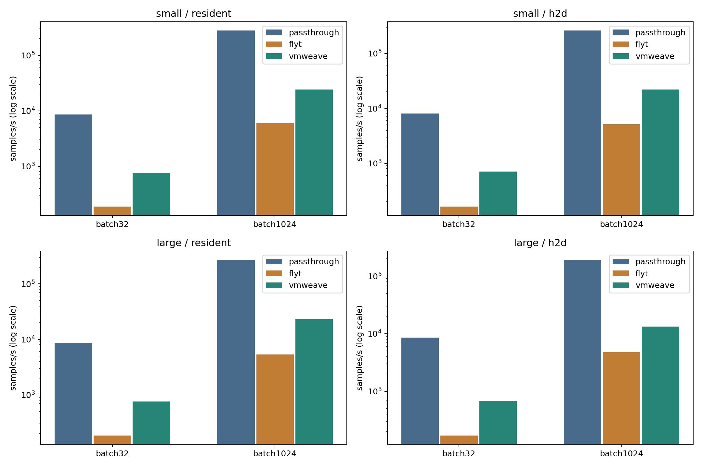
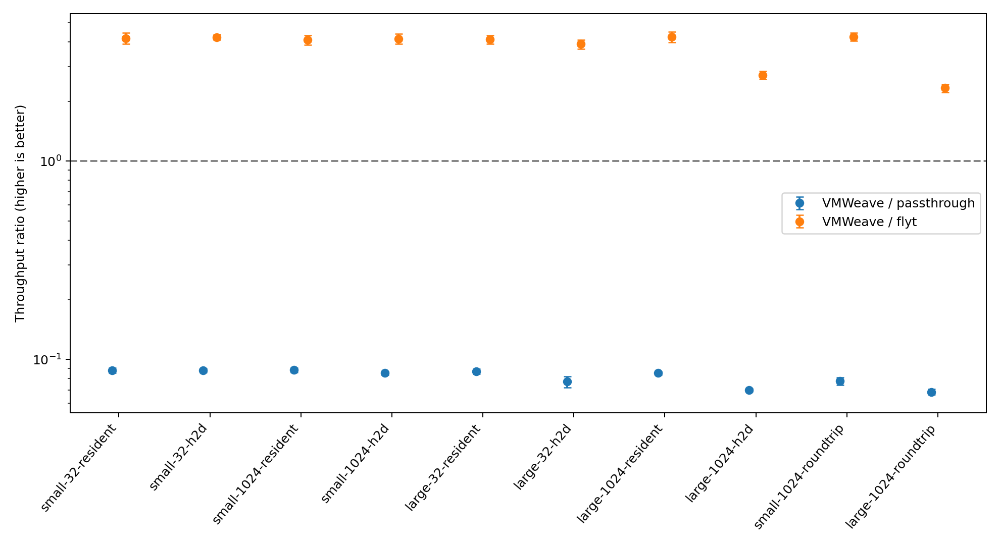
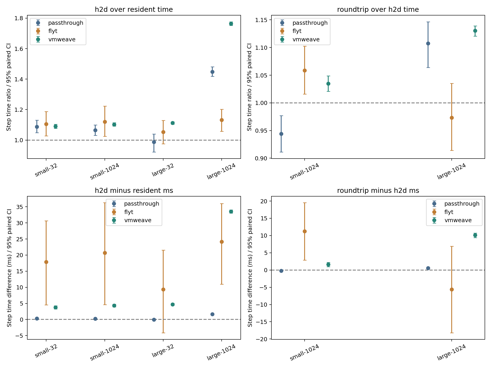

# PyTorch 학습의 통신·연산 통합 성능: VMWeave / Flyt / GPU Passthrough

2026-11-02 시작, 완료·복구 확인 2026-11-03 03:54 KST. 동일 물리 GPU를 세 방식이 순차 사용하는 단일 장비 실험이다.
최적화된 VMWeave v0.5.5, 보존된 호환 Flyt SHM 구현, GPU Passthrough VM을 비교했다.
**정확성 비교 25건과 정식 성능 측정 300회(10조건 × 3방식 × 10블록)를 완료했다.**
실험용 자원을 회수하고 GPU 0의 NVIDIA 바인딩과 원래 HAMi 설정을 복구했다.

관측한 10조건에서 VMWeave 처리량은 Passthrough의 6.9–8.8%, Flyt의 2.34–4.24배였다(조건별 대응 기하평균 범위). Flyt 대비 CI 전체가 1보다 큰 조건은 10개, 작은 조건은 0개, 1을 포함하는 조건은 0개다. 이 범위는 조건 전체를 하나로 합친 평균이 아니다.

## 무엇을 비교했는가

평가 대상은 호출 전달·입출력 복사·GPU 연산·동기화를 포함하는 **학습 완료 처리량**이다.
resident는 입력을 GPU에 미리 올려 두고, h2d는 매 step 입력과 목표값을 복사한다.
roundtrip은 h2d에 출력 D2H를 추가한다. 따라서 별도 추론 실험 없이 같은 학습 코드에서
통신량을 바꿨을 때의 전체 실행 성능을 비교한다. roundtrip은 일반 학습의 필수 동작이 아닌
양방향 전송 진단이다. resident도 CUDA 호출 전달을 포함하므로 순수 GPU 연산 성능은 아니다.

| 조건 | 작은 모델 | 큰 모델 |
|---|---:|---:|
| Linear → ReLU → Linear | 32 → 64 → 8 | 2048 → 4096 → 1024 |
| 학습 파라미터 수 | 2,632 | 12,588,032 |
| batch | 32 / 1024 | 32 / 1024 |
| 입력 방식 | resident / h2d; batch1024에 roundtrip 추가 | 동일 |

응용 입력·목표값·출력의 논리 payload는 다음과 같다. CUDA 호출 메타데이터와 내부 복사는 제외한다.
resident의 매 step 입력 H2D는 0이며 최초 업로드는 타이머 밖이다.

| 모델·batch | h2d의 H2D / step | roundtrip 추가 D2H / step |
|---|---:|---:|
| small-32 | 5 KiB | 해당 조건 없음 |
| small-1024 | 160 KiB | 32 KiB |
| large-32 | 384 KiB | 해당 조건 없음 |
| large-1024 | 12 MiB | 4 MiB |

두 모델의 구조와 학습 단계는 같고 행렬 크기가 다르다. large는 선정한 두 모델 사이의 상대적 규모이며,
이 GPU에서 연산이 병목인 조건임을 뜻하지 않는다. 작은 작업에서는 호출 및 실행 준비 비용이
전체 시간에서 차지하는 비중이 커질 수 있고, 큰 작업에서는 GPU 연산이 그 비용을 얼마나
상쇄하는지 확인한다. h2d와 resident의 차이는 **입력 전송을 추가한 전체 경로의 비용**이다.
이 차이만으로 순수 memcpy 시간, IPC 지연 또는 PCIe 최대 대역폭을 계산하지 않는다.

## 측정 조건과 통계

- GPU: RTX PRO 6000 Blackwell Server Edition, UUID `GPU-772181af-05a4-0c24-de59-8487bd37c142`, PCI `0000:40:00.0`.
- 공통 KubeVirt Guest: Ubuntu 22.04, kernel 5.15.0-191, 8 vCPU / 16 GiB, NVIDIA 580.173.02.
- Flyt의 ivshmem backing은 기존 KubeVirt hook으로 주입하고, 호출·전송·자원 관리 경로는 보존된 Flyt client/server와 manager를 사용했다. VM 프로비저닝 비교는 아니다.
- PyTorch `2.11.0+flyt.cu128`, CUDA 12.8. 세 방식에서 동일 호환 빌드와 학습 소스를 사용했다.
- FP32 eager, TF32 off, deterministic, MSE, SGD(lr=0.01), foreach/fused off, PyTorch CPU thread 1.
- `DISABLE_ADDMM_CUDA_LT=1`, `CUBLAS_WORKSPACE_CONFIG=:4096:8`. 일반 upstream PyTorch 전체 지원을 평가한 결과가 아니다.
- 동일 seed·CPU 생성 초기 가중치·입력. 입력 생성, 첫 할당, 32 step warmup, 검산은 타이머 밖이다.
- 16 step마다 GPU 완료 동기화하며 마지막 동기화도 타이머에 포함한다. 매 조건 새 애플리케이션 프로세스를 사용한다.
- launcher/QEMU는 host CPU 0–7, 원격 backend는 8–11에 배치했다. 원격 방식은 backend CPU를 추가로 사용한다.
- remoting GPU compute100 / VRAM8192MiB, Flyt 188 SM. Passthrough는 GPU 전체를 보지만 워크로드는 동일하다.
- VMWeave 공개 최적화 설정은 [runtime-configuration.json](runtime-configuration.json), 바이너리 신원은 [artifacts.json](artifacts.json)에 보존했다.
- VMWeave 요청 tracing은 off다. Flyt 보존 바이너리의 기본 stdout/API 카운터는 제거하지 않고 수집했다. 이 카운터는 초기화·warmup·검산도 포함하므로 timed 구간의 호출 수로 해석하지 않는다.
- 예비 5블록 54회: 첫 블록은 전체 10조건, 나머지는 small-32-resident와 large-1024-h2d. 정식 통계에서 제외했다.
- 예비 최소/최대 step 시간으로 세 방식의 공통 step 수를 확정했다. 가장 빠른 방식 5초를 목표로 하되 가장 느린 방식 약 60초와 4096 step 상한, 최소32·16배수 규칙을 적용했다.
- 정식 10블록에서 시스템 순서를 균형화하고 조건 순서를 회전했다. 같은 조건은 세 방식 모두 같은 step 수다.
- 아래 비율은 같은 블록의 처리량 비율을 먼저 계산한 기하평균과 블록 bootstrap 10,000회 percentile 95% CI다. 조건별 CI이며 다중비교 보정은 하지 않았다. 센서 표본이나 step을 독립 반복으로 세지 않는다.

Flyt가 프로세스별로 512MiB SHM 영역을 반환 없이 순차 배정해 4GiB BAR에서 9번째 프로세스의
초기화가 실패했다. 실패를 보존하고, 성능 측정 전에 **세 방식 모두 최대 5조건마다 새 VMI와
backend로 재시작**하도록 실행기를 수정했다. 디스크는 재사용한다. 재시작 시간은 타이머 밖이며,
블록 내부 두 방문을 별도 독립 블록으로 세지 않았다. 따라서 장시간 세션 안정성·시작 지연은
이번 처리량 수치로 판단할 수 없다.

## 학습 처리량

처리량은 각 방식의 10회 중앙값(samples/s)이다. `W/P`, `W/F`는 VMWeave / Passthrough,
VMWeave / Flyt 비율이며 1보다 크면 VMWeave가 빠르다. 중앙값끼리 나눈 값과 대응 비율의
기하평균은 서로 다른 통계이므로 정확히 같을 필요가 없다. 모델·batch가 다른 행의 samples/s를
동일한 학습 문제의 성능 순위로 해석하지 않는다.

| 조건 | steps | Passthrough | Flyt | VMWeave | W/P [95% CI] | W/F [95% CI] |
|---|---:|---:|---:|---:|---:|---:|
| small-32-resident | 304 | 8,659.0 | 188.9 | 761.1 | 0.088 [0.085, 0.091] | 4.164 [3.913, 4.441] |
| small-32-h2d | 352 | 8,090.0 | 163.6 | 703.0 | 0.088 [0.086, 0.090] | 4.224 [4.088, 4.351] |
| small-1024-resident | 304 | 279,851.1 | 6,080.5 | 24,320.5 | 0.088 [0.086, 0.091] | 4.083 [3.852, 4.317] |
| small-1024-h2d | 320 | 261,290.8 | 5,166.5 | 21,983.9 | 0.085 [0.084, 0.087] | 4.145 [3.902, 4.387] |
| large-32-resident | 336 | 8,627.9 | 184.2 | 761.7 | 0.087 [0.084, 0.090] | 4.108 [3.902, 4.316] |
| large-32-h2d | 304 | 8,592.4 | 170.5 | 686.3 | 0.077 [0.072, 0.082] | 3.892 [3.687, 4.088] |
| large-1024-resident | 304 | 273,269.4 | 5,381.2 | 23,300.7 | 0.085 [0.084, 0.087] | 4.236 [3.961, 4.495] |
| large-1024-h2d | 240 | 192,346.8 | 4,756.6 | 13,254.9 | 0.070 [0.069, 0.071] | 2.719 [2.596, 2.845] |
| small-1024-roundtrip | 272 | 271,389.2 | 4,941.2 | 21,208.0 | 0.078 [0.074, 0.081] | 4.241 [4.038, 4.433] |
| large-1024-roundtrip | 256 | 172,426.5 | 4,872.3 | 11,659.6 | 0.069 [0.067, 0.071] | 2.341 [2.230, 2.445] |

## 결과 해석

small batch1024에서 입력이 GPU에 상주할 때 W/P는 8.8%, W/F는 4.08배였다.
large batch1024에서 입력이 GPU에 상주할 때 W/P는 8.5%, W/F는 4.24배였다.
입력 H2D가 없는 상주 조건의 격차는 입력 전송량만으로 설명할 수 없다. 호출 전달·동기화와 실행 경로를 포함한 차이이며 순수 GPU kernel 속도의 차이를 뜻하지 않는다.

## 전송 추가에 따른 완료시간 변화

비율은 같은 방식·같은 블록의 step 시간 비율이며, 1보다 크면 전송 추가 조건이 느리다.
Δ는 대응 step 시간 차이(ms)의 산술평균과 블록 bootstrap 95% CI인 탐색적 보조 지표다. 음수도 그대로 포함했다.
기본 실행 시간이 다르므로 증가 비율이 작다고 절대 증가 시간이 짧은 것은 아니다.
두 조건은 별도 프로세스이며 조건별 step 수가 다를 수 있으므로 전체 시간이 아닌 step 시간을 비교한다.

| 모델·batch·방식 | H2D / resident [95% CI] | ΔH2D ms [95% CI] | roundtrip / H2D [95% CI] | ΔD2H ms [95% CI] |
|---|---:|---:|---:|---:|
| small-32-passthrough | 1.088 [1.048, 1.130] | 0.321 [0.178, 0.467] | — | — |
| small-32-flyt | 1.106 [1.027, 1.187] | 17.876 [4.548, 30.659] | — | — |
| small-32-vmweave | 1.090 [1.077, 1.104] | 3.764 [3.250, 4.265] | — | — |
| small-1024-passthrough | 1.065 [1.031, 1.100] | 0.241 [0.116, 0.365] | 0.944 [0.911, 0.977] | -0.216 [-0.345, -0.088] |
| small-1024-flyt | 1.120 [1.025, 1.223] | 20.691 [4.621, 36.261] | 1.059 [1.016, 1.102] | 11.261 [2.886, 19.522] |
| small-1024-vmweave | 1.103 [1.092, 1.114] | 4.329 [3.905, 4.779] | 1.035 [1.021, 1.049] | 1.621 [0.973, 2.239] |
| large-32-passthrough | 0.987 [0.922, 1.039] | -0.033 [-0.264, 0.148] | — | — |
| large-32-flyt | 1.053 [0.976, 1.129] | 9.309 [-4.158, 21.529] | — | — |
| large-32-vmweave | 1.112 [1.103, 1.120] | 4.700 [4.376, 5.009] | — | — |
| large-1024-passthrough | 1.448 [1.418, 1.481] | 1.679 [1.574, 1.791] | 1.107 [1.064, 1.147] | 0.586 [0.357, 0.789] |
| large-1024-flyt | 1.132 [1.058, 1.202] | 24.181 [10.939, 36.017] | 0.973 [0.914, 1.035] | -5.631 [-18.229, 6.906] |
| large-1024-vmweave | 1.763 [1.753, 1.776] | 33.517 [33.062, 34.019] | 1.131 [1.121, 1.139] | 10.117 [9.367, 10.750] |

비율이 1보다 작더라도 복사 자체가 실행을 가속한다고 해석하지 않는다. GPU 클록, 캐시,
호스트 경합과 별도 프로세스 변동이 섞인다. 조건 간 효과와 CI를 함께 보고 원인 분리는 별도 계측이 필요하다.

## CPU 비용·측정 길이·센서 관측

CPU 비용은 launcher(Guest CPU 포함)와 backend Pod의 cgroup 사용량을 합산한다.
guest 프로세스 CPU 시간은 별도 열이며 launcher CPU에 다시 더하지 않는다. node 전체의 IRQ·제어 plane CPU는 포함하지 않는다. 시계 오차를 고려해
타이머 내부에 완전히 들어오는 0.5초 표본 구간만 사용했다. 아래 CPU s/step은 해당 구간의
평균 코어 사용량 × step 시간인 추정치다. 유효 표본이 없는 실행은 0으로 대체하지 않았다.

| 방식 | 전체 측정 길이 범위(s) | CPU 유효 실행 | CPU 관측 구간 비율 중앙값 | 추정 CPU s/step 중앙값 | GPU 표본 있는 실행 |
|---|---:|---:|---:|---:|---:|
| passthrough | 0.869–1.700 | 62/100 | 39.9% | 0.003942 | 1/100 |
| flyt | 44.051–74.015 | 100/100 | 98.4% | 0.184587 | 100/100 |
| vmweave | 12.261–22.906 | 100/100 | 94.0% | 0.058832 | 100/100 |

이 표의 CPU 중앙값은 크기가 다른 조건을 묶은 기술 통계이며 방식 간 단일 효율 순위가 아니다.
CSV의 command_wall_seconds는 SSH 실행 명령의 시작부터 종료까지이며 초기화·warmup·검산·종료를 포함한다.
주 처리량은 이 시간에서 계산하지 않는다. cold start만 분리 측정한 값도 아니다.
조건별 원자료는 [measurements.csv](measurements.csv), CPU 구간별 수치와 GPU 센서 요약은
[resource-summary.json](resource-summary.json)에 있다. GPU는 2초 간격으로 관측하므로 짧은
실행의 활동률·클록·메모리를 대표하지 못할 수 있다. Passthrough GPU 조회는 Guest SSH,
다른 방식은 host nvidia-smi를 사용했으며 모니터링 오버헤드를 제거하는 별도 실험은 하지 않았다.

## 공유 호스트 관측

기존 Prometheus의 정식 실행 기간 기록을 사후 조회했다. 새 GPU 부하를 실행하지 않았다.
30초 간격의 평가 시계열이며 GPU는 마지막 scrape에서 60초 이상 지난 값을 제외했다.
모니터 재시작 구간의 공백을 0으로 채우지 않았다. CPU는 이 실험의 사용량도 포함한다.

| 지표 | 관측 최솟값–최댓값 | 평가 시점 관측률 |
|---|---:|---:|
| GPU 1 활동률 | 0.0–0.0% | 98.1% |
| GPU 2 활동률 | 0.0–0.0% | 98.1% |
| GPU 3 활동률 | 0.0–0.0% | 98.1% |
| Host load1 | 3.74–24.94 | 100.0% |
| Host 전체 CPU non-idle | 6.43–10.37% | 100.0% |
| Host MemAvailable | 527.59–547.39 GiB | 100.0% |

활동률 표본은 GPU 메모리 점유나 짧은 burst, 특정 CPU의 경합을 모두 나타내지 않는다.
호스트 상태 관측만으로 성능 차이의 원인을 분리하거나 외부 간섭이 없었다고 단정하지 않는다.
실험에 배치한 CPU 0–11의 개별 시계열, 원래 query와 관측 공백은 [host-context/](host-context/)와
[수집 요약](host-context/summary.json)에 있다. 이 자료를 근거로 성능 표본을 제외하지 않았다.

### Pod 변화

정식 실행 기간에 1763회 상태를 관측했고 API 조회 실패는 0회였다. 승인된 HAMi·DCGM 모니터와 실험용 Pod를 제외한 변화 관측은 1회다.
아래 시간은 첫 관측 시점이며 실제 변경 시각이나 원인은 확정하지 않는다. 이 변화로 성능 표본을 제외하지 않았다.

| 첫 관측(KST) | Pod | 관측 변화 |
|---|---|---|
| 11-02 20:16:26 | aap-lab/jupyter-bactp1 | 목록에서 사라짐 |

[전체 변화 요약](external-summary.json)과 [관측 원본](external-pods.jsonl)을 함께 확인한다.
Pod 수준 관측은 프로세스 내부 동작이나 애플리케이션 수준의 무중단을 입증하지 않는다.

## 정확성, 실패와 복구

모든 10조건에서 1/10 step의 loss·전체 output·weight·gradient를 Passthrough와 비교했다.
Flyt 10건, VMWeave 10건, 작은 모델 CPU 참조 5건이 rtol=1e-4 / atol=1e-6으로 통과했다.
이번 비교에서 두 원격 방식의 tensor 최대 절대오차는 모두 0이었고 CPU 참조의 최댓값은 2.3842e-7이었다.
정식 실행은 출력 finite와 최종 loss도 검사했다. 전체 tensor별 최대 오차와 판정은
[correctness/](correctness/)에, 큰 tensor blob의 SHA256은 각 qualification의 tensors.json에 있다.
큰 blob은 로컬 보존 자료이며 Git에는 포함하지 않았다.

고정 입력 반복의 검증 한계를 보완하기 위해 별도 새 세션에서 입력 값을 매번 바꾸는
H2D → GPU 2배 연산 → D2H 검사를 수행했다. 작은/큰 payload 각각 4회 × 3방식의
24검사가 통과했고 출력 hash도 방식 간 일치했다. [보조 전송 검증](transfer-validation/summary.json)은
정식 성능 표본에 포함하지 않는다.

첫 Flyt 9번째 초기화 실패는 [원본 로그](qualification/initial/flyt/small-1024-roundtrip/)에 있다.
미완료 두 조건은 새 세션에서 [재검증](qualification/recovery/flyt/)했다. 이 실패는 유효 성능
표본에 포함하지 않으며, 실패한 성능 값을 유리한 값으로 교체한 것이 아니다.
기타 준비 단계의 수정은 [preparation-events.json](preparation-events.json)을 참고한다.

9번째 블록의 Passthrough VM 기동 중 2026-11-03 01:29:16 KST에 PCIe root port의
Link Down/Card not present, 5초 후 Link Up/Card present가 기록됐다. GPU가 다시 열거되면서
NVIDIA 드라이버에 연결됐고 VFIO VM 기동이 실패했다. 링크 단절 원인은 확정하지 못했다.
해당 Passthrough 성능 측정은 시작되지 않았다. [실패 증거](infrastructure/b9-passthrough-startup-failure/)를
보존하고, 새 Passthrough 세션에서 변경 payload 전송 8검사를 통과한 뒤 실행을 재개했다.

중단 전 완료한 Flyt 10회는 [중단 블록 원자료](interrupted/formal-b9-attempt1/)에 별도로 보존했다.
긴 중단 전후 방문을 하나의 대응 블록으로 합치지 않기 위해 **9번째 블록의 세 방식 전체를 재측정**했다.
이는 관측 처리량에 따른 선택이 아니라 불완전 블록 교체이며, 앞선 8블록은 유지했다.
[복구 결정 기록](infrastructure/recovery-decision.json)에 따라 소스·작업량·시스템 및 조건 순서·
방문당 최대 5조건 규칙은 그대로 유지했다. 정식 통계는 완성된 10블록의 300회이며,
보존한 중단 블록 10회와 복구 probe 8검사는 이 통계 및 보조 전송 검증 24건에 포함하지 않는다.
이 기동 실패를 특정 방식의 정상 실행 처리량이나 일반적인 장애율로 환산하지 않는다.

정식 300회 완료 후 보조 전송 검증의 Passthrough 준비 중에도 2026-11-03 03:32:11 KST에
Link Down/Card not present, 1초 후 Link Up/Card present가 기록됐다. GPU가 NVIDIA에
다시 연결돼 VFIO 자원 대기가 만료됐으며, 이때 검증 VM과 검사는 시작되지 않았다.
[두 번째 준비 실패](infrastructure/post-campaign-passthrough-startup-failure/)와 최초 호스트 이력 조회를
보존한 뒤 동일 검사기로 새 세션에서 재시도했다. 완료된 성능 300회는 이 사건 전에 종료됐으며
이 사건을 근거로 성능 표본을 변경하지 않았다. 두 링크 사건의 근본 원인은 확정하지 못했다.

이후 재시도 실행기가 이미 존재하는 호스트 이력 디렉터리를 다시 생성하려다 중단됐고,
안전 종료 처리로 시험 VM·디스크를 회수했다. 이는 실행기 처리 오류로,
[오류와 중간 복구 기록](infrastructure/validation-environment-rebuild/)을 보존했다.
보조 검산용 VM만 같은 기반 디스크·공개 Guest·PyTorch/CUDA 아티팩트와 설정으로 다시 준비하고,
기존 호스트 이력은 측정 기간 일치를 검증한 뒤 재사용했다. 최종 24건은 재구성한 검산 VM에서
수행했으며, 정식 성능 측정의 기존 VM 세션을 연장한 검사는 아니다. 성능 300회는 재실행하지 않았다.

복구 결과는 [cleanup.json](cleanup.json)에 보존했다. 기존 VM·channel의 UID와 spec 유지,
HAMi 설정 원문 일치와 모니터 Pod spec 복원을 검사했다. [외부 Pod 관측](external-pods.jsonl)은
관측 시점의 UID·ready·restart 변화만 기록한다. 애플리케이션 수준의 무중단 SLA 증거는 아니다.

## 해석 범위

1. 이 결과는 동일 장비의 제한된 FP32 eager MLP에서 **통신과 연산을 합친 완료 처리량**이다.
   실제 데이터 로딩·증강, 추론 지연, LLM·CNN, 분산 학습, 학습 수렴 시간으로 일반화하지 않는다.
2. Flyt는 기존 호환 복구의 [기반 commit·patch·바이너리](../../../thesis-isolation/evidence/20261026-flyt-compatibility/manifest.json)를 사용했다.
   Flyt 논문의 수치를 그대로 재현하거나 원본 release의 모든 경로를 평가했다는 뜻은 아니다.
3. GPU 0은 단독 사용했지만 GPU 1–3과 host의 다른 작업은 유지했다. CPU 전용 예약,
   메모리 NUMA 강제 배치, GPU 고정 클록은 적용하지 않았다. CPU affinity는 격리를 보장하지 않는다.
   warmup은 같은 32 step이며 방식별 경과 시간이 달라 동일한 온도·클록 상태를 보장하지 않는다.
4. 10개 시간 블록은 같은 물리 GPU·재사용 디스크를 공유한다. CI는 이 조건에서의 반복 변동이며
   장비·날짜·워크로드 전체 모집단에 대한 보장은 아니다. 통계적 동등성 검정은 하지 않았다.
5. 입력 전송 효과는 전체 경로의 차이다. 이번 측정만으로 호출 개수, 순수 RPC 지연,
   메모리 복사 대역폭 또는 개별 최적화의 인과 효과를 분해할 수 없다.

## 원자료와 재분석

- [사전 계획 및 수정 기록](PLAN.md), [확정 protocol](protocol.json)·[설정 해시 기록](protocol-seal.json), [예비 자료](pilot/), [정식 자료](formal/).
- [대응 비율·CI JSON](summary.json), [CSV](measurements.csv), [소스 및 실행 전제](../../README.md).
- [복사본 오프라인 재분석 검증](offline-reanalysis.json), [전체 증거 감사](audit.json), [소스 해시](source-manifest.json), [전체 파일 SHA256](../../SHA256SUMS).
- `python3 experiments/training-threeway/analyze.py`는 클러스터·GPU 없이 원자료에서 통계를 다시 생성한다.
- 그림은 matplotlib를 설치한 Python으로 `analyze.py --plots`를 실행한다.
- `report.py`는 완료·복구 검사를 통과한 파생 통계로 이 문서를 생성한다. 실행별 원본 JSON은 변경하지 않는다.
