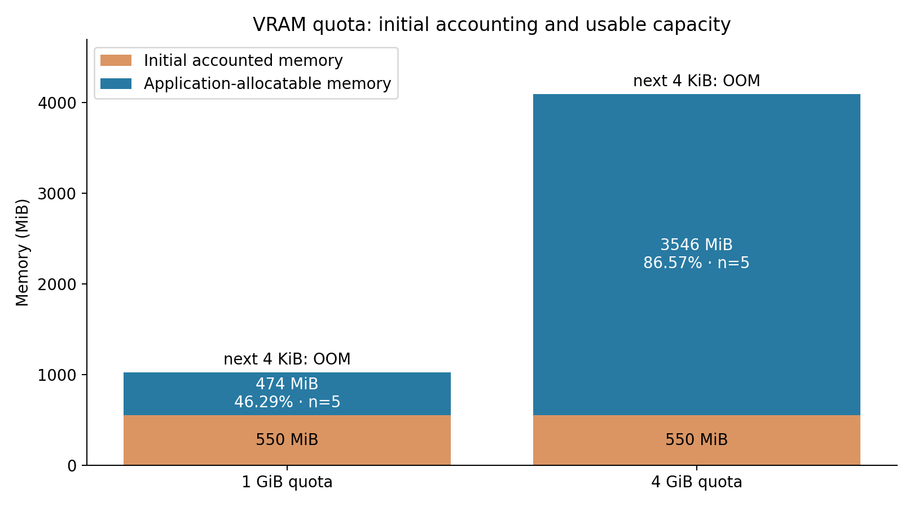
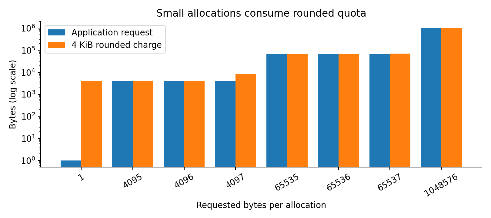
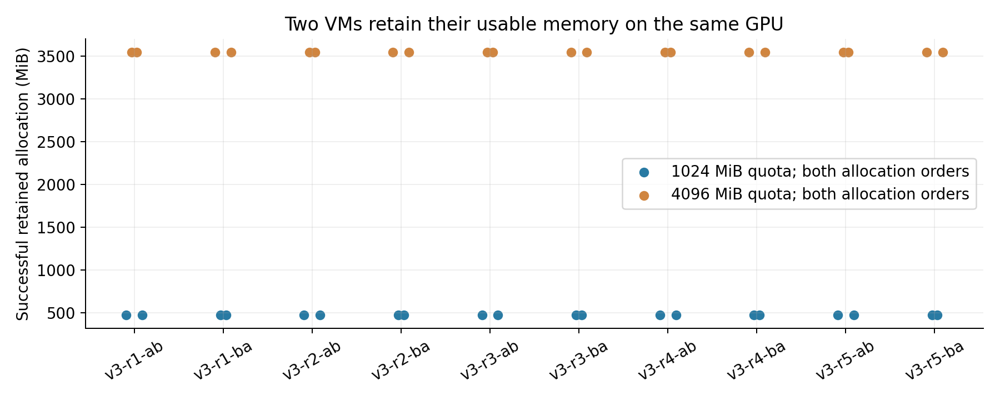
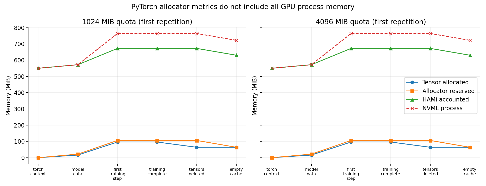
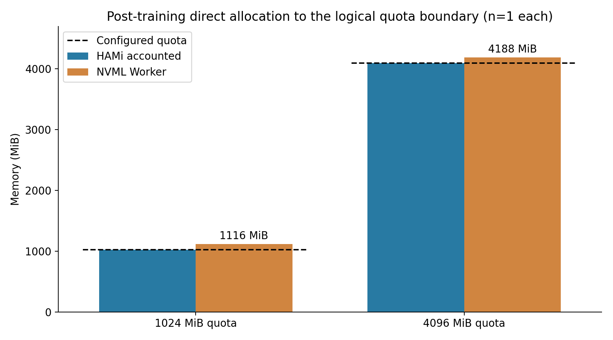
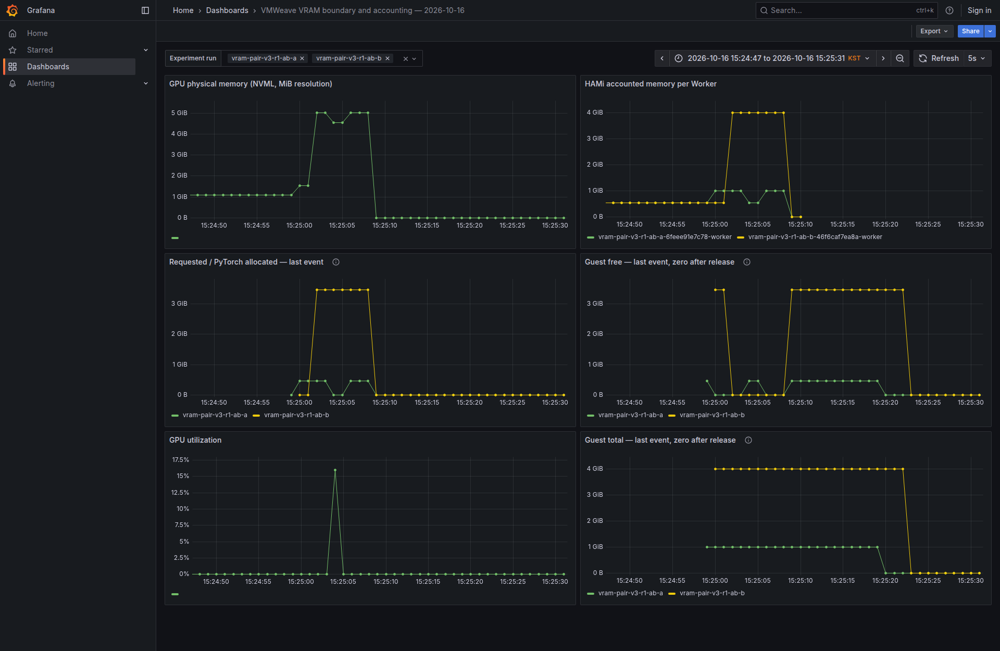
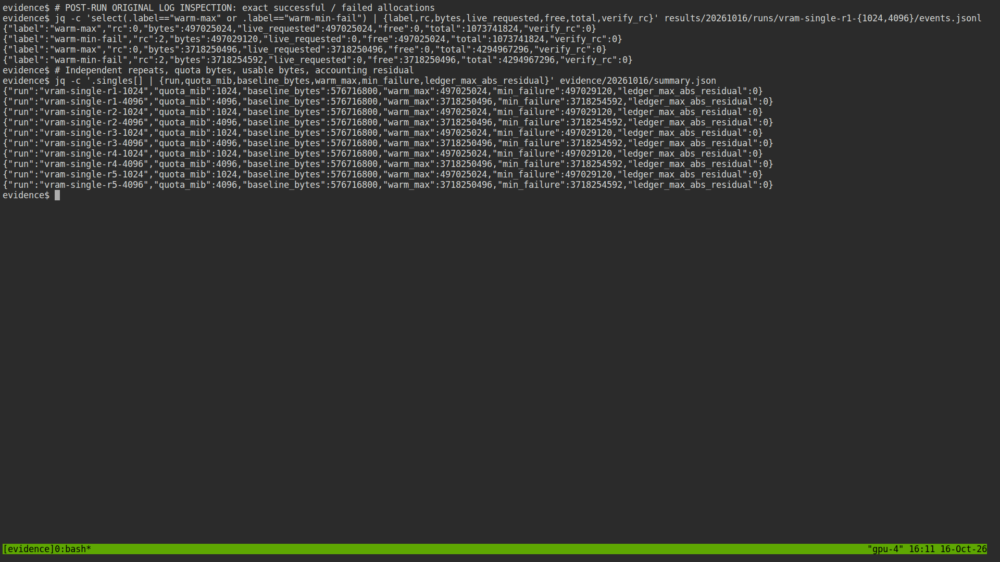

# VMWeave VRAM 가용 경계·메모리 계상 검증 — 2026-10-16

**단일 VM 10회, 두 VM 10쌍, PyTorch 계상 10회 및 학습 상태 경계 추가 확인 2회 완료.** 기존 1 GiB/4 GiB 한도에서 OOM 발생을 확인한 시험을 확장해 실제 가용 경계를 4 KiB 해상도로 측정했다.

이 빌드에서는 **초기 계상량 550 MiB가 한도에 포함**됐다. 따라서 1 GiB 설정에서 사용자 버퍼에 사용 가능한 양은 **474 MiB**, 4 GiB 설정에서는 **3546 MiB**였다. “설정한 VRAM 전체가 애플리케이션 버퍼로 보장된다”는 해석은 성립하지 않았다. 반면 시험한 조건의 **논리 할당 상한 차단**·해제 후 재사용·두 VM 동시 가용성은 확인했다. **PyTorch 학습 중에는 NVML Worker 사용량이 HAMi 계상보다 약 91.75 MiB 컸다.** 따라서 단순 할당에서 성립한 계상 일치를 실제 학습 전체에 일반화할 수 없다. **학습 후 잔여 논리 한도를 채운 추가 확인: 두 한도 모두 NVML 프로세스 사용량이 설정 한도를 초과했다.**

## 1. 검증 범위와 판정

| 항목 | 결과 | 근거 범위 |
|---|---|---|
| 설정 한도 전체를 사용자 버퍼로 사용 | **미충족** | 초기 550 MiB를 제외한 용량만 사용 가능 |
| 사용자 할당 상한 차단 | 확인 | 최대 성공값 다음 4 KiB 요청에서 CUDA OOM(2) |
| 정확한 API 가용 경계 | 확인 | 한도별 새 VM 5회, cold/warm 경계 동일 |
| 논리 계상 모델 | 확인 | 초기 계상량 + 할당별 4 KiB 올림 합계; 이벤트 원장 독립 재계산 |
| 두 VM 동시 사용 | 10쌍 통과 | 양쪽 최대 가용량 유지, 할당 순서 교환, OOM 후 데이터 검산 |
| PyTorch 캐시와 실제 사용량 구분 | 10회 측정 | allocated/reserved, HAMi, NVML을 단계별 분리 |
| 학습 물리 사용량과 HAMi 계상 일치 | **불일치** | 학습 단계 NVML − HAMi = 약 91.75 MiB |
| 물리 프로세스 전체 사용량의 설정 상한 | 미충족 | 학습 상태 경계 추가 확인, 한도별 1회 |
| GPU 내부 메모리의 모든 byte 귀속 | **미확인** | NVML 해상도·비동기 표본·장치 잔여량 한계; 내부 드라이버 영역을 추정해 확정하지 않음 |

## 2. 환경과 실험 방법

- 지정 GPU: RTX PRO 6000 Blackwell Server Edition, UUID `GPU-7d708c42-8d4a-16d5-0746-474567157aa3`, NVML 총량 97887 MiB, driver 580.173.02.
- KubeVirt VM당 8 vCPU / 16 GiB RAM, VM별 독립 SHM Channel·Worker·세션.
- 한도: 1024 / 4096 MiB. 단일 VM·PyTorch는 compute 50%, 동시 두 VM은 각 25%.
- 기존 VM이 예약한 compute 50%를 유지하기 위해 두 VM 시험만 25%로 조정했다. 연산 성능 시험이 아니며 두 조건을 동일 compute 조건으로 합산하지 않는다.
- [환경·이미지 식별자](environment.json), [protocol과 변경 사유](protocol.json), [원본 파일 SHA-256](evidence/20261016/raw-sha256.json).
- cold는 Worker의 CUDA 초기화 이후, 검산 모듈 로드 전이다. CUDA 컨텍스트가 없는 상태를 뜻하지 않는다.
- 단일 큰 할당, 16 MiB 청크 누적 할당, 4 KiB 부근 소형 요청, 동일 총량의 분할 할당, 부분 해제·재할당을 검사했다.
- 탐색은 4 KiB 격자의 이진 탐색이다. 파일럿 예측 경계는 각 독립 VM에서 먼저 재확인했으며, 모든 탐색 후보마다 VM을 새로 만든 것은 아니다.
- cold 할당은 전체 memset·동기화, warm 할당은 전체 byte 검산을 수행했다. GPU에서 uint32 영역을 검사하고 첫 word·남는 tail byte를 CPU에서 검사했다.
- 두 VM probe는 별도 소유 scratch 버퍼의 앞·중간·끝을 손상시켰을 때 검산기가 실패하고 복원 후 통과하는 대조 검사도 수행했다.

## 3. 가용 경계

| 설정 한도 | 독립 반복 | 초기 계상량 | 최대 성공 할당 | 최소 실패 할당 | 사용자 가용 비율 |
|---|---:|---:|---:|---:|---:|
| 1024 MiB | 5 | 550 MiB | **474 MiB** (497,025,024 byte) | 497,029,120 byte | 46.29% |
| 4096 MiB | 5 | 550 MiB | **3546 MiB** (3,718,250,496 byte) | 3,718,254,592 byte | 86.57% |

cold/warm 및 누적 할당에서 같은 경계를 확인했다. 한도별 5회 사이 경계 변동은 없었다. 4 KiB는 **API 요청 경계의 해상도**이며 물리 VRAM의 byte 단위 측정 정확도가 아니다. 전체 live allocation 수는 구현의 4096개 제한보다 낮게 유지했다.



## 4. 논리 메모리 계상

이번 CUDA C probe에서 관측한 관계는 다음과 같다.

```text
Guest reported used = quota - Guest reported free
                    = initial 550 MiB + sum(ceil(live_request_bytes / 4096) * 4096)
```

요청 1·4095·4096 byte는 각각 4096 byte, 요청 4097 byte는 8192 byte가 차감됐다.
동일한 약 1 MiB payload라도 4097 byte씩 나누면 allocation마다 올림이 발생한다.
[이벤트별 계상 원장](evidence/20261016/ledger.csv)은 요청·해제 순서를 다시 재생해 이 식을 확인한다.
이는 Guest 메모리 조회만으로 독립적인 물리 검증을 했다는 뜻이 아니다. 안정화된 기준·최대 할당·해제 단계에서는 HAMi exporter와 정확히 매칭된 Worker PID의 NVML 사용량도 대조했다.



550 MiB를 드라이버의 특정 내부 객체 하나에 귀속하지 않는다. 이번 Worker/CUDA 초기화 후의 **관측된 초기 계상량**이다. 모듈 로드 전후에 차이가 검출되지 않았다고 모듈의 실제 비용이 0 byte라고 단정하지 않는다.

### 장치 전체와 프로세스 합의 차이

안정된 최대 할당 구간을 선택해도 장치 전체 사용량은 프로세스별 합보다 컸다. 단위는 MiB이며 범위는 최소–최대다.

| 조건 | 표본 수 | 장치 전체 | 프로세스 합 | 미귀속 잔여량 |
|---|---:|---|---|---|
| single-1024 | 30 | [1033.0, 1033.0] | [1024, 1024] | [9.0, 9.0] |
| single-4096 | 32 | [4105.0, 4105.0] | [4096, 4096] | [9.0, 9.0] |
| pair | 38 | [5134.0, 5134.0] | [5120, 5120] | [14.0, 14.0] |

[선택 기준과 전체 표본](evidence/20261016/physical-reconciliation.json)을 함께 보존했다. 메모리 값이 같다는 조건으로 표본을 필터링하지 않았다. NVML 쿼리는 원자적 동시 관측이 아니므로 안정화 구간을 사용했다. 이 잔여량의 내부 귀속을 확정하지 않으며, **Worker 계상 상한이 장치 전체 물리 사용량의 완전한 상한이라는 주장은 성립하지 않는다.**

## 5. 두 VM 동시 사용

VM/namespace 역할을 교환한 방향별 5쌍, 총 10쌍을 실행했다. 각 쌍에서 A 먼저/B 먼저 할당하는 두 순서를 모두 검사했다. 양쪽은 각각 474 MiB/3546 MiB를 유지했고, 추가 4 KiB 요청은 OOM이었다. OOM 전후 기존 버퍼를 전체 검산하고 해제·128 MiB 재할당·검산을 확인했다. 추가로 64 MiB씩 번갈아 할당했다.

검산은 단계별 barrier에서 수행한 정확성 확인이다. 지속 서비스의 처리량·지연시간 SLA 시험은 아니다. 물리 여유가 충분한 이번 배치에서의 동시 사용을 입증하며, 과다 예약 상황의 항상 가용 보장은 입증하지 않는다.



## 6. PyTorch 단계별 계상

[기존 PyTorch 검증](../pytorch-smoke/README.md)과 같은 고정 호환 빌드의 FP32 eager MLP 1024→2048→1024, batch 32, MSE·SGD, 20 step을 사용했다. 모든 반복에서 loss 감소를 확인했다. 일반적인 MLP 학습 구조이며, upstream PyTorch wheel·모든 연산의 호환성을 검증한 것은 아니다. `loss.detach().cpu().item()`으로 결과를 읽었다.
아래는 한도별 5회의 최소–최대값이며 단위는 MiB다.

| 한도 | 단계 | allocator allocated | allocator reserved | HAMi accounted | NVML Worker | NVML − HAMi |
|---:|---|---:|---:|---:|---:|---:|
| 1024 | torch-context | 0.000 | 0.000 | 550.000 | 550.000 | 0.000 |
| 1024 | model-data | 16.262 | 22.000 | 572.000 | 572.000 | 0.000 |
| 1024 | first-training-step | 96.398 | 106.000 | 672.252 | 764.000 | 91.748 |
| 1024 | training-complete | 96.398 | 106.000 | 672.252 | 764.000 | 91.748 |
| 1024 | tensors-deleted | 64.000 | 106.000 | 672.252 | 764.000 | 91.748 |
| 1024 | empty-cache | 64.000 | 64.000 | 630.252 | 722.000 | 91.748 |
| 4096 | torch-context | 0.000 | 0.000 | 550.000 | 550.000 | 0.000 |
| 4096 | model-data | 16.262 | 22.000 | 572.000 | 572.000 | 0.000 |
| 4096 | first-training-step | 96.398 | 106.000 | 672.252 | 764.000 | 91.748 |
| 4096 | training-complete | 96.398 | 106.000 | 672.252 | 764.000 | 91.748 |
| 4096 | tensors-deleted | 64.000 | 106.000 | 672.252 | 764.000 | 91.748 |
| 4096 | empty-cache | 64.000 | 64.000 | 630.252 | 722.000 | 91.748 |



`allocated`는 PyTorch allocator에서 사용 중인 메모리이며 프레임워크가 유지한 할당도 포함할 수 있다. `reserved`는 allocator가 확보한 영역이다. 컨텍스트·라이브러리 등 allocator 밖의 메모리를 전부 포함하지 않는다. tensor 삭제, `empty_cache()`, Worker 종료를 서로 다른 회수 단계로 구분했다. 차액의 내부 객체별 귀속은 이 계측만으로 확정하지 않는다.

원본 `status: PASS`는 학습·probe 실행과 해당 검산의 성공을 뜻하며 전체 물리 계상 일치의 PASS가 아니다. NVML 대조 허용치 2 MiB를 적용하면 학습 단계의 **계상 일치 판정은 불일치**다.

학습 단계에서 HAMi는 **672.25 MiB**, NVML Worker는 **764 MiB**로 **약 91.75 MiB 차이**를 보였다. 모델·입력·optimizer를 삭제해도 allocated는 **64 MiB** 남았고, `empty_cache()`는 reserved를 **106 → 64 MiB**로 줄였다. 이후 HAMi **630.25 MiB**, NVML **722 MiB**로 차이는 지속됐다. 이를 전부 캐시나 특정 라이브러리의 비용으로 단정하지 않는다. `empty_cache()`가 모든 프로세스 VRAM을 반환한다는 해석도 성립하지 않는다. Worker 종료 후 GPU 프로세스 부재는 최종 감사로 별도 확인했다.

### 학습 상태에서 잔여 한도를 채운 추가 확인

기본 학습의 764 MiB만으로는 물리 사용량의 설정 한도 초과를 입증할 수 없다. 반복 중 관측한 계상 차이를 검증하기 위해 사전 반복과 분리한 추가 확인을 **한도별 새 VM 1회씩** 수행했다. 위 10회 반복 수에 포함하지 않는다.

동일한 20 step 학습 상태를 유지하고, PyTorch allocator 밖에서 Guest `cudaMalloc`으로 잔여량의 4 KiB 격자 최대값을 채웠다. `floor(reported_free / 4096) * 4096`보다 4 KiB 큰 요청은 먼저 실패했고, 해당 격자 최대값은 성공했다. 전체 memset·동기화와 앞/중간/끝 합계 48 byte 표본을 검사했다. 이 추가 확인은 단일 C probe의 전체 byte 검산과 구분한다.

| 한도 MiB | 추가 할당 최대 MiB | 최소 실패 byte | 최대 할당 시 HAMi MiB | NVML Worker MiB | 차이 MiB | 남은 free byte |
|---:|---:|---:|---:|---:|---:|---:|
| 1024 | 351.746094 (368,832,512 byte) | 368,836,608 | 1023.998047 | 1116 | 92.001953 | 2048 |
| 4096 | 3423.746094 (3,590,057,984 byte) | 3,590,062,080 | 4095.998047 | 4188 | 92.001953 | 2048 |

첫 추가 시도는 학습 후 잔여량이 4 KiB 배수라는 가정에서 중단됐다. 실제 나머지는 **2048 byte**였다. 직접 경계 할당 전의 실패를 [별도 보존](evidence/20261016/supplementary-failure/record.json)하고 정상 회수한 뒤, 새 v2 실행 ID로 위의 격자 탐색을 수행했다. 이는 단순 C probe의 4 KiB 계상 모델을 PyTorch 관련 모든 할당 경로에 일반화할 수 없다는 추가 관측이다.

**두 한도 모두 NVML 프로세스 사용량이 설정 한도를 초과했다.** 이는 학습 후 추가 버퍼를 채운 조건의 결과이며, 기본 MLP만으로 같은 최대 사용량이 발생했다는 뜻은 아니다. 최대 상태에서 추가 4 KiB 요청은 OOM이었고, 직접 할당을 해제한 뒤 학습 step이 다시 완료됐다. 논리 quota 차단과 물리 프로세스 전체 사용량 상한은 서로 다른 속성이다. 추가 확인은 한도별 1회이므로 반복 신뢰도를 기존 5회 경계 시험과 동일하게 표현하지 않는다.



[추가 확인 Grafana](evidence/20261016/grafana/trained-boundary/grafana.png) · [원본 조회 터미널](evidence/20261016/terminal/05-trained-boundary.png) · [추가 probe](torch_boundary.py)


## 7. Grafana와 터미널 캡처

아래는 **실제 Grafana에서 Prometheus 시계열을 절대 시간 구간으로 조회한 사후 캡처**다. 합성 Grafana 화면이나 실험 당시 실시간 촬영이라고 표시하지 않는다. 원본 조회 구간·URL·브라우저 정보는 각 캡처의 `capture.json`에 있다. PyTorch 구간의 requested gauge는 allocator allocated를 사용하고, 추가 경계 구간에서는 성공해 유지 중인 직접 cudaMalloc 할당량을 더한다. 짧은 학습 커널은 NVML 이용률 표본에 잡히지 않을 수 있어 이용률 그래프만으로 GPU 실행 여부를 판정하지 않는다. Guest gauge는 마지막 API 관측값을 유지하고 Channel 회수 후 0을 수명주기 표시값으로 내보낸다. 회수 시점의 0은 새 CUDA API 측정값이 아니다.



- [1 GiB Grafana](evidence/20261016/grafana/single-1g/grafana.png)
- [4 GiB Grafana](evidence/20261016/grafana/single-4g/grafana.png)
- [PyTorch Grafana](evidence/20261016/grafana/pytorch/grafana.png)
- [Grafana dashboard JSON](dashboard.json), [원본 Prometheus 조회 정의](evidence/20261016/monitoring/queries.json)

터미널 캡처는 실제 bash/tmux/ttyd에서 원본 파일을 조회한 화면이다. 당시 학습 화면의 실시간 녹화가 아니다.



[올림·회복](evidence/20261016/terminal/02-rounding-recovery.png) · [두 VM](evidence/20261016/terminal/03-pair.png) · [PyTorch·독립 감사](evidence/20261016/terminal/04-pytorch.png)

## 8. 실패·계측 한계·회수

- 파일럿 1회와 추가 경계 탐색의 정렬 가정 실패 1회를 본 반복과 분리했다. 후자는 학습 이후 직접 경계 할당 전에 중단됐고 Released로 회수했다. [실패 원본·stderr](evidence/20261016/supplementary-failure/).
- 두 VM의 첫 두 준비 시도는 기존 VM 50% 예약과 시험 VM 50%+50%가 충돌해 `CardInsufficientCore`로 배치되지 않았다. 최초 오류는 실행기가 아직 없는 Worker 프로세스를 찾으면서 드러났다. GPU probe는 실행되지 않았다. 첫 시도의 두 할당과 두 번째 시도의 B는 Released로 회수했다. 두 번째 시도의 A는 미배치 Worker의 detach 증거를 기다리며 Draining에 남았다. GPU 프로세스와 VMI는 없으나 backing/메타데이터는 보존돼 있으며 정상 회수로 계상하지 않는다. 25%+25%의 새 쌍으로 본 측정을 시작했다. [실패 기록](evidence/20261016/preparation-failure.json) · [Kubernetes 상태·이벤트](evidence/20261016/preparation-failure-observations.json).
- 초기 Prometheus scrape는 exporter의 Content-Type 누락으로 거부됐다. 수정 후 정상 수집을 확인했으며 원시 관측기는 별도로 데이터를 보존했다. Grafana 캡처는 정상 수집 구간을 사용했다. 누락 구간을 보간하거나 재구성하지 않았다.
- NVML CLI 메모리는 MiB 해상도다. 장치 전체와 프로세스 합의 차이, allocator 밖의 메모리, 순간 피크는 별도 관측·미설명 잔여량으로 남긴다. 모든 물리 VRAM byte가 한도에 포함된다는 결론은 내리지 않는다.
- HAMi exporter는 종료된 Worker 관련 행을 포함할 수 있어 정확한 Worker 이름으로 결합했다. 활성 프로세스는 Pod UID·host PID·GPU UUID를 대조했다.
- SHM backing·host pinned memory는 VRAM에 합산하지 않는다. 이 시험은 호스트 RAM 전체 계상을 수행하지 않았다. 할당 경계 검증은 동기 cudaMalloc/cudaFree 경로에 한정하며, managed memory·VMM·cudaMallocAsync 등 모든 CUDA 메모리 API를 포괄한 검증은 아니다.
- 측정에 성공한 42개 VM은 모두 정상 회수했고, 준비 실패 1건의 Draining 메타데이터/backing은 별도로 보존한다. 최종 회수 및 기존 VM 보존 상태는 [최종 감사](evidence/20261016/final-audit.json)에 기록한다.

## 9. 해석과 재현

사용자에게 보장할 용량을 정의할 때는 “논리 메모리 계상 한도”, “애플리케이션 버퍼 가용량”, “실제 GPU 프로세스 사용량”을 구분해야 한다. 이번 환경에서는 기본 비용 550 MiB와 할당별 올림, PyTorch 캐시·추가 라이브러리 비용까지 고려해야 한다. 550 MiB를 모든 GPU·모델의 고정 여유분으로 일반화하지 않는다.

후속 구현 검토에서는 학습 중 HAMi에 반영되지 않은 물리 사용량의 할당 경로를 추적하고, API별 계상 범위를 확인해야 한다. 단순히 설정 한도에서 550 MiB를 빼는 것만으로 학습의 물리 한도 보장을 해결할 수 없다. 미배치 Worker의 Draining 회수 경로도 별도 수정·회귀 검증이 필요하다. 이번 변경은 실험과 증거·문서 반영이며 런타임의 메모리 제한 구현을 수정한 것은 아니다.

- [집계 JSON](evidence/20261016/summary.json), [경계 CSV](evidence/20261016/boundaries.csv), [PyTorch 단계 CSV](evidence/20261016/torch-stages.csv)
- [관측 원본](evidence/20261016/monitoring/observations.jsonl.xz), [물리 메모리 시계열](evidence/20261016/monitoring/physical.csv)
- [CUDA probe](probe.c), [검산기 대조 검사](probe_checked.c), [실행기](run.py), [PyTorch 실행기](run_torch.py)
- [오프라인 감사](analyze.py), [그래프 생성](plot.py), [실제 터미널 캡처 도구](capture_terminal.cjs), [Grafana 캡처 도구](capture_grafana.cjs)

```bash
python3 experiments/vram-accounting/analyze.py --final
python3 experiments/vram-accounting/plot.py  # matplotlib 필요
```

원본 선택 파일은 byte와 해시를 보존해 공개한다. 전체 명령·클러스터 설정·로컬 키·이미지·Python bundle은 공개 묶음에 포함하지 않는다. 실제 GPU 재실행은 사이트별 Kubernetes 접근·이미지·키가 필요한 실행기이며, 일반 clone에서 즉시 실행되는 범용 도구가 아니다. 같은 실행 ID를 덮어쓰지 않도록 새 결과 경로와 이름을 사용한다.
